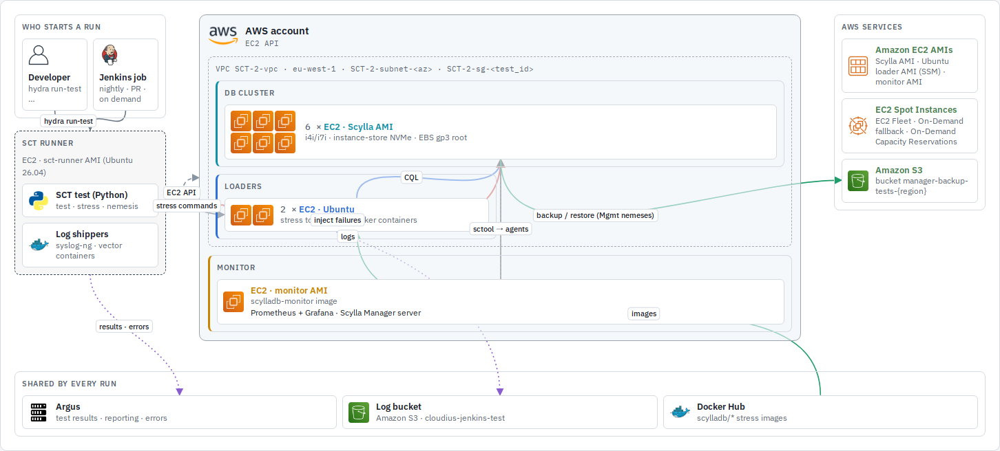
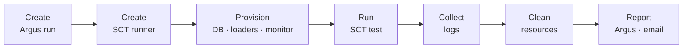
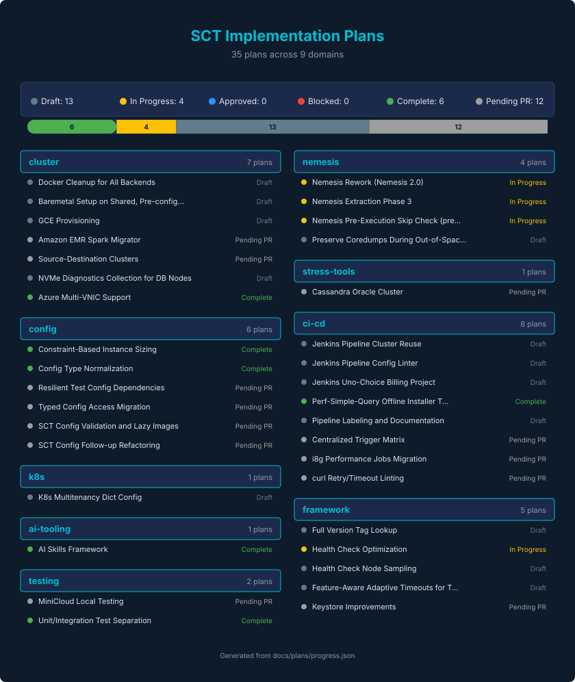

# SCT - Scylla Cluster Tests

SCT tests ScyllaDB clusters under heavy read/write load on real or virtual machines.
A single test run provisions everything it needs, runs the workload, injects failures, collects logs,
and tears down. Each run creates:

* **DB cluster**: the ScyllaDB nodes under test
* **Loaders**: machines that run load generators (cassandra-stress, latte, scylla-bench, ...)
* **Monitor**: a [Scylla Monitoring](https://github.com/scylladb/scylla-monitoring) stack for the DB cluster and loaders

Tests run inside **Hydra**, a container image with all SCT dependencies preinstalled.



<sub>A longevity run on AWS. The [SCT system map](docs/system-map.md) shows what every other test type adds or drops; the images are generated from [an interactive version](docs/system-map/index.html) you can open locally to switch backends.</sub>

- [1. Set up](#1-set-up)
- [2. Run your first test locally](#2-run-your-first-test-locally)
- [3. Run on a cloud backend](#3-run-on-a-cloud-backend)
- [4. Everyday tasks](#4-everyday-tasks)
- [5. Writing and configuring tests](#5-writing-and-configuring-tests)
- [6. Types of tests](#6-types-of-tests)
- [7. Diagnostics and results](#7-diagnostics-and-results)
- [8. CI and Jenkins](#8-ci-and-jenkins)
- [9. Contributing](#9-contributing)
- [10. Maintainer reference](#10-maintainer-reference)

## 1. Set up

**Prerequisites:** Linux, Docker or Podman, `sudo` access, and an AWS account (SCT reads its
SSH keys and credentials from S3, so even local runs need AWS access).

1. **Configure AWS access** using Okta (internal):
   [AWS Setup and Okta Integration for SCT](https://scylladb.atlassian.net/wiki/spaces/RND/pages/386138322/AWS+Setup+and+Okta+Integration+for+Scylla+Cluster+Tests).
   Then export the profile in every shell where you run `hydra`:
   ```bash
   export AWS_PROFILE=DeveloperAccessRole   # the name of your Okta-created profile
   ```
   Without Okta, ask your AWS admin for an access key and run `aws configure`
   ([install the AWS CLI](https://docs.aws.amazon.com/cli/latest/userguide/getting-started-install.html)).

2. **Install Hydra:**
   ```bash
   sudo ./install-hydra.sh
   hydra bash   # sanity check: drops you into the SCT container
   ```

3. **Podman only:** allow short image names, otherwise the monitoring stack fails to start inside Hydra:
   ```bash
   cat > ~/.config/containers/registries.conf <<'EOF'
   unqualified-search-registries = ["registry.fedoraproject.org", "registry.access.redhat.com", "docker.io", "quay.io"]
   short-name-mode="permissive"
   EOF
   ```

Other cloud accounts: [AWS environment](docs/aws_configuration.md) ·
[GCP project setup](docs/gcp_create_new_project.md) · [Azure networking](docs/azure_configuration.md) ·
[AWS EMR permissions](docs/aws-emr-permissions.md).

To develop SCT itself (IDE, unit tests, pre-commit), also set up the
[local development environment](docs/install-local-env.md).

## 2. Run your first test locally

### minicloud (recommended)

[minicloud](docs/minicloud.md) emulates the EC2 and GCE APIs on your machine and runs every
node as a QEMU/KVM VM, so the real `aws`/`gce` provisioning code runs without paying for cloud
instances. S3 (keystore, artifacts) is still real, so the AWS setup above is needed.

1. Host prerequisites:
   - `/dev/kvm` writable by your user, docker, and about 80 GiB free in `$HOME`.
   - About 22 GiB of free RAM for the run below (5 guests × 4 GiB + 2 GiB headroom). Guest
     memory is locked up front; with rootless docker, set an unlimited memlock limit for your
     user. Short on RAM? See [guest memory locking](docs/minicloud.md#guest-memory-locking).
   - Passwordless sudo: the first start creates the `minicloud0` network device with
     `sudo -n` (and on firewalld hosts, such as Fedora, moves it into the `trusted` zone).
     A boot-time unit that pre-creates `minicloud0` removes the need; see
     [running minicloud locally](docs/minicloud.md#running-locally).
   - For `-b aws`: your IAM identity needs `ebs:ListSnapshotBlocks` and `ebs:GetSnapshotBlock`.
2. Run the provisioning smoke test (3 DB nodes, 1 loader, 1 monitor, non-disruptive nemesis):
   ```bash
   SCT_SCYLLA_VERSION=2026.1 scripts/run-minicloud-test.sh -f provision -b aws -m hydra
   ```
3. Results land in `~/sct-results/latest/`, like any other run.

If the nodes never boot, look in `~/sct-results/latest/minicloud.log` or `docker logs minicloud`
(for example `AccessDeniedException` means the EBS permissions are missing) and the
[minicloud troubleshooting table](docs/minicloud.md#troubleshooting).

To fit a bigger test-case on one machine, see the
[downscaling-for-minicloud](skills/downscaling-for-minicloud/SKILL.md) skill.

### Docker

The Docker backend runs the whole cluster as containers on your machine. It is the quickest way
to debug test or nemesis logic.

1. Your user needs [passwordless sudo](https://unix.stackexchange.com/a/468417).
2. Raise the async I/O limit (once per machine):
   ```bash
   echo "fs.aio-max-nr=3000000" | sudo tee /etc/sysctl.d/99-sct-aio.conf
   sudo sysctl --system
   ```
3. Run a short longevity test:
   ```bash
   export SCT_SCYLLA_VERSION=2026.1
   export SCT_ENABLE_ARGUS=false   # don't report local runs to Argus
   hydra run-test longevity_test.LongevityTest.test_custom_time \
       --backend docker --config test-cases/PR-provision-test-docker.yaml
   ```
4. Check the results in `~/sct-results/latest/`. It holds the logs, `test_id`, and events.
   See [collected log files](docs/collected-logs.md) for what each file contains.

Docker-specific notes: [overview](docs/docker-backend-overview.md) ·
[which nemeses work on Docker](docs/docker-backend-nemesis.md) · [SSL/TLS](docs/docker-backend-ssl.md).

## 3. Run on a cloud backend

> **Cloud runs cost money.** Always [clean up](#clean-up-resources) when you are done.

All backends use the same command. Only `--backend` and a few settings change:

```bash
export SCT_SCYLLA_VERSION=2026.1
export SCT_ENABLE_ARGUS=false
hydra run-test longevity_test.LongevityTest.test_custom_time --backend <backend> --config test-cases/PR-provision-test.yaml [extra --config ...]
```

By default SCT reaches the nodes over private IPs, as it does from an SCT runner inside the
cloud. From a laptop, either switch the test's connections to public IPs as the table shows,
or run Hydra on an [SCT runner](docs/sct-runners.md) (see below), where the defaults work as-is.

| Backend | Extra settings for a run from your laptop | Notes |
|---|---|---|
| `aws` | `--config configurations/network_config/test_communication_public.yaml` (or `all_addresses_ipv6_public.yaml` for IPv6) | Most used backend; most longevity tests run here. |
| `gce` | `--config configurations/network_config/test_communication_public.yaml` | Most artifact and rolling-upgrade tests run here. GCE has no IPv6. |
| `azure` | `export SCT_IP_SSH_CONNECTIONS=public` | [Azure networking](docs/azure_configuration.md) |
| `oci` | `export SCT_IP_SSH_CONNECTIONS=public` | Oracle Cloud |
| `xcloud` | `export SCT_XCLOUD_PROVIDER=aws SCT_XCLOUD_ENV=lab` | ScyllaDB Cloud managed clusters. [xcloud backend](docs/xcloud-backend.md) |
| `baremetal` | `export SCT_S3_BAREMETAL_CONFIG=<name>` (required, no default) | Runs against hosts that already exist, such as lab machines. The inventory is a local `<name>.json` if present, otherwise `<name>.json` from the keystore. Being hardened for regular local lab use. |
| `k8s-eks`, `k8s-gke` | | Scylla Operator on managed Kubernetes. [K8S functional tests](docs/k8s-functional-test.md) |
| `k8s-local-kind`, `k8s-local-kind-aws`, `k8s-local-kind-gce` | | Kubernetes functional tests on a local or single-VM kind cluster. |

To try a test before spending cloud time, run it on [minicloud](#minicloud-recommended) first.

**Close to the cluster:** run Hydra on an [SCT Runner](docs/sct-runners.md), a cloud VM in the
same network as the cluster, as Jenkins does:

```bash
hydra create-runner-instance --cloud-provider aws -r <region> -z <az> -t <test-id> -d <duration>
hydra --execute-on-runner "$(cat sct_runner_ip)" "run-test longevity_test.LongevityTest.test_custom_time --backend aws --config test-cases/PR-provision-test.yaml"
```

Copy the network config from the test's Jenkins pipeline. The predefined configs are in
`configurations/network_config/`.

## 4. Everyday tasks

### Choose a ScyllaDB version

```bash
export SCT_SCYLLA_VERSION=2026.1                               # release
export SCT_SCYLLA_VERSION=master:latest                        # nightly of a branch
export SCT_SCYLLA_VERSION=2024.2.5-0.20250221.cb9e2a54ae6d-1   # exact build
```

See [full version tag usage](docs/full-version-tag-usage.md). To test your own build, see
[BYO ScyllaDB](docs/byo-scylladb.md). To find a regression, see [bisecting with SCT](docs/bisecting-with-sct.md).

### Find the logs

Every run writes to `~/sct-results/<timestamp>/`, and `~/sct-results/latest` points to the most recent run.
[What each log archive contains](docs/collected-logs.md).

### Debug a nemesis

Multi-node Docker runs need Scylla 2026.1+ (racks are on by default), or set
`simulated_racks: 1`. See [docker backend specifics](docs/docker-backend-overview.md).

Run the default nemesis setup on Docker. These configs are the ones the
[AbortRepairMonkey docker pipeline](jenkins-pipelines/oss/nemesis/longevity-5gb-1h-AbortRepairMonkey-docker.jenkinsfile) uses:

```bash
hydra run-test longevity_test.LongevityTest.test_custom_time --backend docker \
    -c configurations/nemesis/longevity-5gb-1h-nemesis.yaml \
    -c configurations/nemesis/AbortRepairMonkey.yaml \
    -c configurations/nemesis/additional_configs/docker_backend.yaml
```

To run one specific nemesis, edit `test-cases/PR-provision-test-docker.yaml`:

```yaml
test_duration: 60
stress_cmd: "cassandra-stress write cl=QUORUM duration=5m -schema 'replication(strategy=NetworkTopologyStrategy,replication_factor=3) ' -mode cql3 native -rate threads=10 -pop seq=1..100000 -log interval=5"
n_db_nodes: 4
nemesis_class_name: 'SisyphusMonkey'     # the runner
nemesis_selector: 'DecommissionMonkey'   # only run this nemesis (class names or flag expressions)
nemesis_interval: 5
```

For architecture, flags, and writing new ones, see the [Nemesis Developer Guide](docs/nemesis.md).

### Reuse a running cluster

Skip provisioning when you re-run against the cluster from your last run:

```bash
export SCT_REUSE_CLUSTER=$(cat ~/sct-results/latest/test_id)
hydra run-test longevity_test.LongevityTest.test_custom_time --backend aws \
    --config test-cases/PR-provision-test.yaml \
    --config configurations/network_config/test_communication_public.yaml
```

See [reusing a cluster](docs/reuse_cluster.md) and [skipping test stages](docs/skip-test-stages.md).

### Connect to test machines

```bash
hydra ssh --user <your-okta-username>   # pick one of your machines
hydra ssh --test-id <test_id>
```

See the [FAQ](docs/faq.md#how-can-i-connect-to-test-machines-in-aws-) for more options.

### Clean up resources

```bash
# list what you own (use your Okta/email username, which may differ from `whoami`)
hydra list-resources --user <username>

# everything from your last run
SCT_CLUSTER_BACKEND= hydra clean-resources --test-id "$(cat ~/sct-results/latest/test_id)"

# everything you own; AWS by default, use -b for other backends
hydra clean-resources --user <username>
hydra clean-resources --user <username> -b gce
```

### Estimate cost

[Test cost estimation](docs/cost-estimation.md) shows what a test-case costs before you run it.

## 5. Writing and configuring tests

**[Writing a test](docs/writing-a-test.md)** walks through the whole path: the test class, the
test-case YAML, how configuration layers, how it turns into a cluster layout (DCs, racks, node
counts, instance sizing) and how to add the Jenkins job. Start there for any new test.

Reference:
- [SCT configuration guide](docs/sct-configuration.md): how the config system works and how to add options
- [Configuration options reference](docs/configuration_options.md): every option, grouped by backend, test type, and concern
- [Cross-cloud instance sizing](docs/cross-cloud-sizing.md): pick instances by constraints instead of names
- [Loaders and stress commands](docs/loader_usage.md) · [Docker-based loaders](docs/docker-loaders.md)
- [Full scan and full partition scan in longevity](docs/using-full-scan-and-full-partition-scan-in-longevity.md)
- [Kafka support](docs/kafka.md)
- [HTTP retry & timeout conventions](docs/http-retry-conventions.md)

## 6. Types of tests

What each type adds to a run, with a diagram per type: [SCT system map](docs/system-map.md).

| Type | Docs |
|---|---|
| Artifact tests | [artifacts_test.md](docs/artifacts_test.md) |
| Longevity | [longevity.md](docs/longevity.md) |
| Upgrade | [rolling-upgrade.md](docs/rolling-upgrade.md) |
| Performance | [Performance testing in SCT](docs/performance/README.md) · [HDR investigate utility](docs/performance-tests.md) · [region scheduling](docs/perf-tests-region-scheduling.md) |
| Microbenchmarking | [microbenchmarking.md](docs/microbenchmarking.md) · [node benchmarks](docs/node_benchmarks.md) |
| K8S functional | [k8s-functional-test.md](docs/k8s-functional-test.md) |
| Cassandra → Scylla migration | [cs-to-scylla-migration.md](docs/cs-to-scylla-migration.md) |
| Features, Manager | *not documented yet*; see `test-cases/features/` and `test-cases/manager/` |

## 7. Diagnostics and results

- [Collected log files](docs/collected-logs.md): what each log archive contains
- [SCT events](docs/sct-events.md): how failures and warnings are raised and reported
- [Kernel panic detection](docs/kernel-panic-detection.md): serial-console panic detection and false positives
- [Diagnostic collector](docs/diagnostic_collector.md)
- [FAQ](docs/faq.md): coredumps, uploading missed logs to Argus, exposing nemesis metrics, ...

## 8. CI and Jenkins

Each Jenkins job is a small jenkinsfile that calls a shared pipeline from `vars/`. The most common
one, `longevityPipeline`, runs these stages:



Log collection, cleanup and reporting run even when the test fails or is aborted. Upgrade,
performance and artifact jobs run the same stages in parallel branches; see
[SCT pipelines](docs/sct-pipelines.md) for every variant and why it differs.

- [SCT pipelines](docs/sct-pipelines.md): pipeline variants, stages and job layout
- [Jenkins job definitions](docs/job_defines_format.md)
- [Billing project parameter](docs/jenkins-billing-project-parameter.md)
- [Trigger matrix manual testing](docs/testing/trigger-matrix.md)

## 9. Contributing

- [Contribution instructions](docs/contrib.md): pre-commit hooks, formatting commits
- [Contribution handbook](docs/contribution-handbook.md): roles, review, branches and backports, CI
- [Local development environment](docs/install-local-env.md)
- Run unit tests with `uv run sct.py unit-tests` and checks with `uv run sct.py pre-commit`
- [Profiling SCT code](docs/profiling.md) · [Cyclic import detection](docs/cyclic-import-detection.md)

**AI code review:** comment `@claude please review this PR` on a pull request to get an
on-demand Claude review (scylladb org members and collaborators).
[How it works](docs/faq.md#how-does-the-claude-ai-code-review-work).

**Development plans:** active implementation plans are tracked in [docs/plans/MASTER.md](docs/plans/MASTER.md).
To write a new one, see [docs/plans/INSTRUCTIONS.md](docs/plans/INSTRUCTIONS.md).



## 10. Maintainer reference

- [KeyStore credential management](docs/keystore-secrets-manager.md) · [credential rotation](docs/keystore-credential-rotation.md) · [SSH key rotation](docs/ssh-key-rotation.md)
- [Updating monitoring images](docs/monitoring-images.md)
- [Building a new loader AMI](docs/new_loader_ami.md)
- [Creating an ES index](docs/hydra-create-es-index.md)
