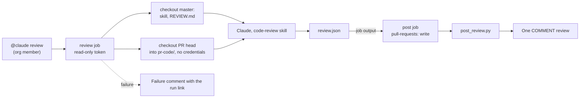

# Claude review of SCT pull requests on request

**Jira:** SCT-1457

**Status:** draft

## Overview

An org member comments `@claude review` on a pull request. The
`claude-review` workflow runs Claude with the `code-review` skill and
`REVIEW.md` from master. Claude reads the pull request code and writes one
review as JSON. A second job, which Claude does not control, checks the JSON
and posts it as one GitHub review with the event `COMMENT`. The same skill
runs on a laptop in Claude Code, where the user approves the draft before it
posts.

## Constraints

- `issue_comment` runs the workflow from master, with secrets, also for fork
  pull requests. The job must not run code from the pull request.
- The review must never push, approve, request changes, or label.
- The rules stay in `REVIEW.md`. The skill holds the method, not a second copy
  of the rules.
- GitHub rejects a whole review when one inline comment is on a line outside
  the diff.

## Design



| Job | Token | Does |
|---|---|---|
| `review` | `contents`, `pull-requests`, `issues`, `actions`, `checks`, `statuses`: read | Reads the pull request data into files with `gh`, then runs Claude with read tools, `Write` for `review.json`, and `git -C pr-code` reads. Claude has no `gh` and no network tool |
| `post` | `pull-requests: write` | Runs `post_review.py` from master, or posts the failure comment |

The skill and `REVIEW.md` come from master, so a pull request cannot change
the instructions of its own review.

`claude.yml` skips a comment that starts with `@claude review` on a pull
request, so only one workflow answers it.

### Skill changes

`skills/code-review/` takes the method of the personal `/fruch-review`
skill:

| Part | In the skill |
|---|---|
| Read the whole files, callers, and threads | Workflow Phase 1 |
| Read the CI status: `gh pr checks`, and the Jenkins test summary comment for the failed tests | Workflow Phase 1 |
| Prove a finding when cheap; else tag it ❓ | Workflow Phase 1; in CI, trace, never run |
| Scope, size ("what could be deleted?"), owning team, and merge order | Workflow Phase 5 |
| Tags, comment layout, summary | `references/writing-review-comments.md` |
| One review with inline comments | Workflow Phase 6: JSON in CI, draft and approval locally |

Left out: running the changed tests, the Jenkins console of a stage that
fails before the tests, and the cross-repository checks. Section "Path for
the dropped parts" gives the way back for each one.

### CI status

A step before Claude reads both sources with the read-only token, into files
that the prompt names:

| Source | Gives | Read with |
|---|---|---|
| Checks and statuses of the head commit | Each GitHub Actions check and each Jenkins status: `jenkins/precommit`, `jenkins/unittests`, `jenkins/collect_tests`, `jenkins/lint_test_cases`, `continuous-integration/jenkins/pr-merge` or `pr-head` | `gh pr checks <n>` |
| The Jenkins test summary comment | Each failed test, with its message, its traceback, and the build link. Jenkins (`vars/postTestSummaryComment.groovy`) posts it once and updates it on each run | The issue comment that starts with `<!-- sct-test-summary -->` |

The summary is current only when its build link has the build number of the
`continuous-integration/jenkins/*` status of the head commit. For each current failure, the review
states whether the pull request caused it. A failure that it caused gets an
inline comment on the responsible line.

## Contracts

### review.json

The body of `POST /repos/{repo}/pulls/{n}/reviews`:

```json
{
  "commit_id": "<head sha>",
  "event": "COMMENT",
  "body": "<summary with the outcome of each REVIEW.md pass>",
  "comments": [
    {"path": "sdcm/foo.py", "line": 42, "side": "RIGHT", "body": "🔧 **important:** ..."},
    {"path": "sdcm/foo.py", "start_line": 10, "line": 14, "side": "RIGHT", "body": "⛏ **nit:** ..."}
  ]
}
```

### post_review.py

```text
post_review.py --repo OWNER/REPO --pr N --head-sha SHA --review-file review.json
```

- Sets `event` to `COMMENT` and `commit_id` to the reviewed head.
- Keeps an inline comment only when its lines are in the diff of the file,
  and a range only when it starts at or before its end. Moves the others to
  the review body. GitHub rejects the whole review for one reversed range
  (422 "Start position could not be resolved"); it accepts a range across
  two hunks.
- Cuts the body at 60000 characters.
- Refuses to post, and fails the job, when the review holds an Anthropic API
  key or a GitHub token.

### Run limits

```yaml
timeout-minutes: 20
claude_args: --model claude-sonnet-5-5 --max-turns 40
```

The first headless runs (layer 3) took 11 to 17 turns, under 45 seconds,
and 0.33 to 0.40 USD each:

| Pull request | CI state | Result |
|---|---|---|
| #16900 | Green | Three tagged findings; skipped the findings of earlier threads |
| #16885 | Build pending; the summary comment is from the older build | Reported the pending build; did not report the old failure as current |
| #16776 | The current summary comment has a failed `ruff` hook | The `CI:` line named the hook, quoted its output, and said the PR caused it |

## Risks

| Risk | Response |
|---|---|
| Prompt injection in the pull request asks Claude to approve or push | The review token is read-only, and the post job forces `COMMENT` |
| Prompt injection makes Claude send out the API key. Claude's own environment holds it, and a local probe read it through `Grep` on `/proc/self/environ` | Claude has no `gh` and no network tool. A deny rule blocks `Read`, `Grep`, and `Glob` on `/proc`, and `git` with `--no-index` or `--contents`, which read files outside the repository. `CLAUDE_CODE_SUBPROCESS_ENV_SCRUB` removes the key from the commands Claude runs. `post_review.py` refuses a review that holds a key or a token. Local probes confirmed each rule |
| `author_association` shows `CONTRIBUTOR` for an org member with private membership | The same check as `claude.yml`. The member makes the membership public, or a maintainer runs the review |
| The workflow cannot run before the merge, because `issue_comment` runs from master | Run the skill headless on a real pull request, and unit-test `post_review.py`, before the merge |
| A review costs more than expected | The turn and time limits. The first runs record the cost in this spec |

## Verification

Each layer proves a different part. A layer runs only after the layer before
it passes.

| Layer | When | What it proves | How |
|---|---|---|---|
| 1. Unit tests | Each push (Jenkins `unittests`) | The post gate forces `COMMENT`, pins the commit, and keeps only diff lines inline | `unit_tests/unit/test_post_review.py` |
| 2. Static checks | Each push | The workflow syntax, the expressions, and the permissions | `actionlint` on both workflows; pre-commit |
| 3. Headless run | Before the merge, by the author | The skill gives a valid review: the pass outcomes, the tags, the volume, the CI line, and no run of PR code | The command below, then `post_review.py --dry-run` on its output. Run it on one pull request with a failed Jenkins test |
| 4. Fork run | Before the merge, optional | The real trigger, the two jobs, and the tokens | The workflow on the master of a fork with an `ANTHROPIC_API_KEY` secret; `@claude review` on a pull request inside the fork |
| 5. First live runs | After the merge | The acceptance criteria of SCT-1457 on real pull requests | `@claude review` on three open pull requests: one clean, one with a known bug, one from a fork |

Layer 3 runs the review job of the workflow with the same prompt, model,
turn limit, and tools, from a checkout of the branch, with the pull request
in `pr-code/`. The CLI run does not use the action, so first parse the
`claude_args` of the workflow with `shell-quote`, as the action does: the
`--allowedTools` value must stay one argument.

```bash
git fetch upstream pull/<n>/head
git worktree add --detach pr-code <head sha>
# The commands of the "Collect the pull request data" step, into pr-data/
claude -p "<the prompt of claude-review.yml, with <n>, <head sha>, and pr-data/>" \
  --model claude-sonnet-5-5 --max-turns 40 --setting-sources project \
  --allowedTools "<the --allowedTools of claude-review.yml>" \
  --disallowedTools "<the --disallowedTools of claude-review.yml>" --output-format json
python3 .github/scripts/post_review.py --repo scylladb/scylla-cluster-tests --pr <n> \
  --head-sha <head sha> --review-file review.json --dry-run
git worktree remove pr-code
```

Layer 5 passes when each of these is true:

- Each run posts one review, by `github-actions[bot]`, with the event
  `COMMENT`.
- The summary gives the outcome of each `REVIEW.md` pass. Each inline
  comment starts with a tag.
- The pull request with the known bug gets that bug as 🚫 or 🔧.
- A pull request with a failed Jenkins test gets a `CI:` line that names the
  test, quotes its message, and says whether the pull request caused it.
- The fork pull request gets a review, and the run log shows no command that
  ran code from `pr-code/`.
- A comment from a user who is not a member starts no job.
- When the review job fails, the pull request gets the failure comment.

## Path for the dropped parts

Each part left out of the first version can come back alone, in its own
pull request. Each row names what the part needs and how to prove it.

| Part | What it needs | How to add it | How to prove it |
|---|---|---|---|
| Claude in the how-to comment, handbook 4.3, and the trial | SCT-1393 (#16900) merged | One row in each of the two tables; add `claude` to `BOTS` in `bot_threads.py` | The how-to comment on the next pull request lists `@claude review` |
| A label trigger | Nothing | A `pull_request_target: labeled` event for the label `claude-review`, with the same two jobs | Add the label to a pull request; one review appears |
| Automatic review | The SCT-1393 trial picks Claude | `pull_request_target: ready_for_review` on the same jobs | The next ready pull request gets a review without a request |
| Run the changed tests | A job with no secrets | A `tests` job before `review`: no API key, read-only token, runs the changed unit tests of the pull request, and passes the result as a job output that Claude reads | A pull request with a failing new test gets a finding that quotes the failure |
| The Jenkins console of a stage that fails before the tests (the test summary comment covers test failures) | A read-only Jenkins API token as a secret | A step before Claude saves the failed stages and the console tail of the `pr-merge` build to a file in the workspace | A pull request whose build breaks before the tests gets a `CI:` line with the failed stage |
| Cross-repository checks | A read-only token for scylla-pkg and the other private repositories; public repositories need none | A `references/cross-repo.md` in the skill that lists what SCT consumes from each repository; the token goes to `GH_TOKEN` of the review step only | A pull request that renames a metric or a config option gets a finding against the other repository |
| Codex and Gemini on the same skill | Nothing | A `.agents/skills` symlink to `skills/`, and a `## Code Review Rules` section in `AGENTS.md` that points to `REVIEW.md` | `@codex review` and `@gemini-cli /review` cite the `REVIEW.md` passes |
| Draft and approval before posting | Not planned | In CI, the maintainer reads the posted `COMMENT` review instead. Locally, the skill shows the draft first | None |

## Decisions

- The review starts on request only, from a comment that starts with `@claude review`. (spec)
- Claude writes the review to a file. A separate job with the only write token posts it. (spec)
- The skill and `REVIEW.md` come from master, not from the pull request. (spec)
- Copilot code review reads skills from `.github/skills`, which links to `skills/`. It already reads the `code-review` skill. Copilot custom agents and `@copilot` comments push commits and do not post reviews. Cost: AI credits per review. (spec)
- Codex code review starts from `@codex review` or automatic review. It reads `AGENTS.md`, from a `## Code Review Rules` section, and posts findings on diff lines. Skills come from `.agents/skills`; skill support in the cloud review is unconfirmed. Cost: a ChatGPT plan; automatic review needs a Business plan. (spec)
- The Gemini CLI action reviews on `@gemini-cli /review` or on open, with inline comments. It reads `GEMINI.md`, or `AGENTS.md` through `context.fileName`. Skills come from `.gemini/skills` or `.agents/skills`; skill support in the action is unconfirmed. Cost: a Gemini API key. (spec)
- The model is `claude-sonnet-5-5`. (open)
- The cost cap is 40 turns and 20 minutes for each run. (open)
