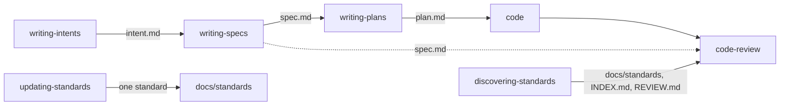

# Development flow skills in SCT

**Jira:** SCT-1379

## Overview

The flow becomes repository skills in `skills/`, which Claude Code and
GitHub Copilot already discover. `writing-intents` and `writing-specs` write
`intent.md` and `spec.md`, and `writing-plans` gets a third format that
writes `plan.md`, all in `docs/plans/<feature>/<idea>/`.
`discovering-standards` writes `docs/standards/`, `docs/INDEX.md`, and
`REVIEW.md`. `updating-standards` adds one standard. `code-review` checks a
change against its spec.

## Constraints

- The skills work in a fresh checkout of SCT, with no setup.
- The flow is optional. No flow skill refuses to run because an earlier flow
  document is missing.
- The full 7-section plans and the mini-plans keep their rules.

## Design



| Component | Role |
|---|---|
| `docs/development-flow.md` | The flow for people: when to use it, the layout, the order of work |
| `writing-intents` | Writes `intent.md` from the conversation or from a diff |
| `writing-specs` | Writes `spec.md` from the intent, the code, and the answers of the user |
| `writing-plans` | Routes to the idea plan when the idea directory holds a `spec.md` |
| `discovering-standards` | Finds the conventions, writes the standards, the index, and `REVIEW.md` |
| `updating-standards` | Writes one convention and its index entry |
| `code-review` | Check 11 compares the change with the spec of its idea directory |
| `REVIEW.md` | The three review passes for people and agents |
| `CLAUDE.md` | Tells the agent when to propose the documents |

An agent proposes the documents when a change is big or touches the SCT
architecture. It shows each document to the user, and asks before it commits
it.

## Contracts

### Outputs

```
docs/plans/<feature>/<idea>/
├── intent.md   # Problem, Who it affects, Evidence, What good looks like, Out of scope
├── spec.md     # Overview, Constraints, Design, Contracts, Risks, Deferred work, Decisions
└── plan.md     # Rules, then one task per unit of work
docs/standards/<domain>/<topic>.md   # ## Topic, ### Standard, Sources: line
docs/INDEX.md                        # one entry per standards file
REVIEW.md                            # Pass 1 bugs and logic, Pass 2 security, Pass 3 compliance
```

## Risks

| Risk | Response |
|---|---|
| The standards drift from `AGENTS.md` and the other sources | Each file names its sources. `discovering-standards` refreshes them |
| `writing-plans` and `writing-specs` trigger on the same request | The descriptions split the triggers: the design of one change, and the plan |

## Decisions

- The skills use the gerund names of the other SCT skills. (spec)
- `writing-plans` writes the idea plan, so that one skill answers each plan request. (spec)
- The root cause of a bug goes in the commit message and the pull request description. (spec)
- Each team files SCT issues with its own Jira tooling. (spec)
- The idea documents have no frontmatter and no `MASTER.md` entry. They describe one change and stay with it. (spec)
- `REVIEW.md` sits at the repository root, where reviewers and automated review tools look for it. (spec)
- The standards domains are `global`, `python`, `testing`, and `config`, the areas of SCT. (spec)
