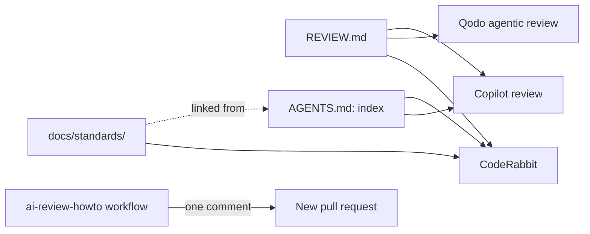
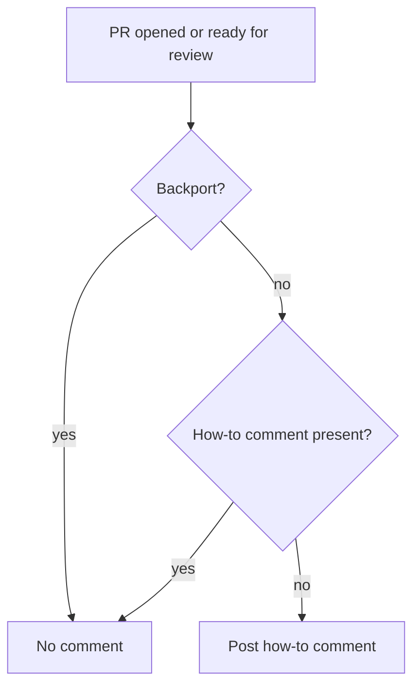

# One review source for the AI pull request reviewers

**Jira:** SCT-1393

**Status:** draft

## Overview

`REVIEW.md` and `docs/standards/` are the only place that holds review rules.
CodeRabbit, Qodo, and Copilot read `REVIEW.md` directly, and their
configuration holds no rule text. `AGENTS.md` and
`.github/copilot-instructions.md` link to the standards, one line each.
CodeRabbit and Qodo turn off each feature that falls outside the three passes
of `REVIEW.md`. A workflow posts one comment on each new pull request that
tells the author how to request each reviewer. After a trial, one reviewer
runs automatically.

## Constraints

- Copilot and Qodo do not follow links. `REVIEW.md` must hold the passes and
  the volume rule as text, not as links.
- CodeRabbit always reads its default guideline files, which include
  `AGENTS.md`, `CLAUDE.md`, and `.github/copilot-instructions.md`. These files
  must not restate or contradict a rule.
- Copilot automatic review is a repository ruleset, not a file. A repository
  admin turns it on.
- The workflow runs on pull requests from forks, so it must not check out or
  run code from the pull request.

## Design



| Reviewer | Reads | How it reaches `REVIEW.md` | Volume |
|---|---|---|---|
| CodeRabbit | `code_guidelines.filePatterns` + its defaults | `REVIEW.md`, `docs/standards/**/*.md` in `filePatterns` | `profile: quiet`, `tone_instructions` |
| Qodo | `.pr_agent.toml` | `[review_agent] enable_review_md = true` | High and Medium inline; summary shows 5 findings per severity group before "View all"; no total cap |
| Copilot | `REVIEW.md`, `AGENTS.md`, `.github/copilot-instructions.md` (PR head) | Native | `REVIEW.md` volume rule |
| Claude | `REVIEW.md`, the `code-review` skill (master) | The skill follows `REVIEW.md` | `REVIEW.md` volume rule |

### Features turned off

| Reviewer | Feature | Reason |
|---|---|---|
| CodeRabbit | `path_instructions` | Restate rules from `docs/standards/` |
| CodeRabbit | `tools`: ruff, pylint, flake8, yamllint | Pre-commit runs ruff and check-yaml. shellcheck, actionlint, hadolint, and gitleaks stay on, because nothing else runs them |
| CodeRabbit | `tools`: markdownlint, languagetool | Style, which the passes do not check |
| CodeRabbit | `finishing_touches`: docstrings, unit tests | Generates code; not a review |
| CodeRabbit | `pre_merge_checks`: title, description, docstrings, issue assessment | commitlint checks the title; the other checks are outside the passes |
| CodeRabbit | `sequence_diagrams`, `estimate_code_review_effort`, `related_issues`, `related_prs`, `suggested_labels`, `suggested_reviewers`, `in_progress_fortune` | Not findings |
| CodeRabbit | `knowledge_base.web_search` | The review uses the repository and Jira |
| Qodo | Effort estimate, ticket analysis, review labels | Not findings |

CodeRabbit keeps `labeling_instructions`, the Jira knowledge base, and the
collapsed walkthrough.

### Triggering



| Reviewer | Automatic | Manual request |
|---|---|---|
| CodeRabbit | No, until the trial ends | Comment `@coderabbitai review`, or `@coderabbitai full review` |
| Qodo | No, until the trial ends | Comment `/agentic_review` |
| Copilot | No, until the trial ends | Reviewers menu, Copilot; or `gh pr edit <number> --add-reviewer @copilot` |
| Claude | No | Comment `@claude review` (org members) |

## Contracts

### Configuration

```yaml
# .coderabbit.yaml (excerpt)
reviews:
  profile: quiet
  auto_review:
    enabled: false
knowledge_base:
  code_guidelines:
    enabled: true
    filePatterns: ["REVIEW.md", "docs/standards/**/*.md", "skills/code-review/SKILL.md"]
```

```toml
# .pr_agent.toml (excerpt)
[review_agent]
enable_review_md = true
inline_comments_severity_threshold = 2

[review_agent_ux]
finding_overflow_count = 5

[github_app]
pr_commands = []
push_commands = []
handle_push_trigger = false
```

### Outputs

The how-to comment starts with a hidden marker, so the workflow posts it once:

```markdown
<!-- ai-review-howto -->
AI reviewers run on request. Each one follows REVIEW.md.
| Reviewer | How to request |
...
```

## Risks

| Risk | Response |
|---|---|
| Qodo `enable_review_md` is a research preview and can change | The trial shows whether Qodo cites the passes; the handbook names the key |
| A CodeRabbit key changes name | Check `.coderabbit.yaml` against the CodeRabbit schema before each change |
| The how-to comment adds noise to each pull request | One comment per pull request; none on backports |
| Qodo reads only `REVIEW.md`, so it sees the standards as a link, not as text | The trial shows whether Qodo misses standard violations; if it does, add the standard summaries to `REVIEW.md` |
| Qodo has no cap on the total number of findings; on the first review it reported 7 | The trial limit of five threads per pull request catches a reviewer that posts too many |
| Copilot review requests did nothing on the first pull request; the repository may have turned Copilot review off | Copilot stays in the how-to comment; when it does not review during the trial, the trial compares CodeRabbit and Qodo |
| CodeRabbit ignored `auto_review.labels_to_ignore` and `auto_review.path_filters`: the schema has no such keys | The keys move to `auto_review.labels` with `!` prefixes and `reviews.path_filters` |

## Deferred work

The trial result turns on automatic review for one reviewer: CodeRabbit
`auto_review.enabled`, Qodo `pr_commands`, or the Copilot ruleset.
The same change updates the how-to comment: it names the reviewer that runs
automatically, and lists the others as optional, with their request
commands.

The Claude review (SCT-1457, `@claude review`) reads the same `REVIEW.md` and
is in the how-to comment. It is not in the trial counts yet: it posts as
`github-actions[bot]`, which other workflows also use, so `bot_threads.py`
cannot tell its threads apart. A marker in the posted review adds it.

## Decisions

- `REVIEW.md` and `docs/standards/` are the single source of the review rules. (spec)
- Intent, spec, and the change go in one pull request. (spec)
- Exactly one reviewer runs automatically; the others run on request. Three automatic reviewers post the same findings three times. (spec)
- Each new pull request gets one comment with the manual request commands. Authors do not know them today. (spec)
- The selection metric is the acted-on rate of the review threads of a reviewer: the thread is resolved, outdated by a later commit, or has a human reply. `scripts/review_analysis/bot_threads.py` measures it. (spec)
- The history is too small to choose: in the 1000 newest pull requests since 2026-06-01, CodeRabbit reviewed 5 (9 threads, 78% acted on), Copilot 17 (26 threads, 100%), and Qodo 11 (51 threads, 4.6 per pull request, 76%). (spec)
- A two-week trial after the merge: authors request all three reviewers on each non-backport pull request. The reviewer with the highest acted-on rate that stays within five threads per pull request runs automatically. (spec)
- Qodo posts High and Medium findings inline. In the summary they are not threads, so the trial cannot count them. (spec)
- Claude and CodeRabbit can also run locally with the same `REVIEW.md`, and post nothing there. The `running-ai-reviewers` skill holds the commands. They need only a Claude team login and a free CodeRabbit login. Qodo and Copilot run only on the pull request: a local Qodo run (PR-Agent) needs a paid API key, which most authors do not have. (spec)
- After the trial, the how-to comment lists only the reviewers that do not run automatically, as optional. (spec)
- Which reviewer runs automatically. (open)
