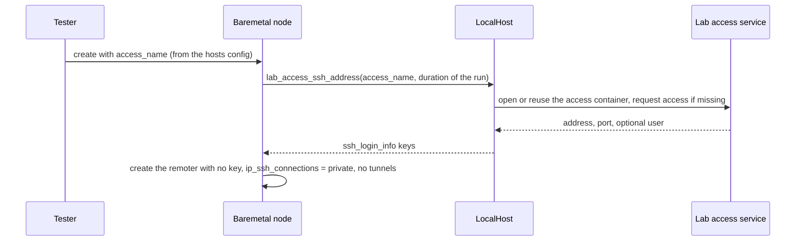

# Connectivity per role, and lab hosts by name

**Jira:** SCT-1215

**Status:** draft

## Overview

Each role of the baremetal hosts config can set its own
`ip_ssh_connections`, and falls back to the value of the run. A node reads
the value of its cluster, so only `public` nodes get reverse SSH tunnels. A
host shared by two nodes frees its stale tunnel ports one time per process.
A node can name its host in the lab access service with `access`. SCT then
takes the SSH address from the lab access lookup, treats the node as
`private`, and the cleanup and the log collection reach the host the same
way.

## Constraints

- A hosts config without the new keys works as today.
- Backends other than baremetal keep the run-wide value.
- The lab access lookup lives in scylla-qa-internal. Without it, a host with
  `access` fails with a clear error. Hosts without `access` do not need it.

## Design

| Reader of `ip_ssh_connections` | Value it uses |
|---|---|
| SSH address, reverse tunnels, stale-port release | The node's |
| Log destination, saslauthd config, CQL address | The node's |
| CQL driver fallback | The node's, which is the DB cluster's unless the node has `access` |
| LDAP address in `scylla.yaml` | The DB cluster's |
| Log collection, cleanup | Each role's, from the hosts config |
| Every other reader | The run's |



The cleanup and the log collection have no node objects. They build the SSH
address of each host from the hosts config with one helper. A host with
`access` goes through a `LocalHost` that the cleanup creates and destroys.

| Condition | Behavior |
|---|---|
| `public` DB role, `private` lab roles | Tunnels and tunnel log destination for the DB nodes only. Cleanup frees tunnel ports on the DB hosts only |
| Loader and monitor on one `public` host | The first node frees the stale ports, the second does not |
| A host with `access` on a `public` role | Treated as `private`: no tunnels, logs go straight to the runner, cleanup frees no tunnel ports |
| A host with `access` and no `public_ip` | `public_ip` defaults to `private_ip` |
| Any SSH to a host with `access` | No SCT key: the lab access service accepts only the SSH `none` method |
| A node of a host with `access` | Asks for access for the run's length: `test_duration` plus 4 hours for setup, teardown, log collection and cleanup |
| The access policy refuses that length | The lookup asks again for its 12-hour default |
| The lookup fails during log collection or cleanup | That host is skipped with a warning; the other hosts are still handled |
| The lab access module is missing, or older than the lookup | The lookup raises `NotImplementedError` naming the host |
| An `access` DB host on a `public` role, with LDAP | Misconfiguration: `scylla.yaml` points at an LDAP tunnel that does not open. Lab DB hosts belong on a `private` role |

## Contracts

### Configuration

The baremetal hosts config, read from the keystore:

```python
class NodeInfo(TypedDict):
    public_ip: NotRequired[str]   # defaults to private_ip
    private_ip: str
    access: NotRequired[str]      # host name in the lab access service

class NodeCredentialInformation(TypedDict):
    username: str
    node_list: list[NodeInfo]
    ip_ssh_connections: NotRequired[Literal["public", "private"]]  # defaults to the run's value
```

```json
{"db_nodes":      {"username": "centos", "ip_ssh_connections": "public",
                   "node_list": [{"public_ip": "3.3.3.3", "private_ip": "10.0.0.1"}]},
 "loader_nodes":  {"username": "jenkins", "ip_ssh_connections": "private",
                   "node_list": [{"private_ip": "10.0.0.60", "access": "monster"}]},
 "monitor_nodes": {"username": "jenkins", "node_list": [{"private_ip": "10.0.0.60"}]}}
```

### Inputs

```python
LocalHost.lab_access_ssh_address(access_name: str, duration: str = "12h") -> dict  # {"hostname", "port"[, "user"]}
```

### Module API

```python
class BaseCluster:
    ip_ssh_connections: str | None = None   # None = the run's value

class BaseNode:
    @property
    def ip_ssh_connections(self) -> str: ...  # the cluster's value, else the run's
    def _ssh_address(self) -> dict: ...       # ssh_login_info keys; "hostname" at least

class TestConfig:
    @classmethod
    def get_logging_service_host_port(cls, ip_ssh_connections: str | None = None) -> tuple[str, int] | None: ...

# sdcm/utils/baremetal_hosts.py
def host_ssh_address(host: dict, ip_ssh_connections: str | None, localhost: LocalHost | None) -> dict: ...
```

`PhysicalMachineNode` overrides `_ssh_address` with the lab access lookup and
returns `private` from `ip_ssh_connections` when it has an `access` name. A
refresh of the IP address calls `_ssh_address` again and rebuilds the
remoter when a key changed.

## Risks

| Risk | Response |
|---|---|
| The set of hosts whose tunnel ports were freed lives for the whole process | One process runs one test, so one run |
| An existing grant, e.g. from an earlier run, is reused without checking the time it has left | Known. The lab access service shows no expiry in its status; checking it is a follow-up |

## Deferred work

- Access to the monitoring ports from outside the lab network, through the
  lab access service.

## Decisions

- The LDAP address follows the DB role, because `scylla.yaml` is written
  per cluster, not per node. (build)
- An `access` host gets no reverse tunnels: the lab access service blocks
  the port forwarding that they need. (review)
- A host with only `public_ip` and no `private_ip` is skipped by the log
  collection. (build)
- SCT drops its key for an `access` host, so the SSH client falls to the
  `none` method. (review)
- Access is requested for the run's length, not a fixed 12 hours. (review)
- One host the lab access service can't reach doesn't stop the log
  collection or the cleanup of the others. (review)
- Whether the hosts config loader rejects an `access` DB host on a `public`
  role with LDAP. (open)
