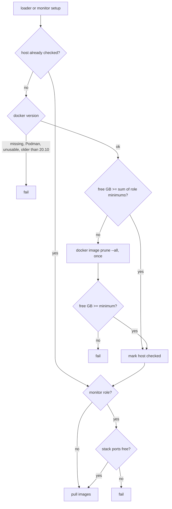

# Preflight check of loader and monitor hosts

**Jira:** SCT-1215

**Status:** built

## Overview

Before a loader or monitor host pulls an image, setup checks the host and
fails with a message that names the problem and the fix. The check has three
parts: Docker Engine 20.10 or newer that the SSH user can use, free space in
the Docker image store, and on monitor hosts, the monitoring stack ports
free. A host with two roles is checked one time for Docker and disk, against
the sum of its role minimums. The configuration rejects `use_mgmt: true` on
baremetal.

## Constraints

- SCT never installs or upgrades Docker as part of the check.
- On a cloud VM the check passes and costs a few SSH calls.
- The docker and k8s-local-kind backends, whose monitoring stack runs on the
  runner, and loaders on Kubernetes, which are pods, skip the check.
- The disk check never removes an image that a container uses.

## Design



| Component | Role |
|---|---|
| Baremetal cluster | Registers the role of each host before any setup, so a host knows all its roles |
| Loader set | Runs the Docker and disk check before the Docker Hub login and the first pull |
| Monitor set | Runs the Docker and disk check and the port check after the prerequisites, before the stack download |
| Docker monitor set | Overrides the check with a no-op |
| Configuration | Rejects `use_mgmt` on baremetal |

The image store is `/var/lib/containerd` when Docker uses the containerd
snapshotter, and `DockerRootDir` otherwise. The roles of a host are keyed by
its private address. A failed check does not mark the host, so the other
role checks again.

| Condition | Behavior |
|---|---|
| No `docker` command | Fail: `Docker is not installed` |
| `docker` is the Podman shim | Fail: ``` `docker` is the Podman shim, SCT needs Docker Engine ``` |
| The SSH user cannot reach the Docker server | Fail, and tell to install and start Docker and add the user to the `docker` group |
| Docker older than 20.10 | Fail: `Docker <found> is older than 20.10, upgrade it on the host` |
| Free space below the minimum after the prune | Fail, naming the store, the free GB, and the needed GB |
| A minimum is 0 | Skip the disk check |
| A monitoring port has a listener | Fail, naming each port, its service, and the process |

## Contracts

### Configuration

```python
docker_min_free_space_gb_loader: int = SctField(
    description="Free space, in GB, the Docker image store of a loader host needs before the run "
    "pulls the stress tool images. Setup first removes images no container uses, then fails if "
    "the space is still short. A host that is both loader and monitor needs the sum. "
    "0 turns the check off.",
)
docker_min_free_space_gb_monitor: int = SctField(...)  # the same, for the monitoring stack images
```

```yaml
# defaults/test_default.yaml
# measured on a lab host: the stress tool images take ~1.5GB and the monitoring stack ~5GB,
# unpacked about twice that
docker_min_free_space_gb_loader: 3
docker_min_free_space_gb_monitor: 10
```

```yaml
# defaults/baremetal_config.yaml
use_mgmt: false  # Manager would run on the monitor host, which other jobs share
```

With `cluster_backend: baremetal` and `use_mgmt: true`, the validation raises
`ValueError("use_mgmt isn't supported on the baremetal backend, set use_mgmt: false")`.

### Outputs

Each failure is a `NodeSetupFailed` on the node. The ports that the stack
binds on the host network:

```python
MONITORING_STACK_PORTS = {
    3000: "Grafana", 8081: "Grafana renderer", 9090: "Prometheus",
    9093: "Alertmanager", 9094: "Alertmanager gossip", 3100: "Loki",
    9095: "Loki gRPC", 9080: "Promtail", 1514: "Promtail syslog",
}
```

### Module API

```python
DOCKER_MIN_VERSION = (20, 10)

def register_docker_host_role(address: str, role: str) -> None: ...
def docker_host_preflight(node: BaseNode, params, role: str) -> None: ...
def ensure_docker_version(node: BaseNode) -> None: ...
def ensure_docker_free_space(node: BaseNode, min_free_gb: int) -> None: ...
def ensure_monitoring_ports_free(node: BaseNode) -> None: ...

class BaseMonitorSet:
    def preflight_check(self, node) -> None: ...  # a subclass can skip it

class BaseLoaderSet:
    owns_host = True  # False on baremetal: no Docker install, no group change
```

## Risks

| Risk | Response |
|---|---|
| The prune removes the cached images of other jobs on a host that runs short of space | Accepted. Only unused images go, pulls are idempotent, and the prune runs only when space is short |
| The minimum Docker version or a disk minimum is too strict | The minimums come from measured needs. The message names both values, and each disk minimum is an option |
| A lab host turns Cockpit or another service on again | The run fails in preflight. The message names the port and the process, so the host owner can act |
| A custom containerd `root` is measured at the wrong path | Known limit. The default containerd root is the common case |

## Deferred work

- Moving the monitoring stack to free ports when a default port is in use.
- Scylla Manager on a shared monitor host.

## Decisions

- 20.10 is the minimum, the oldest Docker line that the supported distros
  still ship. (spec)
- A host with several roles is checked one time, against the sum of the
  minimums: 13 GB for a loader and monitor. (review)
- The prune runs at most once per host, and replaces a separate image cache
  budget. (review)
- The check runs on every backend where SCT sets up the host. (review)
- Fedora's Cockpit stays disabled on lab hosts by agreement, so the port
  check fails instead of moving the stack. (review)
- A failed check does not mark the host, so the other role retries it. (build)
