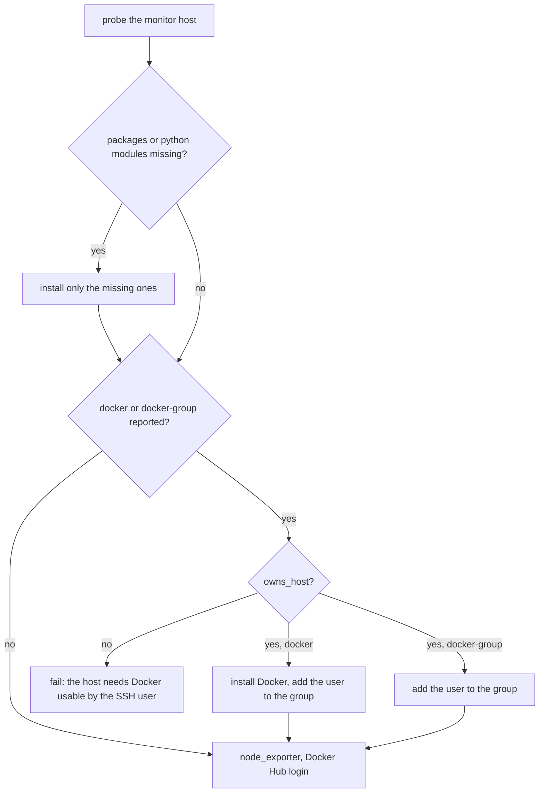
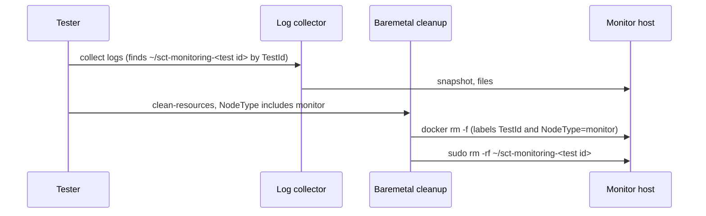

# Monitor setup changes only what a shared host lacks

**Jira:** SCT-1215

**Status:** draft

## Overview

A probe on the monitor host lists what is missing: `curl`, `unzip`,
`python3`, `pip3`, the `yaml` and `psutil` modules, Docker, or only the
`docker` group membership. Setup installs only that. A monitor set whose
`owns_host` is False, the baremetal one, never installs or changes Docker,
leaves the firewall, the SSH packages, and the apt-daily timers alone, and
installs the stack in a directory of its own run. The cleanup of a baremetal
monitor host removes only the containers and the directory of the run.
Baremetal loader and monitor hosts record and restore no package baseline.

## Constraints

- Cloud VMs that the run created keep today's behavior, except that setup
  installs only what is missing and does not restart a Docker it installed.
- The formal monitor image and `~/PREPARED-MONITOR` keep their paths.
- The stack keeps the default container names and ports of
  scylla-monitoring. One SCT monitor runs on a host at a time.

## Design



| Area | `owns_host` True (cloud VM) | `owns_host` False (baremetal) |
|---|---|---|
| Missing packages and python modules | Installed | Installed |
| Missing or unusable Docker | Installed, user added to `docker`, no restart | Setup fails |
| Firewall and SSH packages on RHEL-like or OCI | Turned off, upgraded | Left alone |
| apt-daily timers, `unattended-upgrades` | Disabled | Left on |
| Install and data directory | `~/sct-monitoring` | `~/sct-monitoring-<test id>` |
| The stack does not start | `kill-all.sh`, then start again | Setup fails |
| Stop of the stack (`REUSE_CLUSTER`) | `kill-all.sh` | Remove the containers of the run |
| Package and service baseline | Not used | Recorded and restored on DB hosts only |

The stack of a run is the containers with both labels `TestId=<test id>` and
`NodeType=monitor`. The stack start already passes `node.tags` to
`start-all.sh` as a Docker label file, so every container gets them, also
the Grafana renderer. The stress containers of a loader on the same host
have no `NodeType=monitor` label, so they stay.



## Contracts

### Module API

```python
class BaseMonitorSet:
    owns_host = True

class MonitorSetPhysical(BaseMonitorSet, PhysicalMachineCluster):
    owns_host = False

    @staticmethod
    def get_monitor_install_path_base(node) -> Path: ...  # $HOME/sct-monitoring-<node.tags["TestId"]>
    def stop_scylla_monitoring(self, node): ...           # removes the labelled containers of the run

class BaseNode:
    keeps_daily_apt_triggers: bool = False  # PhysicalMachineNode: True for loader and monitor nodes

class PhysicalHostCleanup:
    def clean_up_host(
        self,
        tunnel_ports: bool,
        scylla_disk_setup: bool,
        restore_baseline: bool = True,
        monitoring_stack_of: str | None = None,  # test id of the run whose stack the host ran
    ) -> None: ...
    def stop_monitoring_stack(self, test_id: str) -> None: ...
    def remove_monitoring_stack(self, test_id: str) -> None: ...

class ConfigurationScriptBuilder:
    disable_apt_triggers: bool = True
```

### Outputs

The probe prints one token for each missing item, and nothing when the host
has everything:

```
curl | unzip | python3 | python3-pip | python-libs | docker-group | docker
```

The failure on a host that SCT does not own:

```
Docker is not running, or the SSH user can't use it, and SCT doesn't install or change Docker on this host: install and start Docker, and add the user to the `docker` group
```

The dry-run line of the baremetal cleanup:

```
Would clean up <role> host <address> (tunnel ports: <bool>, scylla install: <bool>, packages: <bool>, monitoring stack: <test id or False>)
```

Log collection after the run adds `TestId` to the tags of each baremetal
host, so it finds the directory of the run.

## Risks

| Risk | Response |
|---|---|
| A kept monitor (post behavior `keep`) leaves the stack running with the default names, and the next run cannot start its stack | Intended: the host is kept on request. The preflight check of the next run names the taken ports |
| A cloud VM without a restart does not see the new `docker` group | The SSH session reconnects after the group change, which makes the group active |
| The pip copy of `yaml` or `psutil` stays after the run and shadows a distro package installed later | Accepted. The baremetal docs page lists it as a host change |

## Deferred work

- Skip, or undo at cleanup, the other changes of the common node setup on
  hosts that SCT does not own: vector as a host service, the `sshd_config`
  edits, and the coredump limits.
- Remove the `~/PREPARED-MONITOR` support when no image needs it.

## Decisions

- Docker is a host requirement on baremetal. Setup fails instead of
  installing it. (review)
- The formal monitor image keeps its Docker restart. (spec)
- Missing python modules come from pip, as today, also on baremetal. Distro
  package names differ, and RHEL-like hosts need EPEL for them. (review)
- The stack of the run is found by its labels, not by its mounts: the
  Grafana renderer has no mount. (build)
- Only DB hosts record and restore a baseline. A restore on a shared host
  removes the packages of other jobs. (review)
- The package cache refresh still runs on every host. It changes no
  installed package. (review)
- The behavior hangs on the `owns_host` class attribute, not on a
  configuration option. (build)
