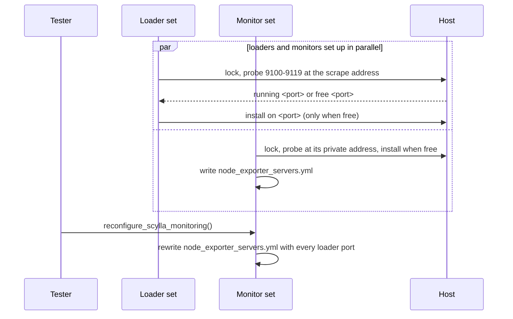

# Reuse a node_exporter that the host runs

**Jira:** SCT-1215

**Status:** draft

## Overview

Before it installs node_exporter on a loader or monitor host, setup probes
ports 9100 to 9119 at the address that Prometheus scrapes. A port that
answers with `node_exporter_build_info` is reused, and nothing is installed.
Otherwise SCT installs its own node_exporter on the first port with no
listener. The node keeps the port it got, and the monitor writes that port
into the scrape targets of the loaders and of itself.

## Constraints

- On a cloud VM with 9100 free, the behavior does not change: SCT installs
  on 9100.
- DB nodes keep their node_exporter setup and their scrape targets on 9100.
- A loader and a monitor on one host can run their setup at the same time.

## Design

| Component | Role |
|---|---|
| `NodeExporterSetup` | Probes, installs when needed, returns the port |
| Loader set | Stores the port on the loader node |
| Monitor set | Stores its own port, writes the scrape targets of the loaders and the monitor |
| Tester | Rewrites the scrape targets after every loader has its port |



The probe runs on the host itself, under a per-host lock, so the second role
on a shared host finds the exporter of the first. `node_exporter_servers.yml`
is a file-based target list, so Prometheus reloads it without a restart.

| Condition | Behavior |
|---|---|
| A node_exporter answers on a port in the range | Reuse it, install nothing |
| Another service holds 9100 | Skip 9100, install on the first free port |
| Every port is free | Install on 9100, as today |
| An exporter listens only on loopback | Its port counts as taken, install on the next free port |
| Loader and monitor on one host | The first installs, the second reuses the same port |
| A reused cluster (`REUSE_CLUSTER`) | Probe again; reuse the exporter or install one |
| All 20 ports are taken | Fail the setup |

## Contracts

### Module API

```python
NODE_EXPORTER_DEFAULT_PORT = 9100
NODE_EXPORTER_PORTS = range(NODE_EXPORTER_DEFAULT_PORT, NODE_EXPORTER_DEFAULT_PORT + 20)

class NodeExporterSetup:
    @staticmethod
    def install(
        node: "BaseNode | None" = None,
        remoter: "Remoter | None" = None,
        scrape_host: str | None = None,  # URL form, IPv6 in brackets; None = no probe, use 9100
    ) -> int: ...  # the port the exporter serves

class BaseNode:
    node_exporter_port: int = NODE_EXPORTER_DEFAULT_PORT

class BaseMonitorSet:
    @staticmethod
    def install_node_exporter(node) -> int: ...
```

`install` raises `RuntimeError("No free port for node_exporter in ...")` when
every port in the range is taken.

### Outputs

The loader and monitor entries of `node_exporter_servers.yml` in the
monitoring config directory:

```yaml
- labels: {dc: <loader region>}
  targets: ["<loader address>:<loader.node_exporter_port>"]
- labels: {dc: monitor}
  targets: ["<monitor private address>:<monitor.node_exporter_port>"]
```

The loader targets move out of `prometheus.yml` into this file. With cloud
Prometheus, the file keeps the loader entries instead of an empty list.

## Risks

| Risk | Response |
|---|---|
| A distro node_exporter lacks a collector that a dashboard panel uses | Accepted on lab hosts. The baremetal docs page lists the known gaps |
| An exporter that answers after more than 2 seconds counts as taken | SCT installs a second exporter on the next port. Both are scraped correctly |
| The lock is per host, not per container | Loader and monitor containers that do not share `/var/lock` are not a supported layout |

## Decisions

- The probe asks the address that Prometheus scrapes, so an exporter that
  only listens on loopback is not reused. (review)
- The probe runs on every backend. On a cloud VM it finds 9100 free and
  costs one SSH call. (spec)
- A reused exporter is not checked for its version or collector set. (spec)
- A firewall between the monitor and the host is not probed. Letting the
  monitor scrape is a host requirement. (review)
