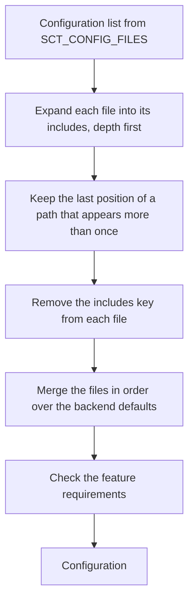

# Resilient test configuration dependencies

**Status:** draft

## Overview

A configuration file can name the files that it needs, in a top-level
`includes` key. The configuration loader expands each file of the
configuration list into its includes, depth first, before the merge. Each
include loads before the file that names it, so the file can override it.
The files that always need authentication add an `includes` entry for
`auth_cassandra.yaml`. A table of feature requirements runs after the merge,
and fails the load when a feature misses a setting that it needs.

## Constraints

- The expansion does not evaluate `{{ }}` or ``. The stress command
  templates in `stress_template_context` render at run time, with values
  that do not exist at load time.
- A configuration list with no `includes` key loads to the same
  configuration as today.
- The Jenkinsfiles keep their `auth_cassandra.yaml` entries during the
  migration. A file that loads twice gives the same result as today.
- The feature files that a Jenkinsfile adds by choice stay in the
  Jenkinsfile.

## Design

Two parts, each one can ship alone.

**Includes.** The loader expands the configuration list before the merge
of the user files. The merge rules do not change.



Example: the list `[rolling-upgrade-with-sla-no-shares.yaml,
rolling-upgrade-artifacts.yaml]`, where the first file includes
`auth_cassandra.yaml`, expands to `[auth_cassandra.yaml,
rolling-upgrade-with-sla-no-shares.yaml, rolling-upgrade-artifacts.yaml]`.

The last position wins for a repeated path. A Jenkinsfile that still lists
`auth_cassandra.yaml` after the test case then merges in the same order as
today.

| Condition | Behavior |
|---|---|
| An include path does not exist | Fail the load. The error names the missing path and the file that includes it |
| The includes form a cycle | Fail the load. The error shows the cycle |
| `includes` is not a list of strings | Fail the load |
| A key comes from an included file | It counts as set by the user, the same as a key from a listed file |

**Feature requirements.** After the merge, the configuration checks a fixed
table of requirements. A failed requirement stops the load. The error names
the feature, the missing setting, and the file that gives it.
`lint-pipelines` loads each pipeline configuration, so it reports the same
error.

| Feature setting | Requires | Fix in the error |
|---|---|---|
| `sla: true` or `service_level_shares` set | `authenticator: PasswordAuthenticator` | Include `configurations/auth_cassandra.yaml` |
| `use_ldap: true` | `ldap_server_type` set | Include one of the LDAP configurations |
| `use_ldap_authorization: true` | `use_ldap: true` and `authorizer: CassandraAuthorizer` | Include `configurations/auth_cassandra.yaml` |
| `alternator_enforce_authorization: true` | `alternator_access_key_id` and `alternator_secret_access_key` set | Include `configurations/alternator/enforce-authorization.yaml` |

The checks that SCT already does stay where they are.

**Migration.** These files get `includes: [configurations/auth_cassandra.yaml]`:

- `configurations/nemesis/additional_configs/sla_config.yaml`
- `configurations/rolling-upgrade-with-sla.yaml` and
  `configurations/rolling-upgrade-with-sla-no-shares.yaml`
- The six LDAP and MS AD LDAP configurations
- `test-cases/upgrades/generic-rolling-upgrade.yaml`
- `configurations/alternator/enforce-authorization.yaml`, which drops its
  copy of the authentication settings

A file gets an `includes` entry only when every Jenkinsfile that uses it also
lists the included file. Feature toggles, distro overlays, instance and
storage overlays, and load profiles that change per pipeline stay in the
Jenkinsfiles.

## Contracts

### Configuration

`includes` is a loader directive, not an `SctField`. The loader removes it
before the merge, so the configuration model never sees it. Paths are
relative to the SCT root, like the entries of `test_config`.

```yaml
# configurations/rolling-upgrade-with-sla-no-shares.yaml
includes:
  - configurations/auth_cassandra.yaml

service_level_shares: [null, null]
stress_before_upgrade: "cassandra-stress write ..."
```

An included file can have its own `includes`.

### Outputs

The load error for a missing include:

```
FileNotFoundError: Couldn't find config file: configurations/auth_cassandra.yml (included from configurations/ldap-authorization.yaml)
```

The load error for a failed requirement:

```
ValueError: sla=true requires authenticator=PasswordAuthenticator. Include configurations/auth_cassandra.yaml in the config.
```

The log of the configuration lists the expanded file list, so a reader sees
which files the run loaded.

## Risks

| Risk | Response |
|---|---|
| A tool that reads a configuration file directly sees `includes` and not the included values | Such tools read the test metadata and the job parameters, not the authentication keys. A unit test loads each migrated file through the loader |
| A requirement fails a valid pipeline that sets the setting in an unexpected way | Run `lint-pipelines` on all pipelines before the merge of the requirements table |
| An included file uses a `++` append value, which adds twice when the file loads twice | The keep-last rule loads a repeated path once |

## Deferred work

- Remove the redundant `auth_cassandra.yaml` entries from the Jenkinsfiles
  and from the nemesis `additional_configs`, after the migration ships.
- Add requirements for object storage, KMS encryption at rest, and the oracle
  cluster of Gemini, when a failure shows the need.

## Decisions

- The include is a YAML key, and the loader renders no template at load
  time. A load-time template pass turns `{{ rows }}` in a
  `stress_template_context` user into an empty string, or fails the render
  and drops the include with only a warning. A local run of anyconfig 0.14.0
  showed both. (spec)
- An include loads before the file that names it, so the file overrides it.
  (spec)
- A repeated path loads once, at its last position, so the old Jenkinsfile
  entries keep today's merge order. (spec)
- The requirements are a fixed table in SCT, not a `requires` key in the
  configuration files. The rule belongs to the feature, not to one test.
  (spec)
- The key name: `includes` or `include`. (open)
