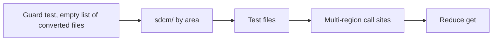

# Typed access to the SCT configuration

**Jira:** SCT-950

**Status:** draft

## Overview

Each reader of `SCTConfiguration` reads the option as an attribute:
`self.params.n_db_nodes` replaces `self.params.get("n_db_nodes")`. The
change is mechanical and goes area by area, one pull request at a time. A
unit test guards the converted files, so that no new literal-key `get()` call
comes back. The multi-region options and the dotted keys get explicit code
at their call sites. At the end, `get()` is a thin attribute lookup with no
special behavior.

## Constraints

- Each pull request leaves every value that a test reads unchanged: the same
  type, the same default, and the same `None` for an unset option.
- Each pull request is small enough to rebase over parallel work. A large
  file, such as `sdcm/tester.py`, can take its own pull request.
- Code outside this repository can still call `get()` during the migration.

## Design

### Conversion rules

| Form at the call site | Typed form |
|---|---|
| `params.get("test_duration")` | `params.test_duration` |
| `params["test_duration"]` | `params.test_duration` |
| `params["test_duration"] = 30` | `params.test_duration = 30` |
| `params.get(name)`, `params.get(f"post_behavior_{kind}_nodes")` | `getattr(params, name)` |
| `params.get("stress_image.ycsb")` | `params.stress_image.get("ycsb")` |
| `params.get("region_name")` where the caller wants a list | `params.region_name` |
| `params.get("region_name")` where the caller wants a string | `" ".join(params.region_name)` |

Assignment through the attribute keeps the Pydantic validation, because the
model sets `validate_assignment`.

A dotted key walks into a dict option. `stress_image` is the only option that
the code reads this way. The dict lookup at the call site keeps the `None`
result for a tool that has no image.

The multi-region options are `region_name`, `ami_id_db_scylla`, and
`ami_id_loader` on AWS, and `gce_datacenter` on GCE. For them `get()` returns
a space-joined string when the stored value is a list. The attribute returns
the stored value. Each call site of these four options is read before it
converts, and it takes the form that its consumer expects.

### Order of the work



1. The guard test lands first, with no converted file.
2. `sdcm/` converts by area: the tester, the cluster base, each backend, the
   provisioning, the stress threads, the nemesis, and the utilities. Each
   pull request adds its files to the guard.
3. The top-level `*_test.py` files and `functional_tests/` convert next.
4. The call sites of the four multi-region options convert last, one by one.
5. When no literal-key call is left, `get()` loses its special behavior.

A group of options that moves to a nested section (see
`docs/plans/config/sct-config-nested-sections.md`) converts in the section
pull request. This migration skips the call sites of a group that has a
section pull request in review.

## Contracts

### Guard

A unit test scans the converted files for the patterns
`params.get("<literal>")` and `params["<literal>"]`. It fails and names the
file and the key for each match. The list of converted files grows with each
pull request. When the migration ends, the test scans all of `sdcm/` and the
test files, and the list goes away.

### Module API

The end state of `get()`, for code outside this repository and for code that
builds a key at run time:

```python
def get(self, key: str):
    """Deprecated. Read the attribute, or use getattr() for a computed key."""
    warnings.warn("SCTConfiguration.get() is deprecated", DeprecationWarning, stacklevel=2)
    return getattr(self, key, None)
```

The dict-style `__getitem__` and `__setitem__` stay for the loading code and
for outside callers. The repository code does not use them.

## Risks

| Risk | Response |
|---|---|
| A multi-region caller gets a list where it expects a string, for example in a command line or a resource name | The four options convert last, one call site at a time, after a read of each consumer |
| Some code receives a plain dict as `params`, such as unit-test fakes and builder helpers, and the attribute read fails on it | Convert the fake to a real `SCTConfiguration`, or keep the dict call and add the file to the guard exceptions with a reason |
| Large mechanical diffs conflict with parallel work in the same files | One area for each pull request, and the busiest files alone |
| A converted call site that runs only in a rare path breaks at run time | The rules keep the values the same. The reviewer checks the rare forms (computed keys, multi-region, dotted keys) by hand |

## Deferred work

- Removing `get()`, `__getitem__`, and `__setitem__`, after the outside
  callers stop using them.
- A type checker in pre-commit that catches a typo in an attribute name
  before run time.

## Decisions

- The guard is a unit test with a growing list of converted files. Each
  pull request then shows its own scope, and no file goes back. (spec)
- A dotted key becomes a dict lookup on its parent option. Only
  `stress_image` uses dotted keys, so a path library adds nothing. (review)
- `get()` stays during the migration, without a warning, so that test logs
  stay clean. The warning comes with the reduced `get()`. (spec)
- The reduced `get()` keeps the `None` result for an unknown key, or raises.
  A raise finds typos in outside callers, but it can break them. (open)
