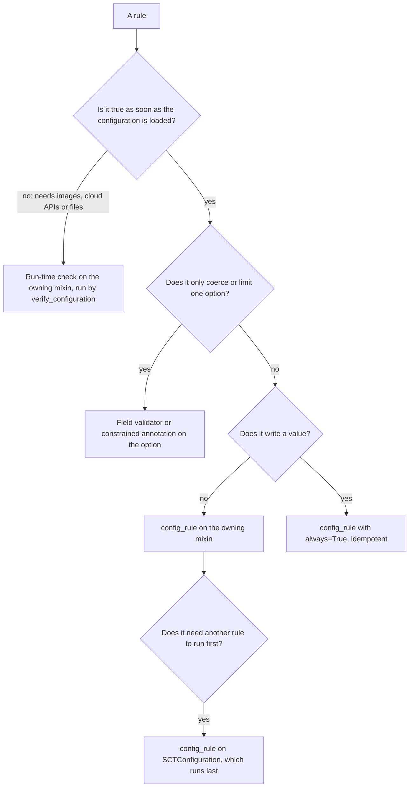
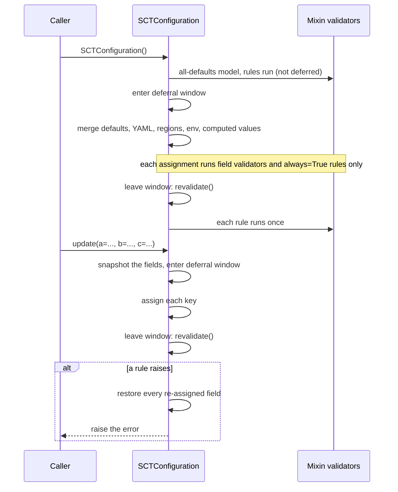

# Config validation on the mixins

**Jira:** SCT-525

**Status:** draft

## Overview

Each configuration rule moves to the mixin that owns the options it checks. A
rule takes one of two forms. A construction-time rule is a pydantic validator
on the mixin. It holds as soon as the configuration is loaded. A run-time
check is a plain method on the mixin. It holds only for a configuration that
SCT will run, because it needs resolved images, cloud API answers, or files on
disk. `verify_configuration` collects and runs the run-time checks. A
per-instance deferral window lets the load and `update` set many options, and
then run each construction-time rule once.

## Constraints

- The option names, the YAML keys, and the attribute access do not change.
- The set of accepted configurations does not change. Each moved rule raises
  the message that it raises today.
- A construction path that the design does not know about runs the rules. The
  default is to validate.
- The design works with the pydantic version in `uv.lock` (2.14).

## Design

### Where a rule goes



`config.py` keeps the rules that span domains, the unexpected `SCT_*`
variable check, and the dispatcher.

### Construction-time rules and their owners

| Rule | Owner | Form |
|---|---|---|
| K8s SNI requires TLS | `KubernetesConfigMixin` | rule |
| DNS names only on some backends | `CommonConfigMixin` | rule |
| `PasswordAuthenticator` requires a user and a password | `ScyllaConfigMixin` | rule |
| Vector store user requires `PasswordAuthenticator` | `VectorStoreConfigMixin` | rule |
| Alternator authorization | `AlternatorConfigMixin` | rule |
| Stress and prepare durations | `StressConfigMixin` | field validator |
| Loader arch supports the amd64-only stress tools | `StressConfigMixin` | rule |
| Fullscan parameters | `LongevityConfigMixin` | rule |
| Docker simulated racks need a supported image | `DockerConfigMixin` | rule |
| Simulated racks or regions force the Gossiping snitch | `ScyllaConfigMixin` | rule, `always=True` |
| An explicit snitch must be Gossiping with simulated racks | `ScyllaConfigMixin` | rule |
| Scylla network interface rule table | `ScyllaConfigMixin` | rule |
| Azure can place each `scylla_network_config` address | `ScyllaConfigMixin` | rule |
| Zero-token nodes | `CommonConfigMixin` | rule |
| Instance provisioning type | `CommonConfigMixin` | constrained annotation |
| Gradual throughput normalisation | `PerformanceConfigMixin` | field validator |
| Gradual throughput steps are valid | `PerformanceConfigMixin` | rule |
| Backtrace decoding disable pattern | `MonitoringConfigMixin` | rule |
| NVMe self-test type | `LogsConfigMixin` | constrained annotation |

The gradual throughput check writes the throttle steps and the thread counts
today. Its normalisation becomes a field validator, and only the pure check
stays a rule. This also removes its second call from `verify_configuration`.
The zero-token check also runs only once.

These stay in `__init__`, because they are part of the load: cloud image
resolution, capacity and dedicated host reservation, the `user_prefix`
construction from the image metadata, and the random cassandra-stress driver
version pick. A rule can run again. A random pick must not.

### Run-time checks

The remaining `_validate_*` and `_verify_*` methods move to their owning
mixins, unchanged in phase: per-backend required options, version supplied,
multi-region options, seeds, nemesis placement and parallelism, nodes per
availability zone, placement groups, partition ranges, data volumes, safepoint
logging, scylla-bench workloads, Docker options, rack-aware teardown, xcloud
options and zones, instance type availability, `scylla.d` override files, the
Spark migrator and EMR options, and the image and repository URL checks.
`verify_configuration` becomes a dispatcher. Its docstring states the
placement rule above.

### Load and update



| Condition | Behavior |
|---|---|
| A single assignment breaks a rule | The assignment raises |
| `update` breaks a rule | Every field that `update` assigned gets its old value back, then `update` raises |
| A configuration is built inside the load of another one | It has its own deferral counter and runs its own rules |
| `model_validate` or direct construction | The rules run, because the counter starts at zero |
| A rule raises during the load | `SCTConfiguration()` raises with the message of the rule |

The module docstring of the validation module states the contract:

> Every mutation of an `SCTConfiguration` leaves it satisfying every
> cross-field rule, or raises and restores the fields it assigned. A single
> assignment validates immediately. `update` applies all keys and validates
> once at the end, so options that are only valid together can be set
> together.

## Contracts

### Module API

The new validation module in `sdcm/sct_config/`:

```python
def config_rule(func=None, *, always: bool = False):
    """Declare a cross-field rule on a mixin, as a pydantic `mode="after"`
    model validator. The rule is skipped while the instance is in a deferral
    window, unless `always` is set. An `always` rule must be idempotent: it
    writes a value only when the value differs."""


@contextlib.contextmanager
def deferred_validation(config: SCTConfiguration) -> Iterator[None]:
    """Suspend the rules on `config`. Re-entrant. The outermost exit calls
    `revalidate(config)`."""


def revalidate(config: SCTConfiguration) -> None:
    """Run every model validator once, in place, keeping the private
    attributes and `model_fields_set`."""
```

The deferral state is a per-instance private attribute, a counter with the
default `0`. A rule reads it from `self`. A counter of zero means "validate".

`revalidate` saves `model_fields_set`, calls
`type(config).__pydantic_validator__.validate_assignment(config,
"artifact_scylla_version", config.artifact_scylla_version)`, and restores
`model_fields_set`. The anchor field belongs to `SCTConfiguration`, is
excluded from the dump, and accepts its own current value. On pydantic 2.14
this call runs every model validator once, keeps the private attributes, and
adds only the anchor to `model_fields_set`.

A run-time check on a mixin:

```python
class NemesisConfigMixin(BaseModel):
    @runtime_check
    def _validate_nemesis_parallel_config(self) -> None: ...
```

`verify_configuration` runs each `runtime_check` of each class in
`CONFIG_GROUPS`, in that order, then the checks on `SCTConfiguration`.

### Configuration

Each mixin declares the required options it owns for each backend. The
dispatcher builds the per-backend view from `CONFIG_GROUPS`, the way the field
order is built. The `BACKEND_REQUIRED_PARAMS`,
`XCLOUD_PER_PROVIDER_REQUIRED_PARAMS`, and `PER_PROVIDER_MULTI_REGION_PARAMS`
tables leave `defaults.py`.

```python
class AwsConfigMixin(BaseModel):
    backend_required_params: ClassVar[dict[str, tuple[str, ...]]] = {
        "aws": ("instance_type_db", "region_name", ...),
    }
```

### Outputs

Each check that is an `assert` today raises `ValueError` with the same
message. This includes `verify_configuration_urls_validity` and the "is not
appendable" check in `helpers.py`. A pydantic `ValidationError` is a
`ValueError`, so callers that catch `ValueError` keep working.

## Risks

| Risk | Response |
|---|---|
| A rule that writes a value is declared without `always`, and recurses or runs twice | The `config_rule` docstring forbids writes without `always`. The gradual throughput rule is split before it moves |
| Two mixins declare a validator with the same method name, and pydantic keeps only one | A guard test fails on a duplicate name across `CONFIG_GROUPS` |
| `revalidate_instances` is enabled later, and `revalidate` turns into a deep copy | A guard test pins the model config, with the reason in its docstring |
| A pydantic upgrade changes `validate_assignment` | A guard test checks that `revalidate` runs each rule once and keeps the private attributes and `model_fields_set` |
| A check moves to construction time but is not true at construction | The placement rule. A test checks that a fresh minimal configuration passes `verify_configuration` with no check firing |
| A moved rule changes which configurations are accepted | The messages stay. `sct.py conf` dumps on docker, aws, and gce match master |
| The pipeline linter patches methods that move | The linter is part of the regression set. Its patch targets move with the methods |
| The change spans several stacked pull requests on a fast-moving `config.py` | The constructor rules and the run-time checks touch different parts of the file, so the rebases stay small |

## Deferred work

- Lazy cloud image resolution, Phase 2 of
  `docs/plans/sct-config-validation-and-lazy-images.md`. After this change,
  `__init__` holds only the load and the image resolution.
- A list option that is changed in place skips the rules. The `update`
  rollback cannot restore it either.

## Decisions

- The deferral state is a per-instance re-entrant counter that defaults to "validate", so a nested configuration and an unknown construction path both run their rules. (review)
- `revalidate` uses `validate_assignment` on an anchor field and restores `model_fields_set`. It is the only in-place call that keeps the private attributes. (review)
- A failed `update` restores every field that it assigned. It does not promise to undo a change made in place to a list. (review)
- Run-time checks stay plain methods. Callers that never call `verify_configuration`, such as most of `sct.py`, must not fail on them. (spec)
- No rule depends on the order of the mixins. A rule that needs another rule first goes on `SCTConfiguration`, whose validators run last. (spec)
- The `xcloud` requirements vary by provider and by cluster type. The per-mixin declaration takes a second key, or xcloud keeps its own table. (open)
