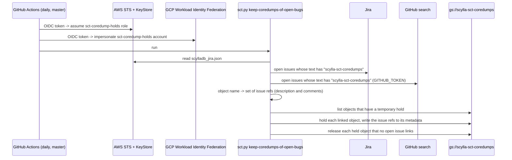

# Keep the coredumps of open bugs

**Jira:** SCT-1656

**Status:** draft

## Overview

A daily GitHub Actions workflow runs an SCT command that finds the open bugs
that link a coredump in `gs://scylla-sct-coredumps`. The command puts a GCS
temporary hold on each linked object, and releases the hold on each object
that no open bug links. The lifecycle rule of SCT-1655 does not delete an
object that has a hold. When the hold is released, the rule deletes the
object on its next pass if it is older than 90 days. The holds live on the
objects, so the command keeps no state of its own. The workflow gets
short-lived AWS and GCP credentials through GitHub OIDC, as the minicloud
image-cache workflows do. No long-lived key is stored in GitHub.

## Constraints

- The command is idempotent. Two runs in a row give the same holds.
- The node upload of SCT-1655 does not change. The signed-URL account keeps
  only `roles/storage.objectCreator`.
- A failed search of one tracker releases no holds. A missing answer must not
  look like a closed bug.
- No long-lived credential in GitHub secrets. Each cloud trusts only the
  workflow on the `master` branch of `scylladb/scylla-cluster-tests`.
- No new Jenkins job.

## Design



The object name comes from the text that SCT writes into the
`CoreDumpEvent`, which people paste into bugs:

```python
COREDUMP_LINK = re.compile(
    r"(?:gs://|https://storage\.cloud\.google\.com/)scylla-sct-coredumps/(?P<name>\S+?\.(?:zst|gz|lz4))"
)
```

| Condition | Behavior |
|---|---|
| A linked object does not exist (deleted, or a typo) | Log it and continue |
| An object is linked from open issues in two trackers | Keep the hold; the metadata lists both refs |
| The Jira or GitHub search fails | Exit non-zero. Set new holds from the trackers that answered, and release none |
| A bug is reopened after its hold was released | The next run holds the object again, if the lifecycle rule did not delete it yet |
| An object has a hold that a person set by hand, with no `sct-held-for` metadata | Leave it as it is |

### Credentials

| Cloud | Mechanism | Trusts | Grants |
|---|---|---|---|
| AWS | IAM role `sct-coredump-holds`, on the GitHub OIDC provider that the `minicloud-github-actions` role uses | `repo:scylladb/scylla-cluster-tests:ref:refs/heads/master` | `s3:GetObject` on the KeyStore object `scylladb_jira.json` only |
| GCP | Workload Identity pool and provider in `gcp-sct-project-1`, service account `sct-coredump-holds` | `assertion.repository == "scylladb/scylla-cluster-tests" && assertion.ref == "refs/heads/master"` | Custom role with `storage.objects.get`, `list`, `update`, on the bucket only |
| GitHub | The built-in `GITHUB_TOKEN`, `issues: read` | This workflow run | Search in the public repositories of `scylladb` |

`prepare-global-resources` (SCT-1655) creates the GCP pool, the provider, the
service account, and the bucket grant, and the AWS role. A re-run changes
nothing.

## Contracts

### Inputs

```
Jira:   JQL  text ~ "scylla-sct-coredumps" AND statusCategory != Done
        fields: key, description, comment
GitHub: search  "scylla-sct-coredumps" org:scylladb is:issue is:open
        fields: repository, number, body, comments
GCS:    list_blobs(scylla-sct-coredumps), fields: name, temporary_hold, metadata
```

### Outputs

The state of each kept object, on the object:

```
temporary_hold: true
metadata:
  sct-held-for: "SCYLLADB-5896,scylladb/scylladb#24214"
```

`gcloud storage objects describe` shows why an object is kept.

### Workflow

```yaml
# .github/workflows/keep-coredumps-of-open-bugs.yaml
on:
  schedule:
    - cron: '0 3 * * *'
  workflow_dispatch:
permissions:
  id-token: write
  contents: read
  issues: read
jobs:
  sync:
    if: github.repository == 'scylladb/scylla-cluster-tests' && github.ref == 'refs/heads/master'
    steps:
      - uses: aws-actions/configure-aws-credentials  # role-to-assume: sct-coredump-holds
      - uses: google-github-actions/auth             # workload_identity_provider, service_account from repo vars
      - run: ./sct.py keep-coredumps-of-open-bugs
        env:
          GH_TOKEN: ${{ secrets.GITHUB_TOKEN }}
```

### Module API

```python
def find_linked_coredumps(texts: Iterable[tuple[str, str]]) -> dict[str, set[str]]:
    """(issue ref, text) pairs -> {object name: {issue refs}}"""

def sync_coredump_holds(linked: dict[str, set[str]], release: bool) -> None:
    """Hold the linked objects. Release the stale holds only when release is True."""
```

## Risks

| Risk | Response |
|---|---|
| A temporary hold does not stop the lifecycle Delete action | Check on the live bucket in the build: hold an object under a test prefix, add a 1-day Delete rule for that prefix, see it stay |
| Jira `text ~` does not match the bucket name inside a URL | Check the JQL on a real bug in the build. Use a narrower match if needed |
| `GITHUB_TOKEN` cannot search the private repositories | Bugs with coredumps are in Jira and in public `scylladb/scylladb`. Private repositories stay out until a bug there needs a hold |
| A held object stays in Coldline for years | About 8 coredumps a month at about $0.004/GB-month. Cost is cents |

## Deferred work

- Argus issue links (run to bug). A run can have several coredumps that the
  bug does not use, so the linked text stays the source.
- A link from Argus to the hold state of a coredump.

## Decisions

- The bugs' own text is the source of the link, not a separate list. The text
  is what a developer reads, and no person has to do an extra step. (spec)
- The holds are temporary holds on the objects, not a second bucket or a copy. (spec)
- The hold metadata names the bugs, so a person can see why an object is kept. (spec)
- The command runs once a day. The 90-day rule leaves time, and the trackers see few searches. (spec)
- The scheduler is GitHub Actions, with OIDC to AWS and GCP as in the minicloud workflows, so no permanent token is stored in GitHub. (spec)
- The command uses its own GCP service account, so the signed-URL account keeps `objectCreator` only. (spec)
- The Jira login stays in the KeyStore. The workflow reads it through the AWS role and does not copy it into GitHub. (spec)
- The Jira projects to search: SCYLLADB, SCT and QATOOLS. (open)
