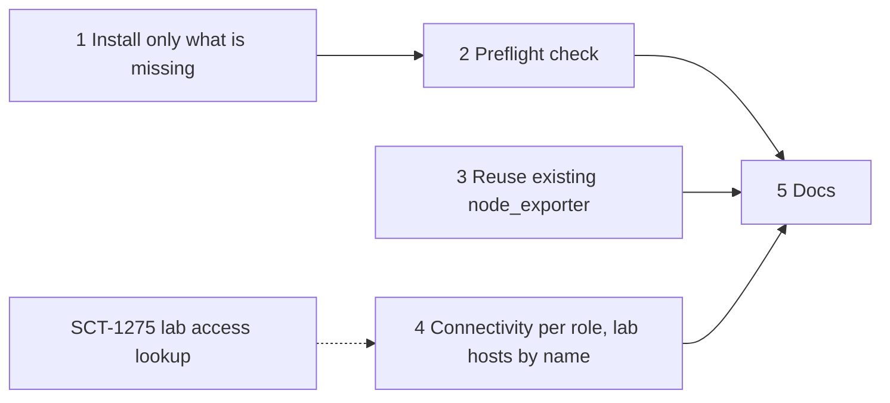

# Baremetal Setup on Shared, Pre-configured Hosts

Overview of the findings, PRs, merge order and test runs: [Baremetal Shared Hosts](https://claude.ai/artifact/14QF6zQCQJRDJfrocfaexs)
(ScyllaDB organization only).

## 1. Problem Statement

The baremetal backend assumes the hosts are fresh machines SCT can configure however it likes.
Lab hosts are not like that: they already run Docker, system services and other Jenkins jobs, and
SCT does not create or destroy them.

SCT-1215 ran the loader and monitor of a longevity test on the lab host `monster` (Fedora 43),
with one DB node in AWS. Every failure came from the monitor and loader setup, not from the test:

- **Docker install conflicts with the host's Docker.** The monitor setup always runs the
  `get.docker.com` script. `monster` runs Fedora's `moby-engine`; the script failed 3 times and
  stopped the run, although Docker already worked.
- **A missing tool stops the run.** `wget` was not installed and the monitoring download needs it.
- **Fixed ports clash with the host's services.** Fedora's Cockpit web console listens on 9090,
  which Prometheus needs. Log collection then reached Cockpit's TLS endpoint instead of Prometheus.
- **node_exporter is installed over an existing one.** Fedora's `prometheus-node-exporter`
  already served 9100. SCT installed its own copy for both the loader and the monitor; both
  failed to bind and stayed behind as failed units.
- **The root disk filled up mid-pull.** Docker keeps images on the 15 GB root filesystem. The
  Grafana pull failed with a write error, Grafana never started, and the test waited 40 minutes on
  dashboard upload before it was aborted.
- **The setup restarts Docker.** On a shared host this kills other jobs' containers. It did not
  happen in SCT-1215 only because the Docker install failed first.
- **Connectivity is all or nothing.** `ip_ssh_connections` is global, so the one DB node in AWS,
  reached over its public address, forced reverse SSH tunnels on the lab hosts next to the runner
  too. The loader and the monitor shared one host, and the second node killed the tunnel the first
  had just opened. SSH to the lab host needed an SCT key added by hand.

The workaround was manual host prep: a `~/PREPARED-MONITOR` marker file, installing `wget`,
disabling Cockpit, removing images by hand. Each new lab host needs the same prep, and nobody
knows the list.

## 2. Current State

**Monitor setup** (`sdcm/cluster.py:BaseMonitorSet`):

- `install_scylla_monitoring_prereqs` either skips everything or installs everything.
  - It skips when `~/PREPARED-MONITOR` exists, or when the node runs the formal monitor image
    (`is_formal_monitor_image`).
  - Otherwise it installs the packages, runs `get.docker.com` with retries (plus a Rocky Linux
    fallback), pip-installs `pyyaml` and `psutil` with `--break-system-packages` when needed, adds
    the user to the `docker` group and always runs `systemctl restart docker`.
- `download_scylla_monitoring` fetches the scylla-monitoring archive with `wget`.
- `start_scylla_monitoring` calls `start-all.sh` without port options, so the stack takes its
  default ports. `start-all.sh` already accepts `-g` (Grafana), `-p` (Prometheus), `-m`
  (Alertmanager), `--loki-port` and `--promtail-port`.
- `__init__` sets `grafana_port = 3000` and `prometheus_port = 9090` as constants.

**node_exporter:**

- `sdcm/node_exporter_setup.py:NodeExporterSetup.install` always downloads node_exporter 1.8.2 and
  writes its own `node_exporter.service`.
- It is called from `BaseLoaderSet.node_setup` and from `install_scylla_monitoring_prereqs`.
- `BaseMonitorSet.configure_scylla_monitoring` and `reconfigure_scylla_monitoring` build the scrape
  targets as `<address>:9100`.

**Baremetal hosts:**

- `sdcm/cluster_baremetal.py:PhysicalMachineNode` and `PhysicalHostCleanup` handle hosts that
  outlive the run.
- `sdcm/utils/resources_cleanup.py:clean_resources_baremetal` cleans up afterwards: it frees SSH
  tunnel ports and undoes the Scylla disk setup.
- Nothing checks or limits Docker's disk use, and nothing removes images a run pulled.

**Related plans:**

- *Lab builders as baremetal test nodes* (PR #16342, pending) reserves lab hosts through Jenkins
  and adds a pre-run host check for SSH key, sudo and Docker. This plan is the other half: making
  SCT's own setup safe on those hosts.
- *Docker Cleanup for All Backends* (`docker-cleanup-all-backends.md`) cleans the runner's
  containers. It does not limit image disk use on test hosts.
- *Baremetal jobs on the local agent* (PR #16445) runs the test on the lab host's Jenkins agent,
  next to the lab hosts. It also carries the SCT-1215 job used for the manual tests below.
- *SCT-1275* reaches lab hosts through the lab access service instead of direct public SSH. It blocks SSH
  port forwarding, so the runner reaches lab ports through nested SSH over its session or
  through TCP resources of that service. Phase 4 reaches lab hosts through it for SSH; reaching
  the monitor's ports from outside the lab is a follow-up.

## 3. Goals

1. A Fedora or Ubuntu host that already runs Docker becomes a working loader and monitor without
   SCT-specific prep: no marker file, no extra packages.
2. Setup never restarts, reinstalls or upgrades a working Docker on a baremetal host, and never
   stops a container it did not start.
3. A host that can't run the test (old Docker, short disk, a taken monitoring port) fails before
   any image pull or container start, saying what is wrong and what is needed.
4. An existing node_exporter on a host is scraped instead of replaced.
5. Cloud backends behave as today: default ports, same install path.
6. A run can mix hosts next to the runner with hosts it reaches over public addresses: only the
   latter get reverse SSH tunnels, and lab hosts are reached without an SCT key on them.

## 4. Implementation Phases

Phases 1, 3 and 4 are independent. Phase 2 builds on phase 1. Phase 5 comes last. Phase 4's
lab-access part needs the SCT-1275 lookup.

### Phase 1: Install only what is missing

**Importance**: Critical

**Description**:

- The monitor prerequisites check for each tool and install only the missing ones. The tools are
  `curl`, `unzip`, `python3`, and the `yaml` and `psutil` Python modules that scylla-monitoring's
  scripts import.
- Docker is left alone when it runs and the SSH user can use it. When it is missing, setup
  installs it; whether a present Docker is good enough is the preflight check's job (phase 2).
- `systemctl restart docker` runs only when setup installed Docker, so it never runs on a
  baremetal host, where Docker is never installed or upgraded. Adding the user to the
  `docker` group needs a new SSH session, not a restart.
- The scylla-monitoring download uses curl with retries, like the node_exporter download already
  does, so `wget` is no longer needed.
- `~/PREPARED-MONITOR` is no longer needed. It stays honoured so existing images and hosts behave
  the same; removing it is a follow-up once no image relies on it.

**Definition of Done**:

- [ ] On a host with everything present, setup runs no package manager, pip or Docker commands.
- [ ] On a host missing only `unzip`, setup installs only `unzip`.
- [ ] `wget` is not used anywhere in the monitor setup.
- [ ] Unit tests cover the "all present", "one missing" and "Docker unusable by the user" cases.

**Dependencies**: none.

### Phase 2: Preflight check of loader and monitor hosts

**Importance**: Critical

**Description**:

- Before the first image pull, setup checks each loader and monitor host and fails right away,
  naming what is wrong and what is needed, instead of failing mid-test:
  - **Docker:** the running server is Docker Engine 20.10 or newer, of any packaging
    (`docker-ce`, `moby-engine`, distro `docker.io`), and not the Podman `docker` shim. 20.10 is
    the oldest line the supported distros still ship. SCT never upgrades Docker: on a shared host
    that restarts the daemon under other jobs.
  - **Disk:** the free space where Docker keeps images is at least a minimum per role. With the
    containerd image store that is `/var/lib/containerd`, not `DockerRootDir`. When space is
    short, setup removes the images no container uses once and checks again; that keeps the
    image cache in bounds without a separate cleanup step. The minimums are config options:
    - monitor hosts: 10 GB. The monitoring stack images measured on `monster` take about 5 GB,
      and unpacked about twice that;
    - loader hosts: 3 GB. The stress tool images take about 1.5 GB. Loaders on AWS and OCI have a
      20 GB root disk, so the monitor's minimum would fail healthy loaders.
  - **Ports, monitor hosts:** the monitoring stack's ports are free (Grafana 3000, Prometheus
    9090, Alertmanager 9093, Loki 3100, Promtail 9080). A taken port fails setup naming the port
    and the process holding it. Lab host owners keep those ports free; Fedora's Cockpit, which
    holds 9090, is disabled on lab hosts by agreement.
- The check runs on all backends. On cloud VMs it is cheap and should never fire.

**Definition of Done**:

- [ ] `moby-engine` on Fedora passes; a too-old Docker or the Podman shim fails before any
      container starts.
- [ ] A host short on Docker disk space fails before any pull, with a message naming the path
      and both sizes; removing unused images never removes an image a container uses.
- [ ] A monitor host with 9090 taken fails before the stack starts, naming the port and process.

**Dependencies**: Phase 1.

### Phase 3: Reuse an existing node_exporter

**Importance**: Important

**Description**:

- Before installing, setup checks port 9100 for a node_exporter (a `/metrics` response that
  contains `node_exporter_build_info`). If one answers, SCT skips the install and scrapes it.
  - The distro build may have a different service name and collector set. Dashboards read the
    same metric names, so the extra or missing collectors are acceptable.
- If something else holds 9100, SCT installs its node_exporter on a free port. The scrape targets
  for that host then use that port instead of `:9100`.
- If the loader and monitor share a host, the second node finds the first one's node_exporter
  and reuses it.

**Definition of Done**:

- [ ] A host with a distro node_exporter on 9100 gets no SCT node_exporter and is scraped.
- [ ] A host with 9100 taken by another service gets SCT's node_exporter on another port, and
      Prometheus scrapes it there.
- [ ] No failed `node_exporter.service` is left on a host after the run.

**Dependencies**: none.

### Phase 4: Connectivity per role, and lab hosts by name

**Importance**: Important

**Description**:

- Each role in the baremetal hosts config (`db_nodes`, `loader_nodes`, `monitor_nodes`) can set
  its own `ip_ssh_connections`, falling back to the run's. A node's SSH address, reverse tunnels,
  log destination and LDAP address follow its own value, so lab hosts next to the runner are
  `private` (no tunnels, logs straight to the runner) while a cloud DB node stays `public`.
- Hosts shared by several nodes free stale reverse-tunnel ports once per run, so the second node
  does not kill the tunnel the first one just opened.
- A node can name its host in the lab access service (`access`). SCT then opens SSH where the
  internal lab access module says, and the host needs no SCT key. `public_ip` becomes optional for
  lab hosts, defaulting to `private_ip`.
- **Needs Investigation:** the lab access service lets clients in with SSH's `none` method only,
  so the lookup has to return no key for those hosts (as the xcloud lookup already does). Confirm
  that with the owners of SCT's SSH client.

**Definition of Done**:

- [ ] A run with a `public` DB node and `private` lab hosts opens tunnels for the DB node only.
- [ ] A loader and a monitor sharing a host both ship logs for the whole run.
- [ ] A lab host with `access` set is reached through the lab access service, with no SCT key on it.

**Dependencies**: none; the `access` part needs the SCT-1275 lookup.

### Phase 5: Baremetal host documentation

**Importance**: Important

**Description**:

- A new doc page for baremetal hosts. It covers:
  - what a host must provide: SSH access, sudo, Docker 20.10 or newer, free disk for Docker's
    images, and free monitoring ports on monitor hosts (the phase 2 checks);
  - what SCT installs or changes on it, and what cleanup undoes;
  - the hosts config: per-role `ip_ssh_connections` and `access`.
- Regenerate `docs/configuration_options.md` for the new options.

**Definition of Done**:

- [ ] The page lists every host requirement and every host change SCT makes, matching phases 1
      to 4.
- [ ] `docs/configuration_options.md` includes the new options.

**Dependencies**: Phases 1 to 4.

### Follow-ups, not in this plan

- **Monitor access from outside the lab.** When SCT runs off the lab network, it cannot reach the
  monitor's ports. Reaching them through the lab access service waits on SCT-1275's choice between
  nested SSH forwards and TCP resources. Not needed while SCT runs on the lab host's agent.
  POC: #16555 (one address lookup for the monitoring stack).
- **Moving monitoring ports instead of failing.** If keeping the ports free proves too strict for
  some hosts, the stack could start on free ports. That means leaving the host network
  (`start-all.sh` refuses `-l` with port options), renamed containers, and every port user,
  log collection included, reading the real ports. POC from SCT-1215: #16547 and #16548.

## 5. Testing Requirements

**Unit tests** (`unit_tests/unit/`), per phase:

- Phase 1: the prerequisite check with fake remoter output, for "all present", "partly missing"
  and "Docker present but unusable".
- Phase 2: Docker version parsing (`docker-ce`, `moby-engine`, the Podman shim); free-space
  parsing and storage-location detection, with and without the prune freeing enough; a taken
  monitoring port reported with its process.
- Phase 3: node_exporter detection for distro exporter, other service and free port.
- Phase 4: per-role settings over the run's, tunnels only for `public` nodes, tunnel ports freed
  once per shared host, and the SSH address taken from the lab access lookup.

**Manual tests:**

- Repeat the SCT-1215 staging job on `monster` after removing the manual prep: delete
  `~/PREPARED-MONITOR` and leave the distro node_exporter running. The run must reach the stress
  commands and finish with logs collected.
- The same job with Cockpit turned on: it must fail in preflight, naming port 9090.
- A provision test on AWS (`provision-aws` label) to confirm cloud behaviour is unchanged.

## 6. Success Criteria

- All phase DoD items are met.
- The SCT-1215 job passes on `monster` with no SCT-specific host prep. The host still has to meet
  the requirements phase 5 documents (SSH access, sudo, Docker 20.10 or newer, free disk for
  Docker's images, free monitoring ports).
- The hosts list no failed SCT units after the run.

## 7. Risk Mitigation

| Risk | Likelihood | Impact | Mitigation |
|------|------------|--------|------------|
| Skipping the Docker restart leaves a cloud VM where the user's new `docker` group is not active | Medium | Setup fails on first `docker` call | The SSH session is already reconnected after the group change; keep the restart on cloud VMs whenever setup installed Docker |
| A lab host turns Cockpit (or another service) back on | Medium | Runs on that host fail in preflight | The failure names the port and process, so the host owner can act; moving ports instead is a listed follow-up |
| The distro node_exporter lacks a collector a dashboard panel uses | Low | Empty panel | Acceptable on lab hosts; list the known gaps in the phase 5 doc |
| Pruning unused images races another job that is about to start a container from that image | Low | The other job re-pulls the image | Only unused images are removed, and pulls are idempotent |
| The minimum Docker version or a free-space minimum is too strict | Medium | Runs fail on hosts that would work | Minimums come from measured needs; the failure names both values, and each minimum is a config option |

**Rollback:** each phase is its own PR and can be reverted alone. The preflight free-space
minimums are config options; setting one to 0 turns that check off without a code change.
