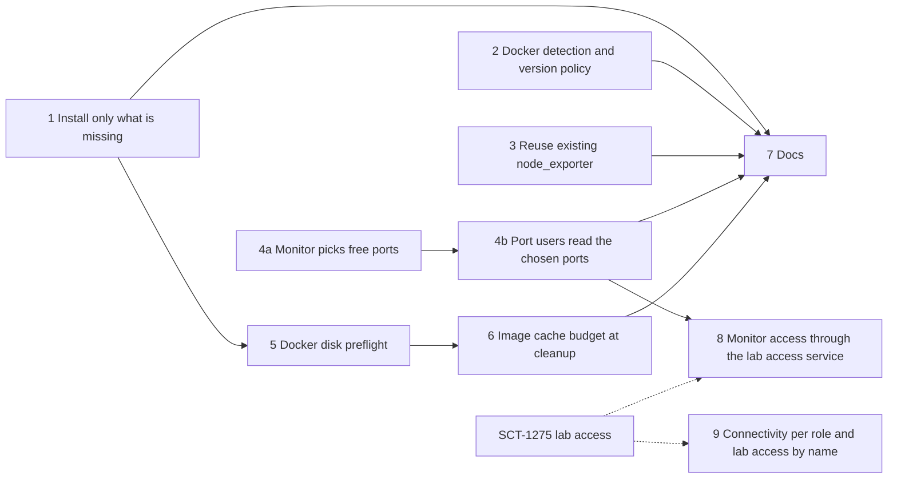

# Baremetal Setup on Shared, Pre-configured Hosts

Overview of the findings, PRs, merge order and test runs: [Baremetal Shared Hosts](https://claude.ai/artifact/14QF6zQCQJRDJfrocfaexs)
(ScyllaDB organization only).

## 1. Problem Statement

The baremetal backend assumes the hosts are fresh machines SCT can configure however it likes.
Lab hosts are not like that: they already run Docker, system services and other Jenkins jobs, and
SCT does not create or destroy them.

SCT-1215 ran the loader and monitor of a longevity test on the lab host `monster` (Fedora 43),
with one DB node in AWS. Every failure came from the monitor and loader setup, not from the test:

- **Docker install conflicts with the host's Docker.** The monitor setup always runs the
  `get.docker.com` script. `monster` runs Fedora's `moby-engine`; the script failed 3 times and
  stopped the run, although Docker already worked.
- **A missing tool stops the run.** `wget` was not installed and the monitoring download needs it.
- **Fixed ports clash with the host's services.** Fedora's Cockpit web console listens on 9090,
  which Prometheus needs. Log collection then reached Cockpit's TLS endpoint instead of Prometheus.
- **node_exporter is installed over an existing one.** Fedora's `prometheus-node-exporter`
  already served 9100. SCT installed its own copy for both the loader and the monitor; both
  failed to bind and stayed behind as failed units.
- **The root disk filled up mid-pull.** Docker keeps images on the 15 GB root filesystem. The
  Grafana pull failed with a write error, Grafana never started, and the test waited 40 minutes on
  dashboard upload before it was aborted.
- **The setup restarts Docker.** On a shared host this kills other jobs' containers. It did not
  happen in SCT-1215 only because the Docker install failed first.
- **Connectivity is all or nothing.** `ip_ssh_connections` is global, so the one DB node in AWS,
  reached over its public address, forced reverse SSH tunnels on the lab hosts next to the runner
  too. The loader and the monitor shared one host, and the second node killed the tunnel the first
  had just opened. SSH to the lab host needed an SCT key added by hand.

The workaround was manual host prep: a `~/PREPARED-MONITOR` marker file, installing `wget`,
disabling Cockpit, removing images by hand. Each new lab host needs the same prep, and nobody
knows the list.

## 2. Current State

**Monitor setup** (`sdcm/cluster.py:BaseMonitorSet`):

- `install_scylla_monitoring_prereqs` either skips everything or installs everything.
  - It skips when `~/PREPARED-MONITOR` exists, or when the node runs the formal monitor image
    (`is_formal_monitor_image`).
  - Otherwise it installs the packages, runs `get.docker.com` with retries (plus a Rocky Linux
    fallback), pip-installs `pyyaml` and `psutil` with `--break-system-packages` when needed, adds
    the user to the `docker` group and always runs `systemctl restart docker`.
- `download_scylla_monitoring` fetches the scylla-monitoring archive with `wget`.
- `start_scylla_monitoring` calls `start-all.sh` without port options, so the stack takes its
  default ports. `start-all.sh` already accepts `-g` (Grafana), `-p` (Prometheus), `-m`
  (Alertmanager), `--loki-port` and `--promtail-port`.
- `__init__` sets `grafana_port = 3000` and `prometheus_port = 9090` as constants.

**Port users outside the monitor set** assume the defaults:

- `sdcm/db_stats.py:PrometheusDBStats` defaults to port 9090. Most callers pass only the host,
  for example `sdcm/utils/latency.py` and the Prometheus snapshot in `sdcm/logcollector.py`.
- `sdcm/prometheus.py:PrometheusAlertManagerListener` defaults to 9093 and is started from
  `sdcm/cluster.py:BaseNode.start_alert_manager_thread`.
- `sdcm/logcollector.py:MonitoringStack` and `GrafanaEntity` hard-code `grafana_port = 3000`.

**node_exporter:**

- `sdcm/node_exporter_setup.py:NodeExporterSetup.install` always downloads node_exporter 1.8.2 and
  writes its own `node_exporter.service`.
- It is called from `BaseLoaderSet.node_setup` and from `install_scylla_monitoring_prereqs`.
- `BaseMonitorSet.configure_scylla_monitoring` and `reconfigure_scylla_monitoring` build the scrape
  targets as `<address>:9100`.

**Baremetal hosts:**

- `sdcm/cluster_baremetal.py:PhysicalMachineNode` and `PhysicalHostCleanup` handle hosts that
  outlive the run.
- `sdcm/utils/resources_cleanup.py:clean_resources_baremetal` cleans up afterwards: it frees SSH
  tunnel ports and undoes the Scylla disk setup.
- Nothing checks or limits Docker's disk use, and nothing removes images a run pulled.

**Related plans:**

- *Lab builders as baremetal test nodes* (PR #16342, pending) reserves lab hosts through Jenkins
  and adds a pre-run host check for SSH key, sudo and Docker. This plan is the other half: making
  SCT's own setup safe on those hosts.
- *Docker Cleanup for All Backends* (`docker-cleanup-all-backends.md`) cleans the runner's
  containers. It does not limit image disk use on test hosts.
- *Baremetal jobs on the local agent* (PR #16445) runs the test on the lab host's Jenkins agent,
  next to the lab hosts. It also carries the SCT-1215 job used for the manual tests below.
- *SCT-1275* reaches lab hosts through the lab access service instead of direct public SSH. It blocks SSH
  port forwarding, so the runner reaches lab ports through nested SSH over its session or
  through TCP resources of that service. That changes how the runner reaches the monitor's ports, which this
  plan makes dynamic (phase 4a). Phase 8 joins the two.

## 3. Goals

1. A Fedora or Ubuntu host that already runs Docker becomes a working loader and monitor with no
   manual prep: no marker file, no extra packages, no disabled services.
2. Setup never restarts or reinstalls a working Docker on a baremetal host, and never stops a
   container it did not start.
3. When a default monitoring port is taken, the stack starts on a free port, and every SCT
   component that talks to it (stats, alert listener, log collection, Argus link) uses that port.
4. An existing node_exporter on a host is scraped instead of replaced.
5. A host with too little Docker disk space fails before any image pull, with a message that says
   how much is free and how much is needed.
6. After a baremetal run, the images SCT left behind stay within a configured disk budget.
7. Cloud backends behave as today: default ports, same install path.
8. Every host check this plan adds runs over the node's SSH session, and the runner reaches the
   monitor's ports through one lookup, so the setup works unchanged when SCT-1275 moves lab hosts
   behind the lab access service.
9. A run can mix hosts next to the runner with hosts it reaches over public addresses: only the
   latter get reverse SSH tunnels, and lab hosts are reached without an SCT key on them.

## 4. Implementation Phases

Phases 1 to 4 are independent of each other. Phase 5 builds on phase 1. Phase 7 comes last.
Phase 8 waits for SCT-1275's connectivity choice and can land after phase 7. Phase 9 is
independent; its lab-access part needs the SCT-1275 lookup.

### Phase 1: Install only what is missing

**Importance**: Critical

**Description**:

- The monitor prerequisites check for each tool and install only the missing ones. The tools are
  `curl`, `unzip`, `python3`, and the `yaml` and `psutil` Python modules that scylla-monitoring's
  scripts import.
- Docker is left alone when it runs and the SSH user can use it. Its installation moves to
  phase 2.
- `systemctl restart docker` runs only when setup installed Docker, so it never runs on a
  baremetal host (phase 2 never installs or upgrades Docker there). Adding the user to the
  `docker` group needs a new SSH session, not a restart.
- The scylla-monitoring download uses curl with retries, like the node_exporter download already
  does, so `wget` is no longer needed.
- `~/PREPARED-MONITOR` is no longer needed. It stays honoured so existing images and hosts behave
  the same; removing it is a follow-up once no image relies on it.

**Definition of Done**:

- [ ] On a host with everything present, setup runs no package manager, pip or Docker commands.
- [ ] On a host missing only `unzip`, setup installs only `unzip`.
- [ ] `wget` is not used anywhere in the monitor setup.
- [ ] Unit tests cover the "all present", "one missing" and "Docker unusable by the user" cases.

**Dependencies**: none.

### Phase 2: Docker detection and version policy

**Importance**: Critical

**Description**:

- SCT reads the running Docker server version and accepts any packaging (`docker-ce`,
  `moby-engine`, distro `docker.io`) at or above a minimum version. The minimum lives in one
  place.
- The Podman `docker` shim is rejected with a clear message.
- What happens when Docker is missing or too old depends on who owns the host:

  | Host | Docker missing | Docker too old |
  |------|----------------|----------------|
  | Cloud VM SCT created | Install a known version | Upgrade to a known version |
  | Baremetal host | Install a known version | Fail setup with the found and needed versions |

- Upgrading Docker on a shared host restarts the daemon under other jobs, so SCT never does it
  there.
- The minimum is Docker 20.10, the oldest release line the supported distros still ship. Neither
  SCT nor scylla-monitoring's `start-all.sh` needs anything newer.

**Definition of Done**:

- [ ] `moby-engine` on Fedora passes the check and is not reinstalled.
- [ ] A too-old Docker on a baremetal host fails setup before any container starts.
- [ ] Unit tests cover each row of the table and the Podman shim.

**Dependencies**: none.

### Phase 3: Reuse an existing node_exporter

**Importance**: Important

**Description**:

- Before installing, setup checks port 9100 for a node_exporter (a `/metrics` response that
  contains `node_exporter_build_info`). If one answers, SCT skips the install and scrapes it.
  - The distro build may have a different service name and collector set. Dashboards read the
    same metric names, so the extra or missing collectors are acceptable.
- If something else holds 9100, SCT installs its node_exporter on a free port. The scrape targets
  for that host then use that port instead of `:9100`.
- If the loader and monitor share a host, the second node finds the first one's node_exporter
  and reuses it.

**Definition of Done**:

- [ ] A host with a distro node_exporter on 9100 gets no SCT node_exporter and is scraped.
- [ ] A host with 9100 taken by another service gets SCT's node_exporter on another port, and
      Prometheus scrapes it there.
- [ ] No failed `node_exporter.service` is left on a host after the run.

**Dependencies**: none.

### Phase 4a: The monitor picks free ports

**Importance**: Critical

**Description**:

- At setup, the monitor set lists the listening ports on the monitor host. For Grafana,
  Prometheus, Alertmanager, Loki and Promtail it keeps the default port when free, and otherwise
  takes the next free one.
- The chosen ports are passed to `start-all.sh` and stored on the monitor node.
- A moved port never lands on another service's default, and the ports stay for restarts, since
  `kill-all.sh` finds the containers by them.
- `start-all.sh` refuses port options together with `-l` (host network), which SCT uses today. So
  once any port moves, the stack runs on its own Docker network instead:
  - containers started on a moved port are named `<name>-<port>` (`aprom-9091`);
  - the Manager scrape target uses the host's address instead of `127.0.0.1`, which on that
    network is the container itself.
- On cloud backends the defaults are always free, so nothing changes there: same `-l` start,
  same ports, same security groups.

**Definition of Done**:

- [ ] With Cockpit on 9090, Prometheus starts on another port and the run logs which one.
- [ ] With all defaults free, `start-all.sh` gets the same arguments as today, `-l` included.
- [ ] With a port moved, Prometheus still scrapes the Manager on the monitor host.

**Dependencies**: none.

### Phase 4b: Port users read the chosen ports

**Importance**: Critical

**Description**:

- Every component that talks to the monitoring stack during the run takes its port from the
  monitor node instead of a default or constant:
  - Prometheus stats;
  - the Alertmanager listener;
  - Grafana annotations and dashboard upload;
  - the Grafana link sent to Argus.
- Log collection runs in its own process after the test and has no monitor node to ask. It reads
  the ports from the container names on the monitor host (`aprom-9091` means 9091, a plain `aprom`
  the default). That covers the Prometheus snapshot and its container stop and start, Grafana
  annotations and screenshots, and the containers' logs.
- They get the address from one place on the monitor node (host and port together), not by
  joining the node's IP with a port. Phase 8 changes only that place when the runner has to go
  through the lab access service.
- Defaults stay in the constructors only for callers outside a test run.

**Definition of Done**:

- [ ] A run whose monitor uses non-default ports collects the Prometheus snapshot, Grafana
      annotations and alerts.
- [ ] No literal 3000, 9090 or 9093 remains in run-time code paths that reach the monitor.

**Dependencies**: Phase 4a.

### Phase 5: Docker disk preflight

**Importance**: Important

**Description**:

- Before the first image pull on a host, setup finds where Docker actually stores images. With the
  containerd image store this is `/var/lib/containerd`, not `DockerRootDir`.
- If free space there is below a configured minimum, setup removes images no container uses and
  checks again.
- If space is still short, setup fails with the free and needed sizes and the path.
- One minimum per role, as config options with defaults in `defaults/test_default.yaml`:
  - monitor hosts: 10 GB. The monitoring stack images measured on `monster` take about 5 GB, and
    unpacked about twice that;
  - loader hosts: 3 GB. The stress tool images take about 1.5 GB. Loaders on AWS and OCI have a
    20 GB root disk, so the monitor's minimum would fail healthy loaders.
- The check runs on loader and monitor hosts on all backends. On cloud VMs it is cheap and should
  never fire.

**Definition of Done**:

- [ ] A host with less free space than the minimum fails before any pull, with a message naming
      the path and both sizes.
- [ ] Removing unused images never removes an image a running container uses.

**Dependencies**: Phase 1.

### Phase 6: Image cache budget at cleanup

**Importance**: Important

**Description**:

- `clean_resources_baremetal` gets one more step for loader and monitor hosts: limit the images
  no container uses to a configured total size.
  - It removes the least recently pulled images first until the total fits. Docker keeps no
    last-used time; the last pull or tag is the closest it has.
  - Images in use by any container, including other jobs' containers, are never removed.
- Docker has no size limit for images, so SCT applies the limit itself.
- New config option for the budget, 20 GB by default for the baremetal backend: a monitoring
  stack and the stress tool images, with room to spare. 0 keeps every image.
- Pre-pulling images is not part of this plan. The cache keeps recently used images warm.

**Definition of Done**:

- [ ] After cleanup, the total size of unused images on each host is at or under the budget.
- [ ] Cleanup logs each removed image with its size.
- [ ] Dry-run cleanup still connects to no host, and logs the budget it would apply.

**Dependencies**: Phase 5, which provides the same storage-location detection.

### Phase 7: Baremetal host documentation

**Importance**: Important

**Description**:

- A new doc page for baremetal hosts. It covers:
  - what a host must provide (SSH key, sudo, Docker at or above the minimum version, free disk);
  - what SCT installs or changes on it, and what cleanup undoes;
  - how ports and node_exporter are chosen.
- Regenerate `docs/configuration_options.md` for the new options.

**Definition of Done**:

- [ ] The page lists every host change SCT makes, matching phases 1 to 6.
- [ ] `docs/configuration_options.md` includes the new options.

**Dependencies**: Phases 1, 2, 3, 4b and 6.

### Phase 8: Monitor access through the lab access service

**Importance**: Important

**Description**:

- When a lab host is reached through the lab access service (SCT-1275), the runner cannot open the monitor's ports
  directly. The monitor address lookup from phase 4b then returns a local address on the runner
  that leads to the chosen port on the monitor host.
- How that local address is made depends on SCT-1275's outcome:
  - nested SSH: a `-L` forward per monitoring port over the node's SSH session, made after
    phase 4a picked the ports;
  - TCP resources of the access service: one resource per monitoring port. Resource ports are fixed when the resource
    is created, so the monitor has to use the ports the resources point at instead of picking free
    ones.
- Loader and monitor traffic to the DB nodes and Prometheus scraping stay on the lab network and
  do not go through the lab access service.
- **Needs Investigation:** which of the two SCT-1275 settles on; with TCP resources of the access service, how the
  run learns the resource ports and what happens when one of them is taken on the host.

**Definition of Done**:

- [ ] The SCT-1215 job, run from an AWS runner with the lab hosts behind the lab access service only, collects the
      Prometheus snapshot and Grafana screenshots.
- [ ] A run that does not use the access service gets the same addresses as after phase 4b.

**Dependencies**: Phase 4b and SCT-1275.

### Phase 9: Connectivity per role, and lab hosts by name

**Importance**: Important

**Description**:

- Each role in the baremetal hosts config (`db_nodes`, `loader_nodes`, `monitor_nodes`) can set
  its own `ip_ssh_connections`, falling back to the run's. A node's SSH address, reverse tunnels,
  log destination and LDAP address follow its own value, so lab hosts next to the runner are
  `private` (no tunnels, logs straight to the runner) while a cloud DB node stays `public`.
- Hosts shared by several nodes free stale reverse-tunnel ports once per run, so the second node
  does not kill the tunnel the first one just opened.
- A node can name its host in the lab access service (`access`). SCT then opens SSH where the
  internal lab access module says, and the host needs no SCT key. `public_ip` becomes optional for
  lab hosts, defaulting to `private_ip`.
- **Needs Investigation:** the lab access service lets clients in with SSH's `none` method only,
  so the lookup has to return no key for those hosts (as the xcloud lookup already does). Confirm
  that with the owners of SCT's SSH client.

**Definition of Done**:

- [ ] A run with a `public` DB node and `private` lab hosts opens tunnels for the DB node only.
- [ ] A loader and a monitor sharing a host both ship logs for the whole run.
- [ ] A lab host with `access` set is reached through the lab access service, with no SCT key on it.

**Dependencies**: none; the `access` part needs the SCT-1275 lookup.

## 5. Testing Requirements

**Unit tests** (`unit_tests/unit/`), per phase:

- Phase 1: the prerequisite check with fake remoter output, for "all present", "partly missing"
  and "Docker present but unusable".
- Phase 2: version parsing for `docker-ce`, `moby-engine` and the Podman shim, and the policy
  table above.
- Phase 3: node_exporter detection for distro exporter, other service and free port.
- Phase 4a: port picking from a fake listening-port list (all free, one taken, all defaults taken).
- Phase 4b: each port user reads the node's ports.
- Phase 8: the monitor address lookup with and without the access service, using a fake forward.
- Phase 9: per-role settings over the run's, tunnels only for `public` nodes, tunnel ports freed
  once per shared host, and the SSH address taken from the lab access lookup.
- Phases 5 and 6: free-space parsing, storage-location detection, and the budget selection order
  (least recently pulled first, in-use images kept).

**Integration tests:**

- Phases 1 and 2 on the Docker backend with a container that already has Docker and the tools,
  checking that no install command runs. **Needs Investigation:** whether the existing Docker
  backend tests can host this.

**Manual tests:**

- Repeat the SCT-1215 staging job on `monster` after removing the manual prep:
  - delete `~/PREPARED-MONITOR`;
  - turn Cockpit back on;
  - leave the distro node_exporter running.

  The run must reach the stress commands and finish with logs collected.
- A provision test on AWS (`provision-aws` label) to confirm cloud behaviour is unchanged.
- Phase 8: the same `monster` job from an AWS runner once SCT-1275 lands.

## 6. Success Criteria

- All phase DoD items are met.
- The SCT-1215 job passes on `monster` with no manual host prep. Prep means anything SCT should do
  itself; the host still has to meet the requirements phase 7 documents (SSH access, sudo,
  Docker 20.10 or newer, free disk for Docker's images).
- The hosts list no failed SCT units, and after cleanup no image beyond the budget.

## 7. Risk Mitigation

| Risk | Likelihood | Impact | Mitigation |
|------|------------|--------|------------|
| Skipping the Docker restart leaves a cloud VM where the user's new `docker` group is not active | Medium | Setup fails on first `docker` call | The SSH session is already reconnected after the group change; keep the restart on cloud VMs whenever setup installed Docker |
| A port user is missed in phase 4b and still uses the default | Medium | Stats or log collection silently reach the wrong service | Phase 4b DoD forbids literal ports in run-time paths; the manual `monster` run keeps Cockpit on 9090 to catch it |
| The distro node_exporter lacks a collector a dashboard panel uses | Low | Empty panel | Acceptable on lab hosts; list the known gaps in the phase 7 doc |
| Image removal races another job that is about to start a container from that image | Low | The other job re-pulls the image | Only unused images are removed, and pulls are idempotent |
| The minimum Docker version is set too high and rejects working lab hosts | Medium | Runs fail on hosts that would work | Phase 2 sizes it from real needs; the failure message names both versions so the host owner can act |
| TCP resources of the access service have fixed ports, while phase 4a picks ports per run | Medium | The runner reaches a port the stack is not on | Phase 8 makes the monitor use the resource ports when TCP resources of the access service are used; nested SSH forwards follow the chosen ports with no change |
| Free-space minimum is too low for a run with many stress tool images | Medium | Pull fails mid-run as before | The minimums come from measured image sizes; revisit when stress tools are added |
| A tool outside SCT expects the default container names (`aprom`) | Low | It misses a stack that moved ports | Only hosts with a taken default get renamed containers; phase 7 documents the naming |

**Rollback:** each phase is its own PR and can be reverted alone. Phases 5 and 6 add config
options whose defaults can be set to disable them (minimum 0, no budget) without a code change.
