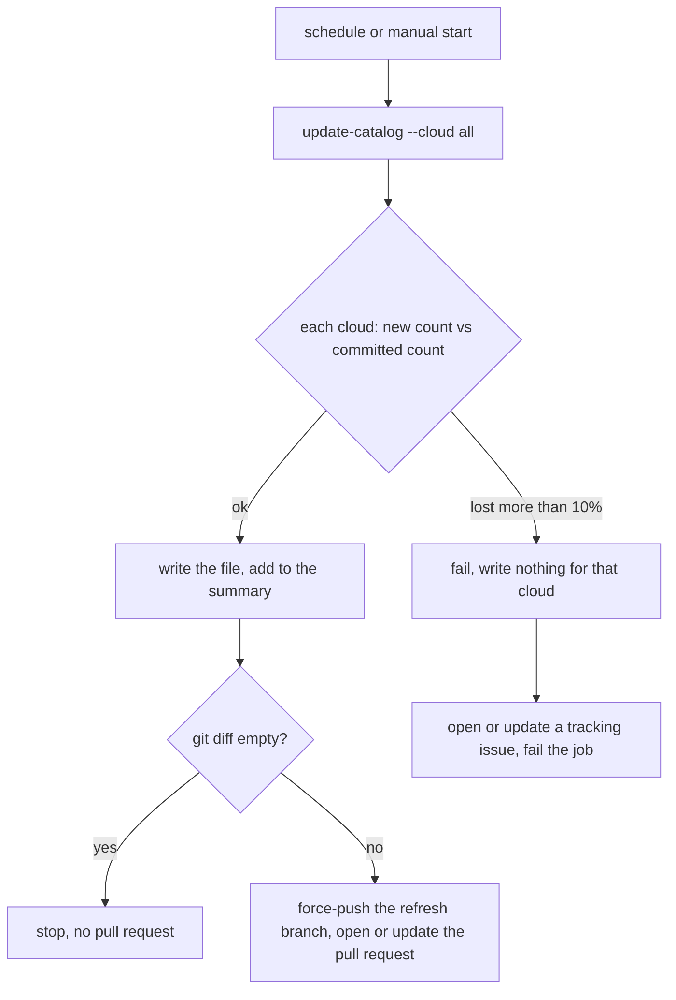

# Automate the instance catalog refresh

**Jira:** SCT-852

**Status:** draft

## Overview

A scheduled GitHub Actions workflow runs `sct sizing update-catalog` for all
clouds every two months, and on a manual start. The refresh compares each
new catalog with the committed one. It refuses a cloud that lost too many
instance types, and it prints a change summary. When the files changed, the
workflow pushes one fixed branch and opens or updates one pull request with
the summary as its body. A person reviews and merges it.

## Constraints

- One AWS credential unlocks all four catalogs. Azure and OCI read public
  pricing APIs. GCE reads its service account from the keystore, which AWS
  unlocks. AWS reads the pricing and EC2 APIs.
- The workflow runs only on `scylladb/scylla-cluster-tests`, not on forks.
- A re-run with no upstream price change gives no diff. The generator writes
  the instance types in a stable order, with stable rounding.
- A manual run of `update-catalog` without the new options writes as it does
  today, except for the shrink guard and the exit code.

## Design



- **Shrink guard.** Before it writes a cloud, the refresh counts the
  instance types in the committed file on disk. It does not use a fixed
  number. When the new list has more than 10% fewer types, the refresh fails
  for that cloud and writes nothing. `--allow-shrink` lets a real removal
  through.
- **Change summary.** The refresh compares the new list with the file on
  disk before the write. The summary is Markdown: per cloud, the counts of
  added, removed, and changed types, the ten largest price changes, and the
  names of the removed types. The workflow uses it as the pull request body.
- **One open refresh pull request.** The workflow always pushes the same
  branch from the current master and force-updates it. An unmerged refresh
  pull request gets the new prices. It does not get a second pull request,
  and it does not collect rebase conflicts.
- **Failure.** A failed refresh fails the job. A failed scheduled run also
  opens or updates one tracking issue, as the keystore expiry check does. A
  later successful run closes the issue.

| Condition | Behavior |
|---|---|
| A pricing API is down or rate-limited, and the generator returns a partial list | The shrink guard fails the cloud; the job fails; the tracking issue opens |
| A generator returns nothing | The cloud is skipped, as today; the job fails |
| No price moved | No diff, no pull request |
| A refresh pull request is open | The next run force-updates its branch and its body |

## Contracts

### Inputs

```
sct sizing update-catalog --cloud {aws,gce,azure,oci,all}
    [--dry-run]       # compute and print the summary, write nothing
    [--allow-shrink]  # let a cloud lose more than 10% of its types
    [--summary-file PATH]  # also write the Markdown summary to PATH
```

Workflow secrets: the existing `QA_USER_AWS_ACCESS_KEY_ID` and
`QA_USER_AWS_SECRET_ACCESS_KEY`, which the keystore expiry check already
uses. The workflow token needs `contents: write`, `pull-requests: write`,
and `issues: write`.

### Outputs

- The catalog files in `data/instance_catalog/`, in today's format.
- The Markdown change summary, on stdout and in the summary file.
- Exit code 1 when a cloud fails the shrink guard or returns nothing.

## Risks

| Risk | Response |
|---|---|
| A real family retirement trips the shrink guard | A person runs the refresh with `--allow-shrink`; the pull request lists the removed types |
| Reviewers approve a price diff without reading it | The summary puts the largest moves first |
| The refresh pull request fails CI for an unrelated reason | It changes only data files; a reviewer can merge it once master is green |
| The AWS key leaks through the workflow | The workflow runs only on schedule and manual start, never on pull requests from forks |

## Decisions

- The workflow runs on GitHub Actions. The keystore expiry check already
  holds the same AWS credential there, and the other repo bots open pull
  requests there. (spec)
- The shrink threshold is 10% of the instance types of a cloud, against the
  committed file. (spec)
- The baseline comes from the committed file at run time, never from a
  number in the code or in a document. (review)
- A person merges each refresh. A price diff is a change that somebody
  must look at. (spec)
- The workflow keeps the static AWS key or moves to OIDC. (open)
