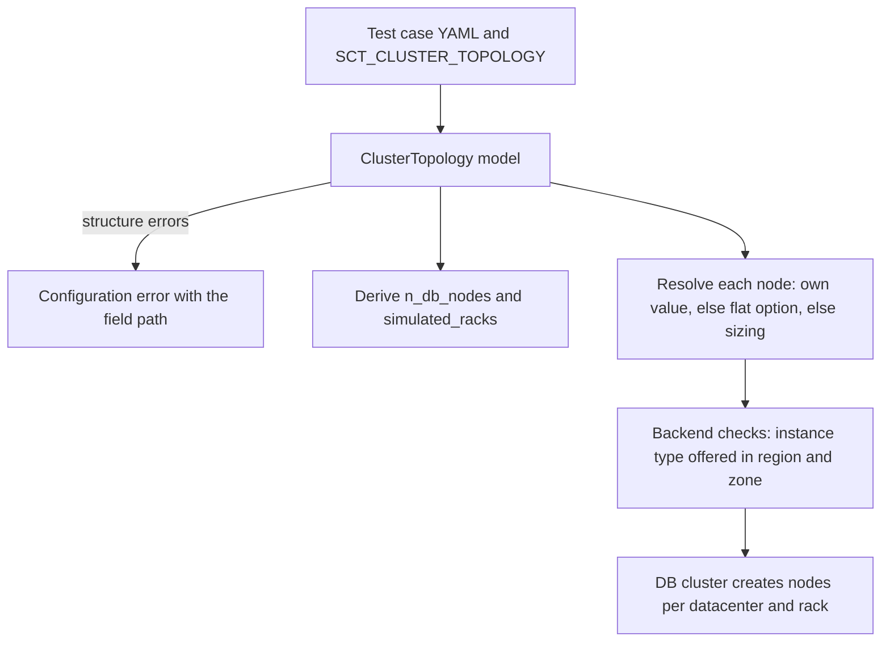

# Per-datacenter, per-rack, and per-node DB cluster layout

**Jira:** SCT-528

**Status:** draft

## Overview

A new option, `cluster_topology`, describes the DB cluster as a list of
datacenters, each with a list of racks, each with a list of nodes. A Pydantic
model validates it at configuration load. Each node can set its instance type
or its sizing constraints, its disks, and its image. A value that a node does
not set comes from the flat option, such as `instance_type_db`. When the
option is set, the configuration derives `n_db_nodes` and `simulated_racks`
from it, and the cluster creates each node with its own values. When the
option is not set, nothing changes.

## Constraints

- The flat options keep their meaning. A Jenkins override of a flat option,
  such as `SCT_INSTANCE_TYPE_DB`, applies to each node that does not set the
  value itself.
- The option uses the same model pattern as `test_metadata`: a Pydantic
  model behind `dict_or_str_or_pydantic`, so YAML, a JSON string in an
  environment variable, and the dot-notation overrides all work.
- The availability-zone pre-filter and the capacity probe check every
  instance type in the layout, not only the flat one.

## Design



The cluster creates the nodes of one rack in one call when they share their
values, and one node at a time when they differ. The node-creation path
already takes an instance type and an image for each call. The disk options
join them.

A rack with an `az` places its nodes in that zone. A rack without an `az`
uses the zones of the flat `availability_zone` option in order, as today.
With more racks than zones, SCT simulates the racks with
GossipingPropertyFileSnitch, as `simulated_racks` does today.

| Condition | Behavior |
|---|---|
| `cluster_topology` and an explicit `n_db_nodes` or `simulated_racks` that differ from the layout | Configuration error |
| A node sets both `instance_type` and `sizing` | Configuration error |
| A rack or a datacenter has no nodes | Configuration error |
| The number of datacenters differs from the number of regions | Configuration error |
| An instance type is not offered in the region or the zone of its rack | Configuration error, or the AZ fallback when it is enabled |
| The backend does not support the option (K8S, xcloud, Docker) | Configuration error that names the backend |

## Contracts

### Configuration

```python
class NodeLayout(BaseModel):
    instance_type: str | None = None      # falls back to instance_type_db (or the backend form)
    sizing: dict | None = None            # same keys as sizing_db; falls back to sizing_db
    image: str | None = None              # falls back to ami_id_db_scylla / gce_image_db / ...
    root_disk_size: int | None = None     # falls back to root_disk_size_db
    data_volume_disk_size: int | None = None
    data_volume_disk_type: str | None = None
    data_volume_disk_iops: int | None = None
    data_volume_disk_throughput: int | None = None
    data_volume_disk_num: int | None = None
    n_local_ssd: int | None = None        # GCE; falls back to gce_n_local_ssd_disk_db


class RackLayout(BaseModel):
    az: str | None = None
    nodes: list[NodeLayout] = Field(min_length=1)


class DatacenterLayout(BaseModel):
    region: str | None = None             # falls back to the region list, in order
    racks: list[RackLayout | list[str]] = Field(min_length=1)  # a list of str is a rack of instance types


class ClusterTopology(BaseModel):
    datacenters: list[DatacenterLayout] = Field(min_length=1)
```

```python
cluster_topology: Annotated[ClusterTopology | None, BeforeValidator(dict_or_str_or_pydantic)] = SctField(
    description="Layout of the DB cluster: datacenters, racks, and nodes. "
    "Values a node does not set come from the flat options.",
)
```

No default: the option is `None` unless a test case sets it.

A short form and a full form, in a test case:

```yaml
cluster_topology:
  datacenters:
    - racks:
        - [i4i.large, i4i.2xlarge]
        - [i4i.large, i4i.2xlarge]
        - [i4i.large, i4i.2xlarge]
```

```yaml
cluster_topology:
  datacenters:
    - region: us-east-1
      racks:
        - az: a
          nodes:
            - sizing: {vcpu: 2, memory: '>=16'}
            - sizing: {vcpu: 8, memory: '>=64'}
              data_volume_disk_size: 1000
        - az: b
          nodes:
            - instance_type: i4i.xlarge
              image: ami-0123456789abcdef0
```

Each field of `NodeLayout` names the flat option that it falls back to. The
generated configuration docs list these pairs.

### Outputs

Each DB node keeps its own instance type in the cluster report and in the
Argus resource and cost reports. These reports read the type from the node,
not from `instance_type_db`.

## Risks

| Risk | Response |
|---|---|
| Code reads `instance_type_db` or `sizing_db` to learn the type of a DB node, and gets a wrong answer in a mixed cluster | Find these readers in the first pull request. Change them to read the node, or document that they read the default |
| Nemesis that add nodes (grow and shrink, replace, add DC) take the flat type, and a mixed cluster grows with a type that it did not have | Keep the flat type for now. See the open decision |
| A large layout makes a long test case | The short form keeps a rack on one line |
| Overriding a full layout from Jenkins is hard | The flat options still override every node without its own value. A full layout comes from a YAML file in `SCT_CONFIG_FILES` |

## Deferred work

- Loader and monitor layouts.
- The K8S backends, where a rack maps to a node pool.
- Moving the model into a nested section when
  `docs/plans/config/sct-config-nested-sections.md` lands.

## Decisions

- One option holds the whole DB layout, with a Pydantic model for its
  validation. The model does not wait for the nested sections. (review)
- A node can give sizing constraints instead of an instance type, so that one
  layout runs on more than one backend. (spec)
- A value that a node does not set falls back to the flat option, so the
  flat options and their Jenkins overrides keep working. (spec)
- An explicit `n_db_nodes` or `simulated_racks` that differs from the layout
  is an error, not a warning. (spec)
- The flat options stay supported. Nothing deprecates them. (spec)
- A node added by a nemesis takes the type of its target node's rack, or the
  flat type. (open)
