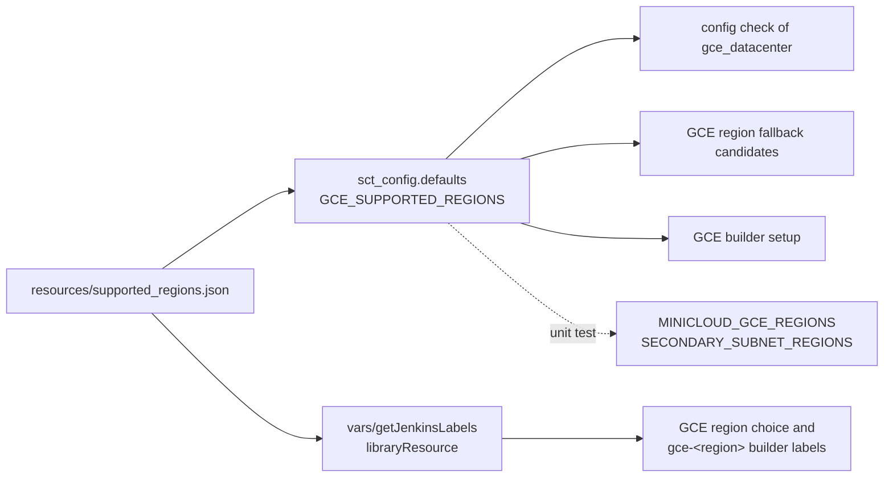

# One registry for the supported GCE regions

**Status:** draft

## Overview

A JSON file in the `resources/` directory of the repository lists the
supported GCE regions. Python loads it once into `GCE_SUPPORTED_REGIONS`, next
to `AWS_SUPPORTED_REGIONS`. The Jenkins shared library reads the same file
with `libraryResource`, and builds the GCE region choices and the GCE builder
labels from it. The configuration check rejects a `gce_datacenter` region
that is not in the file. The other copies of the list go away.

## Constraints

- `getJenkinsLabels` runs on the Jenkins controller before an agent exists.
  It cannot read a file from a workspace. `libraryResource` reads from the
  shared library checkout, which the controller has.
- The pipelines load the library from the branch under test
  (`library identifier: 'sct@snapshot', retriever: legacySCM(scm)`). Each
  branch reads its own registry.
- The order of `MINICLOUD_GCE_REGIONS` and of
  `GceRegion.SECONDARY_SUBNET_REGIONS` sets subnet CIDRs. The registry does
  not drive those orders.
- CI does not compile the Groovy files of `vars/`. A Groovy error shows only
  in a real pipeline run.

## Design



- **Registry file.** It holds one key per backend. This change fills only
  `gce`. The file is JSON because Python reads it with the standard library
  and `getJenkinsLabels` already parses JSON with `JsonSlurperClassic`.
- **Python.** `sdcm/sct_config/defaults.py` loads the file once at import and
  exposes `GCE_SUPPORTED_REGIONS`. The region fallback and the GCE builder
  setup read it. `SUPPORTED_REGIONS` in `gce_utils` and
  `SUPPORTED_GCE_REGIONS` in the GCE provision constants go away.
- **Configuration check.** For the `gce` backend, SCT strips the zone suffix
  from each `gce_datacenter` entry and checks the region against
  `GCE_SUPPORTED_REGIONS`, as it does for AWS regions. The description of
  `gce_datacenter` points to the registry instead of a list of names.
- **Jenkins.** `getJenkinsLabels` builds the `gce` entry of
  `supported_regions_by_provider` and the `gce-<region>` builder labels from
  the registry. The builder label keeps its current pattern,
  `<gcp_project>-builders-<region>-template-v9`. The plain `gce` label keeps
  the `us-east1` builder.
- **Minicloud and secondary subnets.** Both keep their own ordered tuples. A
  unit test checks that each registry region is in both tuples. A new region
  is appended to each tuple, so no existing CIDR moves.

Failure behavior:

| Condition | Behavior |
|---|---|
| `gce_datacenter` holds a region that is not in the registry | The configuration check fails and lists the supported regions |
| The registry file is missing or is not valid JSON | SCT fails at import; the pipeline fails in `getJenkinsLabels` |
| A registry region has no minicloud or secondary subnet index | The unit test fails |
| A pipeline asks for `random` GCE region | `getJenkinsLabels` picks from the registry, as before |

## Contracts

### Inputs

```json
{
  "gce": ["us-east1", "us-east4", "us-west1", "us-central1"]
}
```

The order of the `gce` list is the default order of the region fallback
candidates. The Capacity Advisor ranking reorders them when it is enabled.

### Configuration

No new parameter. `gce_datacenter` gets a validation and a new description.

```python
gce_datacenter: StringOrList = SctField(
    description="GCE region(s), one of the regions in resources/supported_regions.json. "
    "Specifying just the region (e.g., us-east1) means the zone will be selected automatically, "
    "or you can mention the zone explicitly (e.g., us-east1-b)",
    appendable=False,
)
```

### Outputs

The error of the configuration check:

```
europe-west9 isn't a supported GCE region, use one of: ['us-east1', 'us-east4', 'us-west1', 'us-central1']
```

### Module API

```python
# sdcm/sct_config/defaults.py
GCE_SUPPORTED_REGIONS: list[str]
```

```groovy
// vars/getJenkinsLabels.groovy
def gce_regions = new JsonSlurperClassic().parseText(libraryResource('supported_regions.json'))['gce']
```

## Risks

| Risk | Response |
|---|---|
| A Groovy error in `getJenkinsLabels` breaks every pipeline, and CI does not compile Groovy | Run one GCE pipeline and one AWS pipeline from the branch before merge |
| `libraryResource` cannot see the file in an old release branch that has no `resources/` directory | Each branch reads its own library checkout; the backport carries the file with the change |
| A user config with a GCE region outside the list now fails | Every `gce_datacenter` in `test-cases/`, `configurations/`, and `jenkins-pipelines/` is in the list today |

## Deferred work

The AWS, Azure, and OCI region lists can move into the same file, one key per
backend. The file shape leaves room for them. This change does not move them.

## Decisions

- The registry is a file in `resources/`, because the Jenkins controller must
  read it without an agent. (spec)
- Minicloud and the secondary subnets keep their own ordered tuples, checked
  by a unit test, because their order is part of the network layout. (spec)
- The change covers only the region list. The zone and region fallback of PR
  #14543 is in master. (spec)
