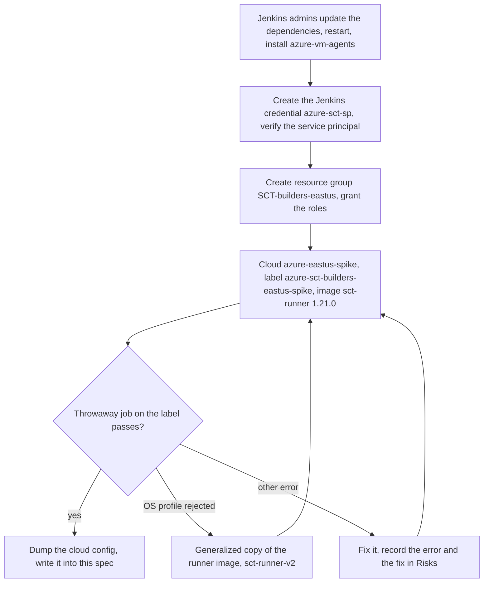
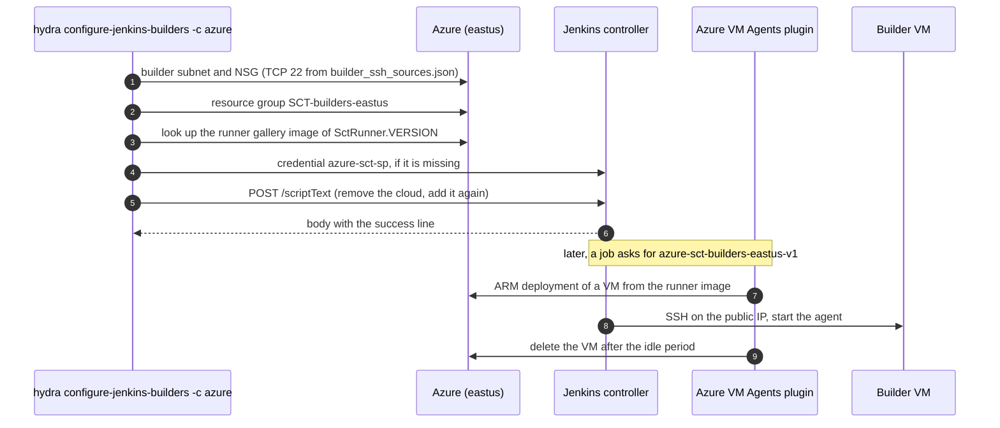

# Jenkins builders on Azure

**Jira:** SCT-1592

**Status:** draft

## Overview

`hydra configure-jenkins-builders -c azure` sets up the Azure VM Agents
plugin in Jenkins, the same way the OCI builder sets up the OCI Compute plugin.
It writes a Jenkins credential for the SCT service principal and opens a
builder NSG to the allowed SSH sources only. It then posts a Groovy script
that adds one Azure cloud for each region. The plugin starts a builder VM from
the SCT runner gallery image when a job asks for the label
`azure-sct-builders-<region>-<version>`. Jenkins connects to it over SSH on
its public IP. The plugin deletes the VM after an idle period.

The design starts with a manual stage. First we configure the plugin by hand
on a test label and run one job on it. Only then do we write code. The
values that work by hand become the values in the Groovy template.

## Constraints

- The builder boots from the SCT runner image. There is no separate builder
  image.
- The plugin sends an OS profile (an admin user and an SSH key) for each VM.
  Azure rejects an OS profile for a specialized image. The SCT runner image is
  specialized today.
- The plugin deletes resources that it thinks it owns. It must not share a
  resource group with the image gallery.
- Network access follows `docs/jenkins-builders.md`. From the internet, only
  TCP 22, and only from `builder_ssh_sources.json`.
- `configure-jenkins-builders` and `prepare-regions` are idempotent on every
  cloud. The Azure path is idempotent too.
- The Jenkins script console answers 200 when the script fails. A success line
  in the response body is the only sign that the script worked.

## Design

### Stage 1: configure the plugin by hand



The exit criterion: one job finishes on an Azure VM that the plugin started
from the runner image, and the plugin deletes the VM after the idle period.

### Stage 2: the code



Azure resources:

| Resource | Name | Owner |
|---|---|---|
| Resource group of the builder VMs | `SCT-builders-<region>`, tag `keep=alive` | `configure-jenkins-builders`. The plugin creates and deletes the VMs in it |
| VNet | `SCT_IMAGES-<region>-vnet`, from `prepare-regions` | `prepare-regions` |
| Builder subnet | `builders` in that VNet | `prepare-regions` |
| Builder NSG | `SCT-builder-nsg`, on the builder subnet | `prepare-regions` and `configure-jenkins-builders` |
| Image | gallery `SCT_IMAGES`, the runner image of `SctRunner.VERSION` | `create-runner-image` |

The builder does not use `SCT_IMAGES-<region>-nsg`, because that NSG allows
SSH from `*`.

Failure behavior:

| Condition | Behavior |
|---|---|
| The runner image is not in the region | Fail that region with a message to run `create-runner-image -c azure` |
| `builder_ssh_sources.json` is missing or not valid | Stop before any change, as on the other clouds |
| The response body has no success line | Fail that region and log the body |
| One region fails | Try the other regions, then fail with the list of failed regions |

## Contracts

### Inputs

```
KeyStore().get_json("jenkins.json")        # url, username, password
KeyStore().get_azure_credentials()         # subscription_id, tenant_id, client_id, client_secret
get_builder_ssh_sources()                  # {role: [CIDR]}, the jenkins role is mandatory
AzureSctRunner image                       # gallery SCT_IMAGES, image of SctRunner.VERSION
```

### Outputs

The Jenkins label, in `vars/getJenkinsLabels.groovy`:

```groovy
'azure-eastus': 'azure-sct-builders-eastus-v1',
```

The Jenkins cloud, one for each region:

```
cloud name:      azure-<region>-qa-builder-<version>
credential id:   azure-sct-sp
template label:  azure-sct-builders-<region>-<version>
image:           gallery SCT_IMAGES, the runner image, version <SctRunner.VERSION>.0
network:         existing VNet SCT_IMAGES-<region>-vnet, subnet builders, public IP
launch:          SSH, user ubuntu, key credential user-jenkins_scylla_test_id_ed25519.pem
retention:       idle, 6 minutes
```

The Groovy script ends with this line on success:

```
Azure cloud configured programmatically
```

### Module API

```python
class AzureBuilder:
    VERSION: str = "v1"

    def __init__(self, region: AzureRegion): ...

    @cached_property
    def name(self) -> str: ...            # azure-<region>-qa-builder-<VERSION>

    @cached_property
    def jenkins_labels(self) -> str: ...  # azure-sct-builders-<region>-<VERSION>

    def configure(self) -> None: ...

    @classmethod
    def configure_in_all_region(cls, regions: list[str] | None = None) -> None: ...


class AzureRegion:
    def ensure_builder_nsg(self, sources: dict[str, list[str]]) -> None: ...
```

## Risks

| Risk | Response |
|---|---|
| Azure rejects the OS profile on the specialized runner image | Stage 1 checks it first. If Azure rejects it, the runner image becomes generalized (see Decisions) |
| The service principal cannot create role assignments | The Azure admins grant the roles once, by hand. The code does not grant roles |
| The plugin update needs a Jenkins restart, so all builders stop for a short time | The Jenkins admins do a safe restart, which waits for the running builds |
| The Azure cloud cleanup deletes every resource group without `keep=alive` that is older than 4 hours, with its VMs | The builder resource group carries `keep=alive`. The plugin deletes the builder VMs |
| The vCPU quota of the VM family in `eastus` is too low | Stage 1 checks the quota before the first VM |
| The runner image has no Java, and the plugin installs it at boot | Stage 1 checks for Java on the image. The template turns off the Java install when Java is there |

## Deferred work

- Azure regions other than `eastus`. `configure_in_all_region` already loops
  over the regions, so a new region needs only `prepare-regions` and a label.

## Decisions

- Azure gets its own builders through the Azure VM Agents plugin. (spec)
- The builder boots from the SCT runner image, as on GCE and OCI. (spec)
- The plugin is configured and proven by hand before any code. The previous
  attempt failed during the plugin setup. (spec)
- The builder VMs go into their own resource group, apart from the gallery,
  because the plugin deletes the resources it owns. (spec)
- When Azure rejects the OS profile on the specialized image, the runner image
  becomes generalized for all runners, in a new gallery image definition. Runner
  VMs then get an OS profile with the `ubuntu` user and the SCT key. This is
  a separate pull request and a new `SctRunner.VERSION`. (open)
- Artifact jobs that run on the builder need their test nodes to reach the
  builder. Azure test nodes are in a VNet for each test, not in the builder
  VNet. Do they reach the builder over its public IP, or through VNet
  peering? (open)
