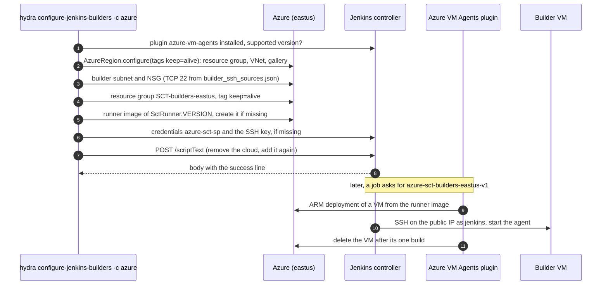

# Jenkins builders on Azure

**Jira:** SCT-1592

**Status:** draft

## Overview

`hydra configure-jenkins-builders -c azure` creates the Azure builders from
scratch. It starts from a region with no SCT resources and a Jenkins with no
Azure credential and no Azure cloud. It creates every Azure resource and every
Jenkins object that the builders need. Nothing is created or configured by
hand. A second run changes nothing.

The command uses the Azure VM Agents plugin, the same way the OCI builder uses
the OCI Compute plugin. The plugin starts a builder VM from the SCT runner
gallery image when a job asks for the label
`azure-sct-builders-<region>-<version>`. Jenkins connects to the VM over SSH on
its public IP. Each VM runs one build, then the plugin deletes it, as on the
other clouds (`docs/jenkins-builders.md`, "How builders behave").

Stage 1 configured the plugin by hand on a spike cloud, and a builder VM came
online from the runner image. The values that worked there are the values of
the code. The code does not reuse anything that Stage 1 created.

## Constraints

- **From scratch.** The only inputs are the secrets in the SCT keystore and the
  Jenkins admin token in `jenkins.json`. The code does not depend on any
  resource or Jenkins object that someone created by hand, or that another
  command must create first.
- The Jenkins admins install the plugin. The code checks that
  `azure-vm-agents` is installed at a supported version, and stops with a
  message when it is not.
- The design targets `azure-vm-agents` 1124.v89b_2f7a_76f35 (it needs
  `credentials` 1514 or newer). The Groovy builder API changes between plugin
  versions, so a plugin upgrade needs the template checked again.
- The builder boots from the SCT runner image. There is no separate builder
  image. The runner image is specialized. The template turns on the plugin's
  specialized-image option, which leaves the OS profile out of the deployment.
- The plugin deletes resources that it thinks it owns. Its resource group holds
  only builder VMs, apart from the image gallery and the network.
- Network access follows `docs/jenkins-builders.md`. From the internet, only
  TCP 22, and only from `builder_ssh_sources.json`.
- The Jenkins script console answers 200 when the script fails. A success line
  in the response body is the only sign that the script worked.

## Stage 1 results

On 2026-11-22 a builder VM came up from the runner image, by hand:

| Time | Event |
|---|---|
| 11:18:37 | The plugin deploys `sct-runner` 1.21.0 from the gallery, specialized option on |
| 11:18:56 | VM running, `Standard_D2_v4` |
| 11:19:13 | SSH session as `jenkins` with `user-jenkins_scylla_test_id_ed25519.pem` |
| 11:19:49 | Agent online |

On the VM: user `jenkins` in group `docker`, OpenJDK 21 from the image, kernel
`7.0.0-1020-azure`, Docker 29.10, 2 vCPUs, 7 GiB, 77 GB disk.

Findings:

- The plugin boots the specialized runner image. The runner image stays
  specialized, and needs no OS profile.
- The admin credential can be any username credential. The SSH key credential
  of the other builders works.
- The launch user is `jenkins`. The runner image copies the keys of `ubuntu`
  to `jenkins` at boot.
- The SCT service principal (subscription Contributor) creates the VM, the
  NIC, and the public IP. It needs no extra role.
- Java is in the image. The plugin installs nothing at boot.
- The hostname is `sct-runner-1-21`, from the image. Jenkins names the node by
  the VM name, so this is cosmetic.
- `hydra` is not on the `PATH`. Jobs run `docker/env/hydra.sh` from their
  checkout, as on the other builders.
- The plugin's verification task runs once an hour. A new cloud shows
  "unverified" until then. Provisioning works anyway.
- Groovy API of 1124: `AdvancedImageBuilder.withGalleryImage(gallery,
  definition, version, specialized, subscriptionId, resourceGroup)`. One build
  per VM is `withRetentionStrategy(new AzureVMCloudOnceRetentionStrategy())`, and VM
  tags are `withTags([new AzureTagPair(name, value), ...])`.
  `AzureVMTemplateBuilder` has no `endRetentionStrategy()`.
- The Jenkins MCP has a 5-second read timeout. The code posts to `/scriptText`
  directly, as the OCI builder does.

What Stage 1 created by hand, and what creates it in the code:

| Created by hand in Stage 1 | Created by the code |
|---|---|
| Jenkins credential `azure-sct-sp` | `_ensure_sp_credential()`, from `KeyStore().get_azure_credentials()` |
| Resource group `SCT-builders-eastus`, tag `keep=alive` | `_ensure_resource_group()` |
| Subnet `default` of `SCT_IMAGES-eastus-vnet` (NSG allows SSH from `*`) | `AzureRegion.configure()`, then `AzureRegion.ensure_builder_network()`: subnet `builders`, NSG `SCT-builder-nsg` |
| Cloud `azure-eastus-spike` | The Groovy template, cloud `azure-eastus-qa-builder-v1` |
| (existed) Jenkins credential `user-jenkins_scylla_test_id_ed25519.pem` | `_ensure_ssh_credential()`, from `KeyStore().get_ssh_key_pair("scylla_test_id_ed25519")` |
| (existed) Runner image `sct-runner` 1.21.0 | `AzureSctRunner.create_image()`, when the image is missing |
| (existed) Tag `keep=alive` on `SCT_IMAGES-eastus`, added by hand: `prepare-regions` creates the group with no tags | `AzureRegion.configure(tags={"keep": "alive"})`, which also adds missing tags to an existing group |

The spike cloud and its resource group are removed when the code lands.

## Design



Each step creates its resource when it is missing and leaves it alone when it
is there. The cloud is the exception: the script removes it and adds it again,
so its settings always match the code.

Azure resources:

| Resource | Name | Created by |
|---|---|---|
| Resource group of the region | `SCT_IMAGES-<region>`, tag `keep=alive` | `AzureRegion.configure()` |
| VNet | `SCT_IMAGES-<region>-vnet`, `10.0.0.0/16` | `AzureRegion.configure()` |
| Gallery | `SCT_IMAGES` | `AzureRegion.configure()` |
| Runner image | `sct-runner`, version `<SctRunner.VERSION>.0` | `AzureSctRunner.create_image()`, when missing |
| Builder subnet | `builders`, `10.0.1.0/24`, in that VNet | `AzureRegion.ensure_builder_network()` |
| Builder NSG | `SCT-builder-nsg`, on the builder subnet | `AzureRegion.ensure_builder_network()` |
| Resource group of the builder VMs | `SCT-builders-<region>`, tag `keep=alive` | `AzureBuilder._ensure_resource_group()` |
| Builder VMs, NICs, public IPs, disks | `sctbuilderv1<6 hex>` | the plugin |

`SCT-builder-nsg` allows TCP 22 from each source in `builder_ssh_sources.json`
and keeps the Azure default rules: traffic inside the VNet is allowed, all
other inbound traffic from the internet is denied. The builder does not use
`SCT_IMAGES-<region>-nsg`, because that NSG allows SSH from `*`.

Failure behavior:

| Condition | Behavior |
|---|---|
| The plugin is missing, or older than 1124 | Stop before any change, with the version found |
| `builder_ssh_sources.json` is missing or not valid | Stop before any change, as on the other clouds |
| Creating the runner image fails | Fail that region |
| The response body has no success line | Fail that region and log the body |
| One region fails | Try the other regions, then fail with the list of failed regions |

## Contracts

### Inputs

```
KeyStore().get_json("jenkins.json")                     # url, username, password
KeyStore().get_azure_credentials()                      # subscription_id, tenant_id, client_id, client_secret
KeyStore().get_ssh_key_pair("scylla_test_id_ed25519")   # private key of the jenkins user
get_builder_ssh_sources()                               # {role: [CIDR]}, the jenkins role is mandatory
```

Nothing else. No resource name is read from Jenkins or Azure as an input.

### Outputs

The Jenkins label, in `vars/getJenkinsLabels.groovy`:

```groovy
'azure-eastus': 'azure-sct-builders-eastus-v1',
```

The Jenkins credentials, created only when missing:

```
azure-sct-sp                             AzureCredentials, the SCT service principal, environment Azure
user-jenkins_scylla_test_id_ed25519.pem  BasicSSHUserPrivateKey, user jenkins (the id the other builders use)
```

Jenkins already has an Azure credential, `azure_credentials`, for another app
registration. The code does not use it or change it.

The Jenkins cloud, one for each region:

```
cloud name:      azure-<region>-qa-builder-<version>
credential id:   azure-sct-sp
resource group:  existing, SCT-builders-<region>
max VMs:         20 (as GCE and OCI; one artifacts run takes one per instance type, 8)
deploy timeout:  1200 s
template name:   sctbuilder<version>
template label:  azure-sct-builders-<region>-<version>, usage EXCLUSIVE
VM size:         Standard_D2_v4, managed disk, Standard_LRS
image:           gallery SCT_IMAGES in SCT_IMAGES-<region>, definition sct-runner,
                 version <SctRunner.VERSION>.0, specialized
OS and launch:   Linux, SSH, no SSH pre-install, no init script, 1 executor
admin:           user-jenkins_scylla_test_id_ed25519.pem (user jenkins)
workspace:       /home/jenkins
network:         VNet SCT_IMAGES-<region>-vnet in SCT_IMAGES-<region>, subnet builders, public IP
retention:       one build per VM (AzureVMCloudOnceRetentionStrategy)
VM tags:         NodeType=builder, keep=168, keep_action=terminate
```

The Groovy script ends with this line on success:

```
Azure cloud configured programmatically
```

### Module API

```python
class AzureBuilder:
    VERSION: str = "v1"
    PLUGIN_MIN_VERSION: str = "1124"

    def __init__(self, region: AzureRegion): ...

    @cached_property
    def name(self) -> str: ...            # azure-<region>-qa-builder-<VERSION>

    @cached_property
    def jenkins_labels(self) -> str: ...  # azure-sct-builders-<region>-<VERSION>

    def configure(self) -> None: ...      # every step of the sequence above, in order

    @classmethod
    def configure_in_all_region(cls, regions: list[str] | None = None) -> None: ...


class AzureRegion:
    def configure(self, tags: dict | None = None) -> None: ...  # now also adds missing tags to an existing resource group
    def ensure_builder_network(self, sources: dict[str, list[str]]) -> None: ...
```

## Risks

| Risk | Response |
|---|---|
| The Azure cloud cleanup deletes every resource group without `keep=alive` that is older than 4 hours, with its VMs | The builder resource group and `SCT_IMAGES-<region>` carry `keep=alive`, set by the code. The plugin deletes the builder VMs |
| Jenkins loses track of a builder, and the plugin never deletes it | Builders carry `NodeType=builder` and `keep=168`. In `keep=alive` groups the cleanup deletes only those VMs, with their NIC, public IP and OS disk, once their keep runs out, and never the group. Seen live: removing a builder's Jenkins node left its VM in Azure |
| The one-build strategy never deletes a builder that got no build (its job was aborted, or ran elsewhere, while the builder booted). Seen live: an unused builder stayed idle for 25+ minutes. AWS and GCE delete idle builders after 6-10 minutes | Accepted: the cleanup deletes it at `keep=168`, about one D2_v4 week at most. The idle strategy would fix it, but lets a builder run several builds |
| A plugin upgrade changes the Groovy builder API, and the script fails | The script fails loudly (no success line). The code checks the plugin version first |
| A new runner image breaks the builders | The image version is part of the cloud. A new image goes with a new builder `VERSION` and label, as on the other clouds |
| The vCPU quota of the VM family in `eastus` is too low | On 2026-11-22 the Dv4 family used 4 of 300 vCPUs. 20 builders need 40 |
| Creating the runner image from `configure-jenkins-builders` takes long | It runs only when the image is missing, as in the OCI builder |

## Deferred work

- Azure regions other than `eastus`. `configure_in_all_region` already loops
  over the regions, so a new region needs only a label.

## Decisions

- Azure gets its own builders through the Azure VM Agents plugin. (spec)
- The builder boots from the SCT runner image, as on GCE and OCI. (spec)
- The plugin is configured and proven by hand before any code. The previous
  attempt failed during the plugin setup. (spec, done 2026-11-22)
- `configure-jenkins-builders -c azure` creates everything from scratch,
  including the runner image, the region network, and both Jenkins
  credentials. It depends on nothing made by hand, and on no other command.
  (spec)
- The runner image stays specialized. The plugin's specialized-image option
  boots it. A generalized image was rejected: it changes every Azure runner,
  and Stage 1 showed it is not needed. (spec)
- The builder VMs go into their own resource group, apart from the gallery,
  because the plugin deletes the resources it owns. (spec)
- The SCT service principal is Contributor on the subscription. It creates the
  resource group and the VMs with no extra role. The code grants no roles.
  (spec)
- Artifact jobs reach their test nodes over public IPs, outbound from the
  builder, as they do today from AWS. The test VNets and the builder VNet all
  use `10.0.0.0/16`, so they cannot be peered. (spec)
- The builder NSG is on the subnet, not on the NIC through the plugin, so the
  plugin does not need to know about it. (spec)
