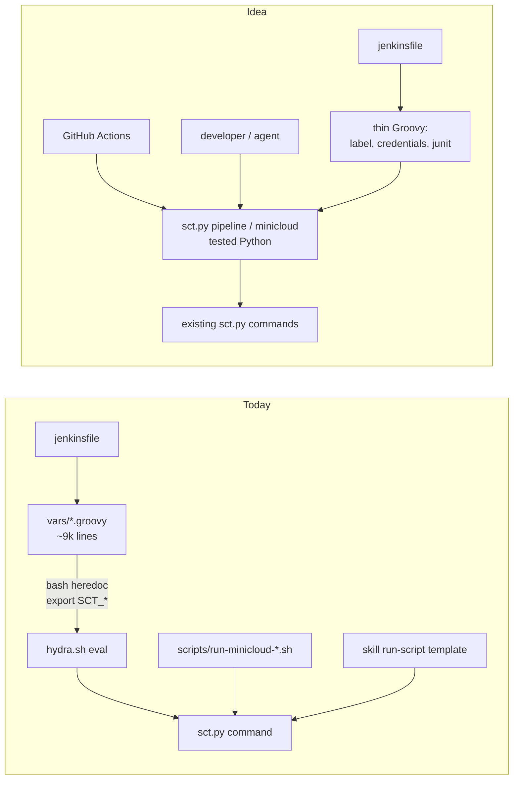

# Less Groovy, one runnable Python layer for CI (proposal)

**Status:** draft

> This spec contains ideas to experiment with, not a committed design. Each section ends in an
> experiment that can stop with no harm. `intent.md` lists the problems and the evidence.

## Overview

Move the logic of the Jenkins steps from Groovy into `sct.py` commands. Jenkins, GitHub Actions,
a developer, and an AI agent then run the same command. Groovy keeps only what Jenkins does
natively. The idea comes from the Dagger guide "Migrate from Jenkins": keep Jenkins as the
trigger, make each step a portable unit, and move one stage at a time beside the old one.
Two options are compared: a Python-native version of these ideas (A), and real Dagger (B).

## Constraints

- No jenkinsfile changes. `longevityPipeline(...)` and the other entry points keep their names
  and arguments.
- Each release branch runs its own `vars/` (`library 'sct@snapshot', retriever: legacySCM(scm)`).
  A branch changes only when a backport is chosen for it.
- Each experiment can be turned off per job, with no code revert.
- The new code goes into new files, so a cherry-pick to a release branch applies cleanly.
- The experiments create no Jenkins jobs. They use the existing jobs and the staging folders.

## Design

### Today and the idea



A Jenkins stage in the idea, while the switch is on:

```groovy
stage('Provision Resources') {
    sh "./docker/env/hydra.sh pipeline stage provision --params-file params.json"
}
```

### The two options

| | Option A: Python-native | Option B: Dagger (Python SDK) |
|---|---|---|
| Portable unit | `sct.py pipeline …` inside the hydra image | Dagger function that wraps the same Python |
| Callers | Jenkins `sh`, GHA `run:`, a laptop, an agent | `dagger call …` from Jenkins, GHA, a laptop, an agent |
| New infrastructure | None | A Dagger engine per builder or a shared engine; Dagger CLI and engine versions kept equal |
| Strong for | P1–P9: env mapping, stages, state, minicloud, agent CLI | P10 PR checks, images (D1–D6), agent sandboxes (B1) |
| Weak for | Image cache and multi-arch need buildx work | P1, P4, P5, P7 still need the Python of option A. Tests run for hours on remote VMs, so the cache helps little |
| Maturity | Our own code | v1.0.0-beta at the time of writing |

Option B can be a layer on top of option A. It does not replace it.

### Release branch safety

| Branch tier | Branches | Idea |
|---|---|---|
| 1 | master, 2026.4, 2026.3 | All experiments |
| 2 | 2026.1, 2026.2, perf-v17, manager-3.10 to 3.13 | Experiments 1 and 3 only, switch default `groovy` |
| 3 | 2025.1 and older | Groovy frozen until end of life |

Canary order for each experiment that touches Jenkins: the PR provision tests of the root
`Jenkinsfile` → a staging folder copy → one tier1 job → the longevity jobs → the other
pipelines → the performance jobs last.

| Condition | Behavior |
|---|---|
| The Python path fails where Groovy passed | Set `pipeline_engine: groovy` for the job, then fix |
| A branch lacks a module that the new code imports | That branch stays on its tier, with no backport |
| The golden test finds a difference with the branch's Groovy | The backport stops on that branch |

## Contracts

### Configuration

A per-job switch, read by the Groovy wrappers. It is a Jenkins parameter, not an SCT option.

```groovy
string(name: 'pipeline_engine', defaultValue: 'groovy', description: 'groovy | python (experiment)')
```

### Module API

Proposed commands. Each one prints JSON with `--json` and does nothing with `--dry-run`.

```
sct.py pipeline env    --params-file FILE [--step NAME]   # Jenkins params -> SCT_* env (P1, P2)
sct.py pipeline plan   --params-file FILE                 # resolved config, cost, stages, label
sct.py pipeline stage  NAME --params-file FILE            # one stage, reads/writes the state file
sct.py pipeline run    --params-file FILE [--local]       # all stages with recovery (P4)
sct.py pipeline status                                    # the state file
sct.py minicloud preflight|up|down|reclaim -b BACKEND -c CONFIG...   # (P9)
```

The state file replaces `sct_runner_ip` and `./latest` (P7):

```python
class PipelineState(BaseModel):
    test_id: str
    backend: str
    runner_ip: str | None = None
    completed_stages: list[str] = []
    failed_stage: str | None = None
```

### Outputs

The hydra image tag can become a hash of its inputs (D1, D2). No version commit is needed:

```
scylladb/hydra:h-<sha256(Dockerfile, uv.lock, pyproject.toml)[:12]>
```

## Experiments

| # | Problem | Hypothesis | Scope | Judge by | Stop by |
|---|---|---|---|---|---|
| 1 | P1, P2 | One Python mapping gives the same `SCT_*` set as each `vars/` step | Golden test parses the branch's own `vars/*.groovy`, then one step switches | Golden test green; fewer parameter drift fixes | Delete the new file |
| 2 | P9 | One `sct.py minicloud …` can serve Groovy, the scripts, and the skill | The 9 minicloud jobs, tier 1 only | Fewer host-trap failures on local runs | Switch back to the Groovy vars |
| 3 | P4, P7 | A Python stage runner with a state file can replace the stage skeleton | Root `Jenkinsfile` provision tests first | Same results as Groovy for some weeks | `pipeline_engine: groovy` |
| 4 | P10 | GHA runs the PR checks with the same result and in less time | pre-commit, unit tests, collect-only, `lint-pipelines` beside Jenkins | Equal results and shorter time | Remove the workflow |
| 5 | D1, D2, D7 | A hash-tagged hydra image ends version commits and backport conflicts | buildx, build in `pull_request`, publish from a trusted job | No `create image` commits; `backport_hydra_fixup.py` unused | Keep the `version` file path |
| 6 | P8 | A skill plus `--json` lets an agent run and watch a job | `running-sct-jobs` skill: local → staging → Jenkins MCP and `argus` | An agent completes the flow without reading Groovy | Delete the skill |
| 7 | B | Dagger adds value on top of A where containers are the product | PR checks, hydra build, one loader image, `container-use` for one agent session | Compare with experiments 4 and 5 | Do not adopt |

### Docker images: what each option gives

| # | Problem | Dagger | Plain buildx |
|---|---|---|---|
| D1 | Version counter committed into the PR, collisions | Build from inputs, digest output | Hash tag computed by `hydra.sh` |
| D2 | Backport conflicts on `version` and `uv.lock` | Same as D1 | Same as D1 |
| D3 | A dependency change needs the label round-trip | Image built from the tree, cached locally | Local build when the hash tag is missing |
| D4 | No cache in CI | Engine cache | `cache-from: type=gha` |
| D5 | amd64 only | Multi-platform builds | `buildx --platform` |
| D6 | 8 helper images built by hand | One function per image | `buildx bake` and a GHA matrix |
| D7 | `pull_request_target` builds PR code with push secrets | Build and publish split | Build and publish split |

### Dagger beyond CI

| # | Idea | Pain today | Catch |
|---|---|---|---|
| B1 | `container-use` MCP server: one container and one git branch per agent | Each agent session needs a worktree, a `.venv`, and an `.envrc` | Experimental |
| B2 | Module functions as agent tools | Agents read Groovy and `hydra.sh` to learn a job | Check the beta |
| B3 | Integration tests with Scylla and Kafka as Dagger services | Tests drive Docker directly and run only on Jenkins | The fixtures change |
| B4 | Tool images built from a fork or a branch on demand | Manual build from `docker/ycsb/README.md` | Low |
| B5 | A shell in the image built from the tree | The hydra tag must match by hand | Low |
| B6 | OpenTelemetry traces for each step | No timing view | Cloud is billed, or we host OTel |

Dagger gives no help for the SCT test itself (hours long, VMs, SSH), the VM images, minicloud
KVM guests (`/dev/kvm`), or the Jenkins-native features.

## Risks

| Risk | Response |
|---|---|
| Two implementations live together for a long time | Delete a Groovy step only after weeks with no difference; time the deletion with branch end of life |
| A pipeline fix must be written twice while the branches differ | Experiment 1 first on tiers 1 and 2 makes later fixes Python on most branches |
| The Python path changes job behavior without notice | The golden test and the per-job switch; canary order |
| Dagger stays in beta or changes its API | Option B stays an experiment on top of A |
| `tcp://` Dagger engines have no authentication | Keep the engine on a private network, or use a local engine per builder |

## Deferred work

- A generic `sctPipeline.groovy` that replaces the pipeline vars, after experiment 3.
- Generated Jenkins parameter definitions from the SCT configuration model.
- Builder label choice (`getJenkinsLabels`) and runner sizing (`getJobTimeouts`) in Python.

## Decisions

- The document is a proposal of experiments, not a roadmap. (spec)
- The goal is to reduce Groovy as much as possible. (spec)
- Jenkins stays the trigger; the jenkinsfiles do not change. (spec)
- Option A or option B, or A with B on top. (open)
- Which experiment goes first. (open)
