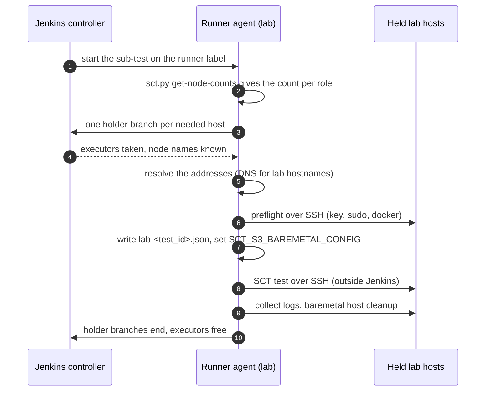
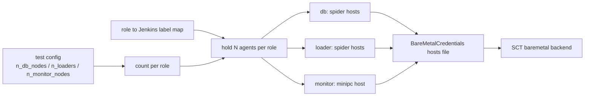

# Lab builders as baremetal test nodes, reserved through Jenkins

**Jira:** SCT-900

**Status:** draft

## Overview

Jenkins is only the resource manager. A perf sub-test in lab mode runs on a
lab runner agent. It asks SCT how many hosts each role needs, and holds that
many lab agents: one parallel branch per host sits in `node(<label>)` and
runs nothing, so the single executor of the agent stays busy. The runner
resolves the addresses of the held agents, checks them over SSH, and writes
a baremetal hosts file. The SCT baremetal backend then reaches the hosts over
SSH, as it does any baremetal host. When the sub-test ends for any reason,
the holder branches end and Jenkins frees the agents.

## Constraints

- Jenkins runs no test code on a held host. Only the runner touches it, and
  only over SSH.
- The hold needs no script approval and no new Jenkins plugin.
- The library runs sandboxed through `legacySCM`. A call into Jenkins
  internals needs script approval, so the design avoids them.
- The hosts file must still exist when post-run cleanup reads it.
- Cloud perf runs keep their behavior and their throttle categories.
- The lab and the cloud perf runs never block each other.

## Design





| Component | Role |
|---|---|
| `sct.py get-node-counts` | Prints the count per role from the merged test configuration |
| Role map (library) | Maps each role to a Jenkins label and an SSH username |
| Hold step (library) | Holds N agents per role, runs a body with the held hosts, ends the holders on every exit |
| Preflight step (library) | Probes every held host over SSH, fails once with a table of all problems |
| Hosts file step (library) | Writes and archives the hosts file, exports its name |
| `perfRegressionParallelPipeline` lab mode | Runs the sub-test on the runner label, skips the SCT runner and cloud provisioning, as `local_agent` does in `longevityPipeline` |
| Lab overlay | Switches the test-case to the `baremetal` backend and sets `simulated_racks` to match the RF |
| Lab host runbook | The one-time setup of a host: test user, key, passwordless sudo, docker on the monitor host, the eligible hosts |

The sub-test runs these stages in order: sizing, hold, preflight, hosts
file, test, log collection, host cleanup, release. Lab mode runs the
sub-tests one after another.

The runner resolves each address itself, without a step on the held agent.
A lab agent is named by its hostname, so the runner uses DNS. An AWS
builder agent, used for staging checks, is named by its instance id, so the
runner uses the EC2 API.

The failure behavior:

| Condition | Behavior |
|---|---|
| Not every host is held before the acquire time limit | Fail the build. Free the hosts that are held |
| A host fails preflight | Fail before the test. One report lists every host and every problem |
| The runner branch fails | `failFast` cancels the holders still in the queue |
| Abort or build timeout during the test | Collect the logs, clean the hosts, then end the holders |
| A held agent disconnects | Its holder branch fails, the run fails, the host goes back to the pool |
| A second lab run starts | It waits on the lab throttle category |

## Contracts

### Configuration

The pipeline reads the existing node counts. Per-DC values add up.

```yaml
n_db_nodes: "3 3"      # 6 DB hosts
n_loaders: 4
n_monitor_nodes: 1
```

The lab overlay sets the backend and the racks. The hosts file name comes
from the environment, not from the overlay.

```yaml
cluster_backend: baremetal
simulated_racks: 3
```

The role map is static in the library first:

| Role | Jenkins label | SSH username |
|---|---|---|
| `runner` | a minipc label | not used |
| `db` | `builders_x86` (spider) | the lab test user |
| `loader` | `builders_x86` (spider) | the lab test user |
| `monitor` | a minipc label | the lab test user |

Lab mode uses its own throttle category with a limit of 1. A Jenkins admin
creates it once. Lab mode ignores the `job_throttle_category` parameter.

### Inputs

```
sct.py get-node-counts    # prints {"db": 3, "loader": 4, "monitor": 1}
```

The command takes the same test-case and overlay arguments as
`sct.py get-db-arch`. A missing monitor count prints `0`.

### Outputs

The hosts file, `lab-<test_id>.json`, in the directory that hydra runs from.
It is a build artifact. Its shape is `BareMetalCredentials`:

```json
{
  "db_nodes":      {"username": "<user>", "node_list": [{"public_ip": "<ip>", "private_ip": "<ip>"}]},
  "loader_nodes":  {"username": "<user>", "node_list": [{"public_ip": "<ip>", "private_ip": "<ip>"}]},
  "monitor_nodes": {"username": "<user>", "node_list": [{"public_ip": "<ip>", "private_ip": "<ip>"}]}
}
```

```
SCT_S3_BAREMETAL_CONFIG=lab-<test_id>    # set for the test and the cleanup stages
```

`KeyStore.get_baremetal_config` reads the local `<name>.json` before S3, so
the run uploads nothing to S3.

The build description lists the runner and the held hosts.

## Risks

| Risk | Response |
|---|---|
| Scylla's disk setup takes over the data disks of a shared dtest host | Use only hosts whose spare disks are for this work. Check the disk layout before the first run. Host cleanup undoes the RAID |
| Two lab runs each hold part of the pool and wait for each other | The lab throttle category has a limit of 1, and the hold has an acquire time limit |
| The pool is too small: 9 hosts for each sub-test | The demo has one sub-test, and lab mode runs sub-tests in order. The open footprint questions can bring a sub-test down to 5 hosts |
| One loader host cannot drive the target rates and skews the results | Measure the loader CPU before the overlay uses one loader. Keep more loader hosts when the loader saturates first |
| The runner cannot reach S3, Argus, or the KeyStore from the lab network | The proof of concept on lab hosts runs hydra on a minipc runner |
| A host is set up wrong | Preflight fails the run in minutes with one report |
| A test changes the host for its other users: the disk setup and `SELINUX=disabled` | Tell the host owners before the first run, and record it in the runbook |
| The baremetal backend cannot reboot a node | The throughput-steps test does not reboot nodes |

## Deferred work

- The role map moves from the library into baremetal configuration options,
  so each test-case or overlay picks its hosts. `get-node-counts` then
  prints the label with each count. The design keeps the map as one lookup
  that the hold step reads.
- A clean boot by reboot, when the hosts get a separate boot disk. A
  rebooted agent drops its Jenkins connection, so the hold then marks the
  host temporarily offline and waits for the agent to reconnect. That needs
  script approval for the node APIs.
- lockable-resources, for an atomic "N agents with label X" and a view of
  who holds what, if a limit of one lab run at a time is too coarse.

## Decisions

- A busy executor is the reservation. The branch ends on success, abort, and
  timeout, so the agent is always freed. (spec)
- Lab runs get their own throttle category, so a lab run never lands in a
  cloud perf category. (spec)
- The hosts file goes through a local file and an environment variable, not
  S3. Staging run #2 showed that hydra reads it from the checkout. (build)
- The runner resolves the addresses, so no step runs on a held agent. (build)
- The pipeline gets the node counts from SCT, so overlays and per-DC values
  count. (spec)
- The monitoring stack runs on the runner agent instead of on one more held
  host. (open)
- One large lab host does the work of the 4 `c7i.8xlarge` loaders, with
  `round_robin`, without the loader CPU saturating before the DB. (open)
