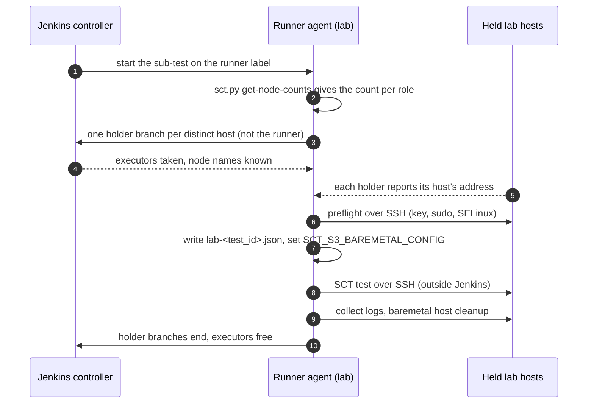
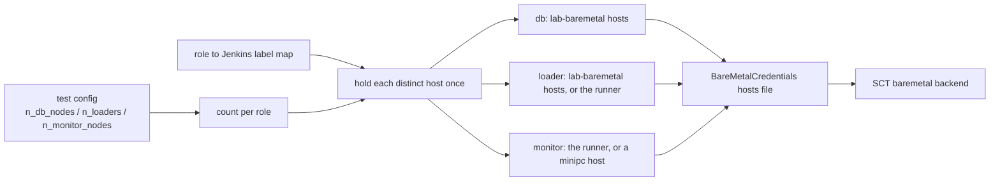

# Lab builders as baremetal test nodes, reserved through Jenkins

**Jira:** SCT-900

**Status:** draft

## Overview

Jenkins is only the resource manager. A perf sub-test in lab mode runs on a
lab runner agent. It asks SCT how many hosts each role needs, and holds those
lab agents: one parallel branch per host sits in `node(<label>)`, so the
single executor of the agent stays busy. A host can take several roles, and
the runner's own agent can take roles too. Each host is held once, however
many roles it takes, and the runner's agent is never held again. Each holder
reports its host's address. The runner checks the hosts over SSH and writes
a baremetal hosts file. The SCT baremetal backend then reaches the hosts over
SSH, as it does any baremetal host. When the sub-test ends for any reason,
the holder branches end and Jenkins frees the agents.

## Constraints

- Jenkins runs no test code on a held host. The holder branch runs one
  read-only command there, which reports the host's address. Everything else
  reaches the host from the runner, over SSH.
- The hold needs no script approval and no new Jenkins plugin.
- The library runs sandboxed through `legacySCM`. A call into Jenkins
  internals needs script approval, so the design avoids them.
- The hosts file must still exist when post-run cleanup reads it.
- Cloud perf runs keep their behavior and their throttle categories.
- The lab and the cloud perf runs never block each other.

## Design





| Component | Role |
|---|---|
| `sct.py get-node-counts` | Prints the count per role from the merged test configuration |
| Role map (library) | Maps each role to Jenkins labels or node names, or to the runner's own agent, and an SSH username |
| Hold step (library) | Holds each distinct host of the role map once, collects the addresses the holders report, runs a body with the held hosts, ends the holders on every exit |
| Preflight step (library) | Probes every held host over SSH, fails once with a table of all problems |
| Hosts file step (library) | Writes and archives the hosts file, exports its name |
| `perfRegressionParallelPipeline` lab mode | Runs the sub-test on the runner label, skips the SCT runner and cloud provisioning, as `local_agent` does in `longevityPipeline` |
| Lab overlay | Switches the test-case to the `baremetal` backend and sets `simulated_racks` to match the RF |
| Lab host runbook | The one-time setup of a host, and of the runner when it takes a role: test user, key, passwordless sudo, the data NIC as the default route, Docker Engine 20.10 or newer that the test user can run on loader and monitor hosts, the monitoring stack's ports free on the monitor host, SELinux on loader hosts, the `lab-baremetal` label on the eligible hosts |

The sub-test runs these stages in order: sizing, hold, preflight, hosts
file, test, log collection, host cleanup, release. Lab mode runs the
sub-tests one after another.

Each holder reports its host's address: the source address of the host's
default route, from `ip -4 route get`. The runner can't resolve the
addresses itself. The lab DNS doesn't know Jenkins node names such as
`minipc5` and `mini-spider1` (proof-of-concept build #8), and DHCP moved
minipc5 between three addresses in one month, so a static address table
would go stale. The same command works on AWS builder agents, so no EC2 API
lookup is needed. The runner's own address is its source address on the
route to the held hosts. Preflight reports a host that reported no address.

A host takes one or more roles. The runner's agent takes the roles that the
role map gives it, and it is not held a second time: a single-executor agent
would wait for itself until the acquire time limit. A host that two roles
name is held once and listed under both roles in the hosts file. The
proof-of-concept `lab-10g` layout runs the runner as a loader and the
monitor, with one more held loader and one held DB host.

Preflight checks every host for the key and passwordless sudo. On loader
hosts it also checks that SELinux is not enforcing. It leaves Docker to SCT:
SCT never installs or changes Docker on a baremetal loader or monitor
(#16535), and its own host preflight checks the Docker version, the free
space for the images, and the monitoring stack's ports before the first
image pull (#16538, `docs/plans/baremetal/host-preflight`). DB hosts don't
need the check: `scylla_setup` runs `setenforce 0`. Loaders never run
`scylla_setup`, so an enforcing loader stays enforcing. SCT already handles
the two failures seen on an enforcing Fedora 44 loader: stress containers
relabel their bind mounts (#16407), and sshd may bind the reverse tunnel
ports (#16408). Other paths may still fail, and only at the stress phase,
so preflight fails an enforcing loader before the test starts.

The failure behavior:

| Condition | Behavior |
|---|---|
| Not every host is held before the acquire time limit | Fail the build. Free the hosts that are held |
| A host fails preflight | Fail before the test. One report lists every host and every problem |
| The runner branch fails | `failFast` cancels the holders still in the queue |
| Abort or build timeout during the test | Collect the logs, clean the hosts, then end the holders |
| A held agent disconnects | Its holder branch fails, the run fails, the host goes back to the pool |
| A second lab run starts | It waits on the lab throttle category |

## Contracts

### Configuration

The pipeline reads the existing node counts. Per-DC values add up.

```yaml
n_db_nodes: "3 3"      # 6 DB hosts
n_loaders: 4
n_monitor_nodes: 1
```

The lab overlay sets the backend and the racks. The hosts file name comes
from the environment, not from the overlay.

```yaml
cluster_backend: baremetal
simulated_racks: 3
```

The role map is static in the library first:

| Role | Jenkins label | SSH username |
|---|---|---|
| `runner` | a minipc label | the lab test user, when it takes a role |
| `db` | `lab-baremetal` | the lab test user |
| `loader` | `lab-baremetal`, or the runner | the lab test user |
| `monitor` | the runner, or a minipc label | the lab test user |

A role can name the runner, and two roles can name the same host. The hold
step counts each host once.

`lab-baremetal` is a dedicated label. It is set only on the hosts allocated
to this work and prepared per the runbook. The role map doesn't use
`builders_x86`, because that label is Scylla CI's whole x86 builder pool: 16
agents, spider1-8, spider12-18 and `mini-spider1`. A sub-test would hold
close to half of it for hours, and could land on hosts such as spider2,
whose only NVMe holds the OS and leaves no spare disk for Scylla.

Lab mode uses its own throttle category with a limit of 1. A Jenkins admin
creates it once. Lab mode ignores the `job_throttle_category` parameter.

### Inputs

```
sct.py get-node-counts    # prints {"db": 3, "loader": 4, "monitor": 1}
```

The command takes the same test-case and overlay arguments as
`sct.py get-db-arch`. A missing monitor count prints `0`.

### Outputs

The hosts file, `lab-<test_id>.json`, in the directory that hydra runs from.
It is a build artifact. Its shape is `BareMetalCredentials`:

```json
{
  "db_nodes":      {"username": "<user>", "node_list": [{"public_ip": "<ip>", "private_ip": "<ip>"}]},
  "loader_nodes":  {"username": "<user>", "node_list": [{"public_ip": "<ip>", "private_ip": "<ip>"}]},
  "monitor_nodes": {"username": "<user>", "node_list": [{"public_ip": "<ip>", "private_ip": "<ip>"}]}
}
```

```
SCT_S3_BAREMETAL_CONFIG=lab-<test_id>    # set for the test and the cleanup stages
```

`KeyStore.get_baremetal_config` reads the local `<name>.json` before S3, so
the run uploads nothing to S3.

The build description lists the runner and the held hosts.

## Risks

| Risk | Response |
|---|---|
| Scylla's disk setup takes over the data disks of a shared dtest host | Only hosts with the `lab-baremetal` label are held, and the label goes only on hosts whose spare disks are for this work. Check the disk layout before the label is set. Host cleanup undoes the RAID |
| Old coredumps of CI builds on a shared host fail the run: spider2 held about 1,900, and an October run raised 57 `CoreDumpEvent` errors in its first 15 s | A baremetal node sets `journal_since` to the run start, and the coredump monitor lists cores with `coredumpctl --since` from it (#16493). Cores from before the run are neither reported nor uploaded |
| Two lab runs each hold part of the pool and wait for each other | The lab throttle category has a limit of 1, and the hold has an acquire time limit |
| The pool is too small: 9 hosts for each sub-test | The demo has one sub-test, and lab mode runs sub-tests in order. The open footprint questions can bring a sub-test down to 5 hosts |
| One loader host cannot drive the target rates and skews the results | Measure the loader CPU before the overlay uses one loader. Keep more loader hosts when the loader saturates first |
| The runner cannot reach S3, Argus, or the KeyStore from the lab network | The proof of concept on lab hosts runs hydra on a minipc runner |
| A host is set up wrong | Preflight fails the run in minutes with one report |
| A test changes the host for its other users: the disk setup, `SELINUX=disabled`, and a prune of unused Docker images when the image store is short of space (#16538) | Tell the host owners before the first run, and record it in the runbook |
| The baremetal backend cannot reboot a node | The throughput-steps test does not reboot nodes |
| A host's data NIC isn't its default route, so the host reports its management address and the test traffic takes the slower link | The runbook sets the data NIC as the default route. A role map entry that names the interface is deferred work |

## Deferred work

- The role map moves from the library into baremetal configuration options,
  so each test-case or overlay picks its hosts. `get-node-counts` then
  prints the label with each count. The design keeps the map as one lookup
  that the hold step reads.
- A clean boot by reboot, when the hosts get a separate boot disk. A
  rebooted agent drops its Jenkins connection, so the hold then marks the
  host temporarily offline and waits for the agent to reconnect. That needs
  script approval for the node APIs.
- A role map entry that names the interface whose address a host reports,
  for hosts whose data NIC isn't the default route.
- lockable-resources, for an atomic "N agents with label X" and a view of
  who holds what, if a limit of one lab run at a time is too coarse.

## Decisions

- A busy executor is the reservation. The branch ends on success, abort, and
  timeout, so the agent is always freed. (spec)
- Lab runs get their own throttle category, so a lab run never lands in a
  cloud perf category. (spec)
- The hosts file goes through a local file and an environment variable, not
  S3. Staging run #2 showed that hydra reads it from the checkout. (build)
- Each holder reports its host's address with one read-only command. The lab
  DNS doesn't know the Jenkins node names, and DHCP changes the addresses.
  (build)
- A host can take several roles and is held once. The runner's own agent
  takes roles without being held again. (build)
- The pipeline gets the node counts from SCT, so overlays and per-DC values
  count. (spec)
- DB and loader hosts come from a dedicated `lab-baremetal` label, not from
  `builders_x86`, so a run never takes Scylla CI builders or a host without
  spare disks. (review)
- Preflight fails a loader host whose SELinux is enforcing. (review)
- The library preflight doesn't check Docker: SCT's host preflight (#16538)
  already checks it on every loader and monitor, with the disk and the
  ports. (series)
- The monitoring stack runs on the runner agent instead of on one more held
  host. The proof-of-concept `lab-10g` runs (builds #10, #12-#14) did this,
  with the runner also a loader. (build)
- One large lab host does the work of the 4 `c7i.8xlarge` loaders, with
  `round_robin`, without the loader CPU saturating before the DB. (open)
