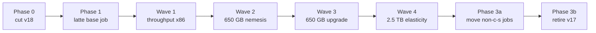
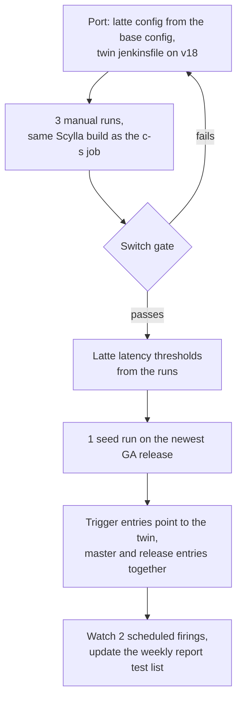

# branch-perf-v18 and the move from cassandra-stress to latte

**Jira:** SCT-1029

**Status:** draft

## Overview

We cut `branch-perf-v18` from master. The first job on it is the latte base
job: the i8g throughput steps on latte. Each c-s case then gets a latte twin
on v18, with the c-s job name plus `-latte`. The twin runs next to its c-s
job until it meets the switch gate, and then the trigger runs the twin. The
c-s job stays on v17 for on-demand runs. The cases move one at a time:
the steps cases first, then the nemesis and the upgrade cases, and the
elasticity case last. When no trigger entry points to a
v17 job, the jobs without c-s move to v18 under their current names, and v17
retires.

## Constraints

- A Jenkins job path has no branch in it. The folder
  `jenkins-pipelines/performance/branch-perf-vN/` selects the SCT branch.
  The job creator runs each Sunday, one time for each perf branch, from that
  branch's checkout. When both trees hold the same job file, the last run
  owns the job.
- The schedule lives on master only, in
  `configurations/triggers/perf-regression.yaml`.
- After the cut, the v18 job creator reads the `branch-perf-v18` branch, not
  master.
- No phase changes a measured workload, cadence, region, or throttle
  category.
- One case at a time. The next case starts only after the trigger runs the
  twin of the previous case.

## Design



| Phase | Content | Owner |
|---|---|---|
| 0 | v18 folders, a v18 line in the job creator, the cut, the `backport/perf-v18` label, a CI check, one manual creator run | fruch |
| 1 | Latte base job: `…-predefined-throughput-steps-i8g-{tablets,vnodes}-latte`, replaces the c-s i8g jobs | fruch |
| Wave 1 | Throughput steps x86: tablets, vnodes, write-tablets, write-vnodes, sanity-vnodes. Needs a latte step config for i4i.4xlarge | juliayakovlev |
| Wave 2 | 650 GB with nemesis: vnodes, tablets, i8g-tablets, i8g-vnodes, rbno-disabled. No latte config exists. Tablets x86 goes first | juliayakovlev |
| Wave 3 | 650 GB rolling upgrade: vnodes, tablets, i8g-tablets. A latte config and a staging job exist | juliayakovlev |
| Wave 4 | 2.5 TB i8g elasticity. Builds on SCT-602 (vponomaryov) | juliayakovlev |
| 3a | Move the jobs without c-s: microbenchmarks, alternator, custom-d1 steady state, logstor | fruch |
| 3b | Remove v17 from the job creator, set the `sct.py` default to v18, disable the v17-only jobs | fruch |

### The jobs that get a twin

All are under `/scylla-enterprise/perf-regression/` and start with
`scylla-enterprise-perf-regression-`, except where a full path is given.
The twin of each job is the same path plus `-latte`.

| Order | Case | c-s job |
|---|---|---|
| Phase 1 | Steps, i8g | `predefined-throughput-steps-i8g-tablets` |
| Phase 1 | Steps, i8g | `predefined-throughput-steps-i8g-vnodes` |
| Wave 1 | Steps, x86 | `predefined-throughput-steps-tablets` |
| Wave 1 | Steps, x86 | `predefined-throughput-steps-vnodes` |
| Wave 1 | Steps, x86 write | `predefined-throughput-steps-write-tablets` |
| Wave 1 | Steps, x86 write | `predefined-throughput-steps-write-vnodes` |
| Wave 1 | Steps, sanity | `/scylla-master/perf-regression/perf-regression-predefined-throughput-steps-sanity-vnodes` |
| Wave 2 | Nemesis | `latency-650gb-with-nemesis-tablets` |
| Wave 2 | Nemesis | `latency-650gb-with-nemesis` |
| Wave 2 | Nemesis | `latency-650gb-with-nemesis-i8g-tablets` |
| Wave 2 | Nemesis | `latency-650gb-with-nemesis-i8g-vnodes` |
| Wave 2 | Nemesis | `latency-650gb-with-nemesis-rbno-disabled` |
| Wave 3 | Upgrade | `latency-650gb-during-rolling-upgrade` |
| Wave 3 | Upgrade | `latency-650gb-during-rolling-upgrade-tablets` |
| Wave 3 | Upgrade | `latency-650gb-during-rolling-upgrade-i8g-tablets` |
| Wave 4 | Elasticity | `latency-2.5tb-i8g-elasticity` |

### The metrics of each case

Each case gets its own page, `cases/<case>.md` next to this spec. The PR
that adds the twin also adds the page. The page holds:

- the jobs of the case,
- the metrics below, with the c-s values (median and spread over the last 5
  runs) and the latte values from the pair runs,
- the latte parameters, and why each one has its value,
- the result of the switch gate.

| Case | Metrics |
|---|---|
| Steps | For each workload (read, write, mixed) and each step: ops/s, P50, P99, and loader CPU. The unthrottled ops/s |
| Nemesis | For each workload: P99 at steady state, and P99 during each nemesis window, with the nemesis name. The duration of each nemesis |
| Upgrade | For each workload: P99 before the upgrade, while each node upgrades, and after the upgrade. The time of each node upgrade |
| Elasticity | P99 at steady state and during each grow and shrink step. The time of each topology change, and the data streamed |

The latte parameters for a case come from its page: the c-s values give the
rate of each step and the concurrency that the loaders need.

### The loop for each case

Phase 1 runs this loop first. Each wave runs it for each case. A case is one
c-s workload family with its tablets, vnodes, x86, and i8g variants.



The switch gate:

| Check | Pass condition |
|---|---|
| P99 stability | Coefficient of variation of P99 for each step is no worse than the c-s job over its last 5 runs |
| Loader headroom | Loader CPU under 70 % on the unthrottled step |
| Throughput | Unthrottled ops/s at least the c-s value, or the gap has a known cause |
| Stress errors | No `LatteStressEvent` errors and no worker stalls under `--rate` (QATOOLS-601) |

### Tuning the latte parameters

The "port" and "3 manual runs" steps of the loop find the latte parameters.

**Fixed, copied from the c-s job:** the schema, the row size, the key count
and distribution, the consistency level, the operation mix, the number and
type of the loaders, and the target rate of each throttled step. The rates
are the targets. They are not tuned.

**Tuned:** `threads`, `concurrency`, and `connections` only.

1. Unthrottled step first. Increase the concurrency by 1.5 times for each
   run. Stop when ops/s increases by less than 5 %, or when loader CPU goes
   above 70 %. Use the lowest concurrency that saturates the cluster. The
   rate search of SCT-580 can do this step.
2. Throttled steps. Calculate the requests in flight from the rate and the
   c-s P99 of the step (Little's law), and add 2 to 3 times headroom, so
   the loader does not queue. Each step must reach its target rate within
   2 %. When a step does not reach it, the loader is the limit: increase
   the concurrency or the threads, never the rate.
3. Run 3 times with the selected values, on the same Scylla build as the
   c-s job.

**Stop when all are true:** each throttled step reaches its rate within
2 %, the unthrottled ops/s stops increasing, loader CPU is below 70 %, and
the P99 variation over the 3 runs is no worse than that of the c-s job.

**Limit:** 3 tuning rounds. When the criteria still fail, stop. Write the
cause in the case page, and agree on the next step before the case
continues.

**No false state for the twin:** the tuning runs use a staging copy of the
job, not the twin. The Argus history of the twin starts when the parameters
are frozen. The case page records each set of values and its result. A
later change to the parameters needs new thresholds and a new seed run,
with a note in Argus.

### Where each job lives

| Job kind | v17 tree | v18 tree | Labels on the master PR |
|---|---|---|---|
| New `*-latte` twin | absent | added | `backport/perf-v18` |
| Rename of an existing latte job to `*-latte` (Phase 1) | removed | added | `backport/perf-v17`, `backport/perf-v18` |
| Job without c-s, same name (Phase 3a) | removed | added | `backport/perf-v17`, `backport/perf-v18` |
| c-s job | kept until 3b | absent | none |

The v17 backport removes the file from the v17 tree, so the v17 creator
cannot take the job back. The creator never deletes a Jenkins job, so a
renamed job's old entry gets disabled by hand.

## Contracts

### Configuration

The job creator gets one more cron line, and its guard accepts both branches
until Phase 3b:

```
H 01 * * 0 %sct_branch=branch-perf-v17
H 01 * * 0 %sct_branch=branch-perf-v18
```

A latte twin's step config uses the dict form of
`perf_gradual_throttle_steps`. The base job sets the shape:

```yaml
perf_gradual_throttle_steps:
  read:
    - {threads: 32, concurrency: 55, rate: '300000'}
    - {threads: 32, concurrency: 55, rate: 'unthrottled'}
```

### Outputs

- A Jenkins job `<c-s job name>-latte` for each twin, under the same folder
  as its c-s job.
- An Argus test for each twin, with a new history.
- A `latency-decorator-error-thresholds-*-latte-*.yaml` for each twin.

## Risks

| Risk | Response |
|---|---|
| A same-name job is in both trees and the v17 creator takes it back | Both backport labels on each move. Check the job's SCM branch after the next Sunday |
| A switched case has no release baseline | The seed run comes before the trigger swap |
| Latte workers stall under `--rate` and show false throughput drops | A gate check, and a pinned latte image with the fix |
| Pair runs share regions with scheduled jobs | Slots from `docs/perf-tests-region-scheduling.md` |
| Wave 2 cost: 5 jobs × 4 long runs | Tablets x86 first. The other variants copy its config after it passes |

## Deferred work

- The c-s jobs without a schedule. Each owner decides, and Phase 3a moves
  the ones that stay on c-s.
- Workloads that only latte can run, for example compressible data with
  compression on in Scylla. They come as new jobs after the twin of the
  case switches. A twin keeps the c-s workload, so that a change in its
  numbers comes from the tool only.
- The best-throughput rate search (SCT-580) can later replace fixed steps
  in the twins. The twins keep the fixed steps for now.

## Decisions

- A twin's name is the c-s job name plus `-latte`. The two sort together in
  Jenkins and Argus, and each keeps its own history. (spec)
- The latte base job comes first. The later waves copy its config. (spec)
- The jobs without c-s move last, just before v17 retires. (spec)
- juliayakovlev owns waves 1 to 4. (spec)
- Order: steps, then nemesis, then upgrade, then elasticity. One case at a
  time. (PR review)
- Each case has its own page with its metrics and its c-s numbers. (PR
  review)
- Latte-only workloads come after the twins, as new jobs. (PR review)
- Only threads, concurrency, and connections are tuned, in at most 3
  rounds, on a staging copy of the job. (PR review)
- Latte-only jobs without a c-s twin (custom-d1 steady state, logstor) keep
  their names. (spec)
- Cut v18 now. SCT-1402 gets the `backport/perf-v18` label when it
  merges. (PR review)
