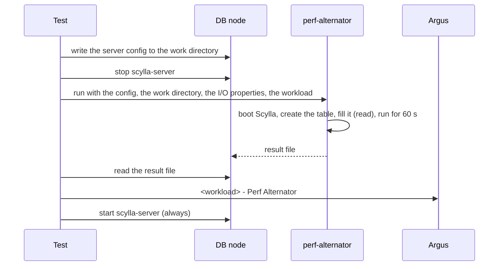

# Weekly perf-alternator microbenchmark

**Jira:** SCT-1382

**Status:** draft

## Overview

A new microbenchmark test runs `scylla perf-alternator` on the single DB
node, for the read and the write workloads, and sends its JSON result to
Argus as `<workload> - Perf Alternator`. The tool boots a full Scylla server
in its own process, as perf-cql-raw does. The test uses the same run flow as
perf-cql-raw: its own server config and work directory, the node's Scylla
server stopped for the run and started again after it. Four weekly jobs
(x86_64 and arm64, read and write) join the `perf-regression` trigger from
2026.2, and the PGO offline-installer trigger.

## Constraints

- The tool can write a result file only from 2026.2. Earlier releases have
  `perf-alternator`, but no `--json-result` option.
- The tool needs Alternator turned on in its server config. Without the
  Alternator port, it waits for the port and then fails.
- The resources and the duration stay fixed. A change to them breaks the
  Argus history.
- perf-cql-raw keeps its command line, its config, and its Argus results.
- The run does not use developer mode. Scylla must pass its startup checks,
  as on a production node.

## Design



| Component | Role |
|---|---|
| In-process server benchmark base | Writes the server config, stops and starts scylla-server, runs the tool, and sends the result. perf-cql-raw and perf-alternator share it |
| perf-cql-raw test | Moves onto the base, with no change to its behavior |
| perf-alternator test | Adds the Alternator settings to the server config. Has a read and a write test |
| Test cases | One for each architecture. They use the perf-cql-raw instance types, c8i.xlarge and c8g.xlarge |
| Weekly jobs | Four jobs in the `scylla-enterprise/perf-regression` folder |
| `perf-regression` trigger | Runs the four jobs from 2026.2 |
| PGO offline-installer trigger | Runs the four jobs on a PGO build of master |

| Condition | Behavior |
|---|---|
| A request fails | The tool stops the run with no result file. The test fails and sends no result |
| The tool exits with an error | The test fails, and scylla-server starts again |
| scylla-server is already stopped before the run | The test continues. The ports are free |
| Scylla adds a stat to the result file | The test skips the stat with a warning, as for the other microbenchmarks |

## Contracts

### Inputs

The command line. The tool removes its own options and gives the rest to
Scylla:

```
scylla perf-alternator --workload {read|write} --duration 60 --json-result <file>
    --workdir <work dir> --options-file <work dir>/conf/scylla.yaml
    --io-properties-file /etc/scylla.d/io_properties.yaml
    --smp 2 --cpus 0,1 -m 3G
```

The server config. It is the perf-cql-raw config, plus the Alternator
settings:

```yaml
seed_provider:
    - class_name: org.apache.cassandra.locator.SimpleSeedProvider
      parameters:
          - seeds: "127.0.0.1"
listen_address: localhost
rpc_address: localhost
api_address: 127.0.0.1
endpoint_snitch: SimpleSnitch
alternator_port: 8000
alternator_write_isolation: forbid
```

The result file, from the 2026.3.4 read run:

```json
{
  "parameters": {"workload": "read", "partitions": 10000, "concurrency": 100,
                 "duration": 10, "operations_per_shard": 0, "remote_host": "127.0.0.1",
                 "flush": true, "scan_total_segments": 10, "cpus": 1},
  "stats": {"median tps": 42615.5, "mad tps": 2335.8, "min tps": 32972.2, "max tps": 44045.8,
            "allocs_per_op": 361.1, "logallocs_per_op": 0.0, "tasks_per_op": 41.1,
            "instructions_per_op": 0.0, "cpu_cycles_per_op": 0.0},
  "test_properties": {"type": "read"},
  "versions": {"scylla-server": {"version": "2026.3.4", "date": "20261018",
                                 "commit_id": "daef9dad4a01", "run_date_time": "2026-11-16 18:19:32"}}
}
```

Master also writes `polls_per_op` and the median, the deviation, the minimum,
and the maximum of the instructions and the cycles per operation.

### Outputs

One Argus table for each run, with the existing microbenchmark columns:

```python
MicrobenchmarkResult(workload="read", parameters=result["parameters"],
                     benchmark_name="Perf Alternator")  # table "read - Perf Alternator"
```

The thresholds start with no limit, so Argus records the results and does
not validate them:

```yaml
# configurations/performance/perf_alternator/latency-decorator-error-thresholds-perf-alternator-microbenchmark_{x86_64,arm64}.yaml
latency_decorator_error_thresholds:
  read:
      allocs_per_op: {fixed_limit: null}
      cpu_cycles_per_op: {fixed_limit: null}
      instructions_per_op: {fixed_limit: null}
  write: ...  # the same
```

The trigger entries:

```yaml
# configurations/triggers/perf-regression.yaml, for each of the four jobs
- job_name: "/scylla-enterprise/perf-regression/scylla-enterprise-perf-alternator-weekly-microbenchmark_x86_64"
  backend: "aws"
  # arch: "aarch64" on the arm64 and arm64-write jobs
  exclude_versions: ["2026.1", "2025.4", "2025.3", "2025.2", "2025.1", "2024.2", "2024.1"]
  labels: []
  params: {region: "us-east-1", microbenchmark: "true", requested_by_user: "juliayakovlev"}
```

```yaml
# configurations/triggers/pgo-offline-installer.yaml: the same params as the perf-cql-raw entries
- job_name: "/scylla-enterprise/perf-regression/scylla-enterprise-perf-alternator-weekly-microbenchmark_x86_64"
  labels: ["pgo-x86"]   # arm64 jobs: labels ["pgo-arm"] and arch: "aarch64"
  exclude_versions: []
```

### Module API

```python
class InProcessServerMicrobenchmarkTest(MicrobenchmarkTest):
    BENCHMARK: str          # the scylla subcommand
    BENCHMARK_NAME: str     # the Argus table suffix
    SCYLLA_CONFIG: str      # the server config of the benchmark
    def run_workload(self, workload: str) -> None: ...

class PerfCqlRawTest(InProcessServerMicrobenchmarkTest):
    def test_read(self): ...
    def test_write(self): ...

class PerfAlternatorTest(InProcessServerMicrobenchmarkTest):
    def test_read(self): ...
    def test_write(self): ...
```

## Risks

| Risk | Response |
|---|---|
| The SCT node blocks the perf counters, so the instructions and the cycles are 0 | perf-simple-query reports them on the same AMIs. The staging run checks that they are not 0 |
| The tool needs more memory per shard than perf-cql-raw | 3G over 2 shards passes the 1 GiB per shard check. The staging run on both architectures confirms it |
| The refactor changes the perf-cql-raw results | The perf-cql-raw command line and config stay the same. A staging run compares its Argus columns |
| One failed request stops the run with no result | Accepted. A failed Alternator request on a local node is a bug to report |

## Deferred work

- Real threshold values, after three or four weekly runs.
- The `write_rmw` workload, with `alternator_write_isolation: only_rmw_uses_lwt`,
  and the `write_gsi` workload. Each one adds two weekly jobs.
- The four jobs in the weekly perf report, after their first weekly run.
- The version comparison report for perf-alternator and perf-cql-raw.

## Decisions

- The read and the write workloads only. They match perf-simple-query and
  perf-cql-raw. (spec)
- `alternator_write_isolation: forbid`, as the tool's author runs the read and
  the write workloads. (spec)
- perf-cql-raw and perf-alternator share one base class. They need the same
  server setup. (spec)
- The PGO trigger runs the jobs, as it runs perf-cql-raw. (review)
- The weekly perf report and the version comparison report wait for the
  first weekly run. They list each job by its Argus test ID, which exists
  only after that run. (review)
- The meaning of "promote to quick tests" in SCT-1382. (open)
