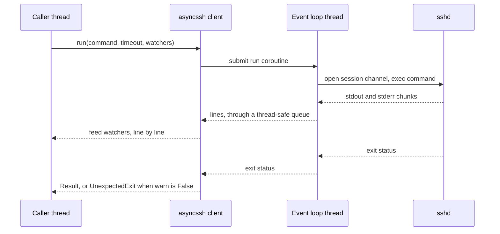

# asyncssh SSH transport

**Jira:** SCT-1396

**Status:** draft

## Overview

A new remoter, `RemoteAsyncSSHCmdRunner`, registers as the `asyncssh` SSH
transport. Its client runs on asyncssh, a pure Python SSH library that gets
its crypto from the `cryptography` wheels. One event loop thread in each
process runs all the SSH connections. The calling thread submits a coroutine
to the loop and waits on its result. The client keeps the `run()` contract of
the `libssh2` client: the same `Result`, the same exceptions, and watchers
that get the output line by line. A test case selects it with
`ssh_transport: asyncssh`.

## Constraints

- `libssh2` stays the default. No test case changes its behavior.
- A remoter works after fork and after pickling. SCT passes remoters to
  subprocesses.
- The client raises the exception classes of the `libssh2` client, so the
  retry logic of `RemoteCmdRunnerBase` applies unchanged.
- `abort_running_commands()` stops a running command from any thread.
- No call blocks a caller thread with no bound. Each wait on the loop has a
  timeout.

## Design

`RemoteCmdRunnerBase` keeps one client for each thread and remoter. In the
new transport, a client is a handle. All clients of a host share the host's
asyncssh connections, and each command runs on its own channel. One
connection carries at most 10 channels, the sshd `MaxSessions` default. The
client opens another connection when all of them are full. The connections
of a host close when its last client closes or is garbage-collected. A new
thread therefore costs no SSH handshake.



The loop thread starts on the first connection in a process. A process that
forks gets a new loop on its first connection. A loop thread does not
survive a fork.

When the remoter has a proxy host, the client first connects to the proxy
host. It then opens the connection to the node through it.

| Condition | Behavior |
|---|---|
| The node does not answer within `connect_timeout` | `ConnectTimeout` after the connect retries, as in `libssh2` |
| The server rejects every authentication method | `AuthenticationException`, retryable |
| The command runs longer than `timeout` | The channel closes. `CommandTimedOut` |
| `abort()` is called from another thread | The running command and every later one fail with `CommandAborted` |
| The command exits non-zero, `warn=False` | `UnexpectedExit` with the full `Result` |
| The connection drops during a command | `FailedToRunCommand`. The next `run()` reconnects |

## Contracts

### Configuration

```python
ssh_transport: Literal["libssh2", "fabric", "asyncssh"] = SctField(
    description="""Set type of ssh library to use. Could be 'libssh2' (default), 'fabric' or 'asyncssh'""",
    default="libssh2",
)
```

```yaml
# defaults/test_default.yaml, unchanged
ssh_transport: 'libssh2'
```

### Module API

The client mirrors `sdcm.remote.libssh2_client.Client`, which
`RemoteCmdRunnerBase` calls.

```python
class Client:
    def __init__(
        self,
        host: str,
        user: str,
        port: int = 22,
        pkey: str | None = None,
        password: str | None = None,
        allow_agent: bool = True,
        forward_ssh_agent: bool = False,
        keepalive_seconds: int = 60,
        timings: Timings | None = None,
        proxy: "Client | None" = None,
    ) -> None: ...

    def connect(self, timeout: float | None = ...) -> None: ...
    open = connect
    def close(self) -> None: ...
    def run(
        self,
        command: str,
        warn: bool = False,
        encoding: str = "utf-8",
        hide=True,
        watchers=None,
        env=None,
        replace_env=False,
        in_stream=False,
        timeout=None,
    ) -> Result: ...
    def abort(self) -> None: ...
    def check_if_alive(self, timeout: float | None = ...) -> bool: ...
    def __enter__(self) -> "Client": ...
    def __exit__(self, *args) -> None: ...
```

```python
class RemoteAsyncSSHCmdRunner(RemoteCmdRunnerBase, ssh_transport="asyncssh"): ...
```

### Outputs

The benchmark script prints one table row per transport and scenario. A row
has the scenario, the session count, the p50 and p99 latency, the
throughput, and the CPU time and peak RSS of the runner process.

## Risks

| Risk | Response |
|---|---|
| The SSH protocol code runs in Python and costs more CPU than libssh2 at scale | The benchmark measures it before the rollout. The gate is in `Decisions` |
| A wait on the loop hangs a caller thread | Each wait has a timeout. A timed-out wait cancels its coroutine |
| asyncssh has one lead maintainer | The transport stays pluggable. ansible-pylibssh is the second candidate |
| The error mapping differs from libssh2 in a case the tests miss | Opt-in rollout per test case before the default changes |

## Deferred work

- The rollout: opt-in runs on AWS, GCE, Azure, Docker, and baremetal, then
  the new default.
- The removal of the `libssh2_client` package, `ssh2-python`, the
  `auditwheel` step in the `Dockerfile`, the macOS wheel pin, and, when no
  test case needs it, the `fabric` transport.

## Decisions

- The clients of a host share its connections, at most 10 channels on each
  connection. The first POC kept one connection for each thread. At 500
  nodes, every new thread pool then cost one handshake for each node, and
  the single loop thread could not keep up with them. asyncssh upstream
  gives the same advice in ronf/asyncssh#573. (build)
- The client reuses `Result` and the exceptions of the `libssh2_client`
  package. They move out of that package when it goes away. (spec)
- The rollout gate, against `libssh2` at 60 and 200 sessions: p50 latency of
  a short command within 10%, connect time within 20%, runner CPU at most
  1.5 times, large output throughput at least equal. (spec)
- The benchmark runs on local Docker sshd containers first, and on minicloud
  before the rollout. (spec)
- The client does not read `~/.ssh/config`. The libssh2 client does not read
  it either, and parsing it cost about 20 ms of CPU on each connect. (build)
- asyncssh is pinned to 2.23.0. Version 2.24 needs `cryptography>=48`, and
  `oci==2.164.2` caps `cryptography` below 46. Bumping asyncssh waits for an
  `oci` upgrade. (build)
- The client prefers AES-GCM over `chacha20-poly1305`. asyncssh builds
  three `cryptography` cipher objects for each chacha packet: 12.9 µs per
  packet against 3.4 µs for AES-GCM. At 200 sessions, chacha took 45% of the
  loop thread. (build)
- The `asyncssh` logger is set to WARNING. asyncssh logs each channel open
  and close at INFO, which costs about 5% of the loop thread and floods
  `sct.log`. (build)
- A garbage-collected client releases its handle on the loop.
  `RemoteCmdRunnerBase` drops the client of a thread that ends without
  closing it. The first POC leaked one connection for each node on every
  thread pool fan-out over the nodes. (build)
- The benchmark has two parts. `ssh_transport_benchmark` covers the micro
  scenarios. `ssh_scale_benchmark` models `scale-450-500`: a setup storm,
  per-node pollers, loader streams, health check fan-outs, and burst
  operations. (build)
