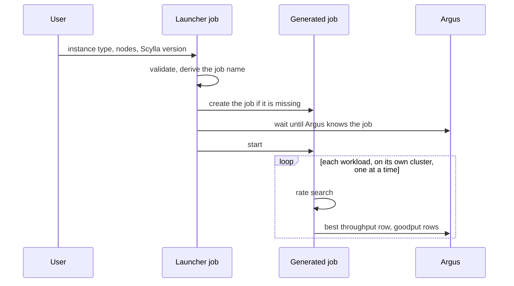

# Best Throughput Under a P99 Limit: Launcher

**Jira:** SCT-580

**Status:** draft

## Overview

A launcher job takes a request (instance type, node count, Scylla version),
creates or reuses one job for that hardware setup, and starts it. The job
runs the rate search of [best-throughput](../best-throughput/spec.md) for
each workload. The problem and the definition of done are in
[best-throughput/intent.md](../best-throughput/intent.md), items 1 and 2.

## Constraints

- One job, and one Argus history, for each hardware setup and test
  configuration.
- A new job reports to Argus from its first run.

## Design



- **The job name** comes from the hardware:
  `<backend>-<instance>-<n>n-<tablets|vnodes>[-suffix]`, in the launcher's
  folder `scylla-enterprise/perf-regression/best-throughput`. Argus scans
  this folder for new jobs.
- **The test configuration** is part of the job's history. A request with a
  `test_config` other than the default must set `job_name_suffix`, so that it
  gets its own job.
- **The Argus wait:** after it creates a job, the launcher starts it only
  when Argus has a test for it. It checks every minute, for up to 30 minutes.
- **The test duration:** the launcher sets `SCT_TEST_DURATION` from the
  search settings: 180 minutes for the setup, the preload and the teardown,
  plus (step duration + 10 minutes) for each search step, each of 2 reruns,
  and each overload step. That is 420 minutes at the defaults.
- **The workloads run one at a time** by default, in the Jenkins throttle
  category of the perf jobs, so no other perf job skews the results. At the
  defaults, the four workloads take about 12 hours. Unthrottled, they run in
  parallel, in about 3 hours.

| Condition | Behavior |
|---|---|
| The request is not valid | Fail before anything is created, with every error listed |
| Argus has no test for a new job after 30 minutes | Fail without starting the job; a rerun of the request starts it |
| The job exists | Reuse it |

## Contracts

### Inputs

```
# launcher job parameters
backend, instance_type_db, n_db_nodes, tablets, job_name_suffix   # the job identity
scylla_version, test_config, extra_environment_variables, region, n_loaders, sub_tests
p99_limit_ms, step_duration, min_rate_per_shard, max_rate_per_shard,
search_precision_pct, max_search_steps, overload_factors
```

`p99_limit_ms` sets `perf_gradual_latency_limit`.

The default `test_config` is the latte predefined-steps test-case of the
tablets job, with its step configuration, `disable_kms.yaml`, and
`disable_speculative_retry.yaml`. The launcher adds its overlays after it:
`tablets_disabled.yaml` for vnodes, `sized_dataset.yaml` and
`latte_time_bound_write.yaml` for the default test-case, and
`best_throughput.yaml` last.

## Risks

| Risk | Response |
|---|---|
| The test timeout ends a run before it reports | The launcher sizes `SCT_TEST_DURATION` from the step budget and the step duration |
| A new job has no Argus test on its first run, so every result submit fails | The jobs live under a folder that Argus scans, and the launcher starts a job only after Argus knows it |
| The launcher uses the Jenkins credentials of the trigger matrix, which can create and reconfigure any job. Anyone who can build the launcher gets that | Use a Jenkins user whose rights are limited to the best-throughput folder, or limit who can build the launcher (see Decisions) |

## Deferred work

- The launcher picks `n_loaders` from the cluster size or the expected rate.

## Decisions

- The job name comes from the hardware, and later requests reuse the job, so
  that its Argus history continues across Scylla versions. (spec)
- The launcher starts a new job only after Argus has a test for it. (spec)
- The launcher sizes `SCT_TEST_DURATION` from the search settings. (spec)
- The search settings are launcher parameters, with their defaults in their
  descriptions. (review)
- The default test configuration is the latte predefined-steps test-case of
  the tablets job. (build)
- The workloads run one at a time by default. (build)
- A request with a `test_config` other than the default must set
  `job_name_suffix`. (review)
- The Jenkins credentials of the launcher: a user limited to the
  best-throughput folder, or a limit on who can build the launcher. (open)
