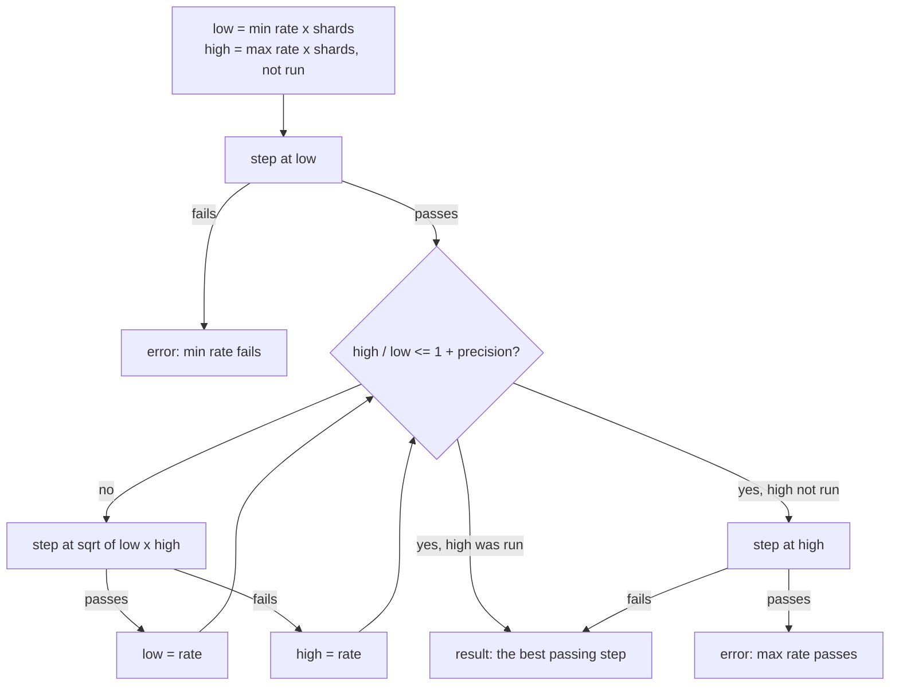

# Best Throughput Under a P99 Limit: Rate Search

**Jira:** SCT-580

**Status:** draft

## Overview

The gradual performance test runs each workload on its own cluster. It sizes
the dataset from the DB nodes, then searches the rate: each step runs latte
at a fixed rate, and the search bisects the rate between two bounds for each
shard until it finds, within 5%, the highest rate whose P99 stays within the
limit. The best rate goes to Argus as one row for each workload. Optional
overload steps then run at multiples of it and report the goodput. The
launcher that creates and starts the jobs has its own spec:
[best-throughput-launcher](../best-throughput-launcher/spec.md).

## Constraints

- Steps are short (5 or 10 minutes), so that a workload takes less time than
  with 30-minute steps.
- A step passes only when the load really sent its rate.
- Steps over the P99 limit are part of a search. They do not fail the run.
- The existing predefined-steps jobs do not change, and their Argus history
  stays.
- The search runs only when its configuration is set.

## Design

The rate search for one workload, after the dataset sizing and the preload:



- **A step** runs every latte command of the workload at the step's rate,
  split evenly over the commands, one command for each loader. Each command
  gets enough in-flight requests that they never limit the rate: the rate
  multiplied by the P99 limit (Little's law with P99 for the mean latency).
  latte keeps the threads of the workload's first configured step, and the
  in-flight requests become its concurrency.
- **The P99 limit** is `perf_gradual_latency_limit` (default 10 ms). It is
  the only P99 limit of a search run: the run sets the P99 `fixed_limit` of
  `latency_decorator_error_thresholds` to null, so that the steps over the
  limit do not fail the run in Argus.
- **A step passes** when the P99 of every operation, in every measurement
  cycle, is within the limit, and the measured throughput is at least 95% of
  the step's rate. For mixed, read and write must both pass.
- **The bisection uses a log scale.** The middle of `low` and `high` is
  `sqrt(low x high)`. Each step halves the ratio between the two ends.
- **The maximum rate runs only at the top.** Until a step fails, the search
  takes `high` as failing. It runs the step at `high` only when the search
  narrows to it. At the defaults, a search takes 8 steps: the minimum rate
  and 7 bisection steps.
- **The result** is the passing step with the highest measured throughput.
- **The dataset** of the test-case is the dataset of a reference node (128 GiB
  RAM, 3750 GB disk). The run scales the key ranges by the smallest DB node,
  relative to the reference, rounded to 0.25 and never below 0.25:
  - the read and mixed hot ranges and the cache warmup, by RAM;
  - the write range, by disk;
  - the preload and the read_disk_only range, by the smaller of the two.

  i4i.4xlarge and i8g.4xlarge keep today's ranges. The preload rate scales
  with its rows.
- **Workload state between steps:** write recreates the schema for each step.
  Read and read_disk_only keep the preloaded data and wait for compactions.
  Mixed grows its dataset with each step and keeps the compaction and
  tablet-split waits.
- **Run time:** at the defaults, a workload runs 8 steps of 10 minutes, each
  followed by 3-6 minutes of compaction and tablet-split waits: about 2 hours
  after the preload. Today a workload runs 5 steps of 30 minutes. The
  launcher runs the four workloads one at a time by default.

| Condition | Behavior |
|---|---|
| The step at the minimum rate fails | Stop. Report stop reason `min rate fails` and throughput 0. Publish an error event |
| The step at the maximum rate passes | Stop. Report stop reason `max rate passes`; the throughput is a lower bound. Publish an error event |
| A step collects no results | Run it once more at the same rate, outside the budget. A second miss counts as a fail |
| The step budget runs out before 5% | Report the best passing step, stop reason `budget` |
| A step sends under 95% of its rate | The step fails. The log names the loader-side limit |
| Argus is not reachable at the end | Write the results file, log a warning, and continue |

## Contracts

### Configuration

```python
perf_best_throughput_search: DictOrStr = SctField(
    description="Rate search for the best throughput within perf_gradual_latency_limit. "
    "Keyed by sub-test, with 'default' for the sub-tests not listed. Keys: "
    "min_rate_per_shard, max_rate_per_shard, precision_pct, max_steps, min_sent_ratio.",
)
perf_gradual_latency_limit: DictOrStr = SctField(
    description="P99 limit of the rate search, in ms, under the 'percentile_99' key. "
    "Keyed by sub-test, with 'default' for the sub-tests not listed.",
)
perf_dataset_sizing: DictOrStr = SctField(
    description="Size the dataset from the DB nodes' RAM and disk. Keys: "
    "reference_ram_gib, reference_disk_gb, scale_step.",
)
perf_overload_steps: DictOrStr = SctField(
    description="Goodput steps at factor x the best throughput. Keys: factors, min_goodput_ratio.",
)
```

```yaml
# defaults/test_default.yaml
perf_gradual_latency_limit: {default: {percentile_99: 10}}

# configurations/performance/best-throughput/best_throughput.yaml
perf_best_throughput_search:
  default: {min_rate_per_shard: 1000, max_rate_per_shard: 60000, precision_pct: 5,
            max_steps: 10, min_sent_ratio: 0.95}
perf_dataset_sizing: {reference_ram_gib: 128, reference_disk_gb: 3750, scale_step: 0.25}
# placeholder until the step duration is set (see Decisions)
perf_gradual_step_duration: {read: 10m, mixed: 10m, read_disk_only: 10m, write: 10m}
latency_decorator_error_thresholds:   # no P99 rule on the step tables, for each sub-test
  mixed: {default: {P99 write: {fixed_limit: null}, P99 read: {fixed_limit: null}}}

# configurations/performance/best-throughput/latte_time_bound_write.yaml
stress_cmd_w:   # the test-case's write commands, with --duration $duration
```

### Outputs

```python
class BestThroughputResult(StaticGenericResultTable):
    # one row for each workload
    # Throughput (op/s, measured), Rate (op/s), Threads, P99 write (ms), P99 read (ms),
    # P99 limit (ms), Step, Stop reason: narrowed | budget | min rate fails | max rate passes

class GoodputUnderOverloadResult(StaticGenericResultTable):
    # one row for each factor
    # Target rate, Sent rate, Sent ratio, Goodput, Goodput ratio (rule: >= 0.9), P99, Failed ops
```

The best step also goes to `<logdir>/result_gradual_increase.log`.

### Module API

```python
@dataclass(frozen=True)
class RateSearchConfig:
    min_rate_per_shard: int = 1000
    max_rate_per_shard: int = 60000
    precision_pct: float = 5
    max_steps: int = 10
    min_sent_ratio: float = 0.95

class RateSearch:
    def __init__(self, config: RateSearchConfig, shards: int) -> None: ...
    def next_rate(self) -> int | None: ...        # None when the search ends
    def record(self, rate: int, passed: bool, throughput: int | None) -> None: ...  # None: no results
    @property
    def stop_reason(self) -> str | None: ...

@dataclass
class BestThroughputStep:
    name: str
    throughput: int                 # measured op/s
    p99: dict[str, float]           # worst P99 for each operation, in ms
    threads: int | None = None
    rate: int | None = None         # the step's fixed rate
    concurrency: int | None = None  # latte concurrency

def in_flight_for(rate: int, p99_limit_ms: float) -> int: ...
def find_best_throughput(
    total_summary: dict, p99_limit_ms: float, min_sent_ratio: float | None = None
) -> BestThroughputStep | None: ...   # applies the P99 limit and the sent-ratio rule
```

## Risks

| Risk | Response |
|---|---|
| Short steps hide the compaction debt of write and mixed, so they show a better result than long steps | Compare 5, 10, and 30-minute steps on i8g before the default is set |
| P99 near the limit is noisy (6-9% between runs), so the best rate changes between runs | Argus history shows the noise; a confirming step at the best rate is an option after the first runs |
| The bounds are wrong for an instance type, so the run stops on an error | The error names the bound; the request sets other bounds |
| The loaders cannot send the rate, so steps fail on the 95% rule and the result is too low | The log names the loader-side limit; the request raises `n_loaders` |

## Deferred work

- A search in a narrow range around the last Argus result.
- New workloads (UPDATE, DELETE, LWT, Alternator) on the same search.
- GCE and Azure.

## Decisions

- Steps run at a fixed rate, and the search bisects the rate. Agreed on
  2026-11-04 (SCT-580). (spec)
- latte generates the load. Agreed on 2026-11-04 (SCT-580). (spec)
- The search starts from the current test configuration. Agreed on
  2026-11-04 (SCT-580). (spec)
- The step duration is the shortest one that gives a stable result. Agreed on
  2026-11-04 (SCT-580). (spec)
- After the tuning on i8g, the test runs on z4d. (review, SCT-580)
- The bisection uses a log scale. The bounds are about 60 times apart, and the
  plain middle puts the first steps near the top. (spec)
- In-flight requests are the rate multiplied by the P99 limit. Then the client
  never limits the rate. (spec)
- A step passes only when it sent at least 95% of its rate. A step that cannot
  send its rate shows a low P99 at a lower rate. (spec)
- The minimum and maximum rate for each shard (1k and 60k op/s) are correct
  for i4i, i8g, and z4d. (open)
- The step duration is 5 or 10 minutes. 10 minutes is the default until it is
  measured. (open)
- Write steps run for the step duration, like the others. At the minimum
  rate, a step that writes the whole 1.6B-row range takes hours. (build)
- latte keeps the threads of the workload's first configured step and gets
  the in-flight requests as its concurrency. The search starts from the
  current test configuration. (build)
- A step that sent under 95% of its rate cannot be the best step. The search
  counts it as failed. (build)
- An overload step multiplies the latte concurrency of the best step by the
  factor, and keeps its threads. (build)
- The step at the maximum rate runs only when the search narrows to it. A
  step at the maximum rate overloads the cluster and, for mixed, leaves a
  bigger dataset and a compaction backlog for the steps after it. (review)
- The search has its own P99 limit, `perf_gradual_latency_limit`. A search
  always has steps over the limit, so its run sets no P99 rule on the Argus
  step tables, and only the search limit applies. (review)
- latte at a fixed rate measures the latency from the scheduled start of each
  request. Checked in `scylladb/latte` at the `0.54.0-scylladb` tag that SCT
  uses. (review)
- The launcher has its own spec. The two parts can ship alone. (review)
- The latte command for each workload: the rune script, the threads, and the
  concurrency for each loader. (open)
