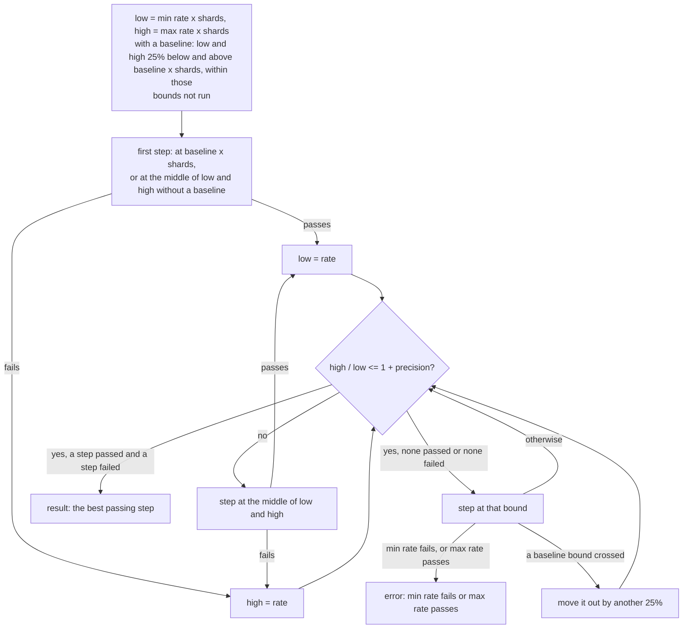

# Best Throughput Under a P99 Limit: Rate Search

**Jira:** SCT-580

**Status:** draft

## Overview

The gradual performance test runs each workload on its own cluster. It sizes
the dataset from the DB nodes, then searches the rate: each step runs latte
at a fixed rate, and the search bisects the rate until it finds, within 5%,
the highest rate whose P99 stays within the limit. It searches between two
bounds for each shard, or, when a baseline is known for the instance family
and workload, around the baseline. The best rate goes to Argus as one row for each workload. Optional
overload steps then run at multiples of it and report the goodput. The
launcher that creates and starts the jobs has its own spec:
[best-throughput-launcher](../best-throughput-launcher/spec.md).

## Constraints

- Steps are as short as a stable result allows: 10 minutes for read, 30 for
  write and mixed.
- A step passes only when the load really sent its rate.
- Steps over the P99 limit are part of a search. They do not fail the run.
- The existing predefined-steps jobs do not change, and their Argus history
  stays.
- The search runs only when its configuration is set.

## Design

The rate search for one workload, after the dataset sizing and the preload:



- **A step** runs every latte command of the workload at the step's rate,
  split evenly over the commands, one command for each loader. Each command
  gets enough in-flight requests that they never limit the rate: the rate
  multiplied by the P99 limit (Little's law with P99 for the mean latency),
  split over the commands. latte keeps the threads of the workload's first
  configured step, and gets each command's in-flight requests split over the
  threads as its `--concurrency`, which is per thread.
- **The P99 limit** is `perf_gradual_latency_limit` (default 10 ms). It is
  the only P99 limit of a search run: the run sets the P99 `fixed_limit` of
  `latency_decorator_error_thresholds` to null, so that the steps over the
  limit do not fail the run in Argus.
- **A step passes** when the P99 of every operation, in every measurement
  cycle, is within the limit, and the measured throughput is at least 98% of
  the step's rate. For mixed, read and write must both pass. A step that
  sent less fails, whatever its P99: latte measures the latency from each
  request's scheduled start, so a loader that lags also goes over the limit.
- **The loaders are guarded.** When a loader goes over 90% CPU during a step,
  the run stops with a test error: the step measured the loaders, not Scylla.
- **The middle of `low` and `high`** is the plain middle, `(low + high) / 2`,
  with a baseline. Without one, the bounds are about 60 times apart, and the
  middle is `sqrt(low x high)`, so the first steps don't go to the top.
- **The bounds run only at the ends.** Until a step passes, the search takes
  `low` as passing, and until a step fails, it takes `high` as failing. It
  runs the step at a bound only when the search narrows to it, or, when no
  step passed, the lower bound as the last step of the budget, so a failing
  minimum rate is reported at any budget. Without a baseline, the first step
  runs at the middle of the bounds. At the defaults, a search takes 7 steps.
- **The baseline** is the best throughput per shard of the instance family
  (`i8g` for `i8g.4xlarge`) and the workload, from the first runs on it.
  Scylla is shard-per-core, so one baseline fits every size of the family.
  With a baseline, the first step runs at it, and the bounds are 25% below
  and above it. Neither bound runs until the search narrows to it, so a
  search takes about 4 steps for a result within about 20% of the baseline.
  A bound that runs and is crossed moves out by another 25%, so a big
  regression or improvement still gets a result, in more steps: 7 at 1.3
  times the baseline. At half the baseline, the budget runs out first, and
  the result is within about 15%, with stop reason `budget`. The minimum and
  maximum rates cap the bounds.
- **The result** is the passing step with the highest measured throughput.
- **The dataset** of the test-case is the dataset of a reference node (128 GiB
  RAM, 3750 GB disk). The run scales the key ranges by the smallest DB node,
  relative to the reference, rounded to 0.25 and never below 0.25:
  - the read and mixed hot ranges and the cache warmup, by RAM;
  - the write range, by disk;
  - the preload and the read_disk_only range, by the smaller of the two.

  i4i.4xlarge and i8g.4xlarge keep today's ranges. The preload rate scales
  with its rows.
- **Workload state between steps:** write recreates the schema for each step.
  Read and read_disk_only keep the preloaded data and wait for compactions.
  Mixed overwrites 20M rows that the preload wrote, so its dataset doesn't
  grow, but its compaction backlog does. It keeps the compaction and
  tablet-split waits.
- **Step duration:** 30 minutes for write and mixed, so that compactions and
  tablet splits run within a step; 10 minutes for read and read_disk_only,
  which don't write.
- **Run time:** each step is followed by 3-6 minutes of compaction and
  tablet-split waits. After the preload, read takes about 1.75 hours without
  a baseline (7 steps) and 1 hour with one (about 4 steps); write and mixed
  about 4 and 2.5 hours. Today a workload runs 5 steps of 30 minutes, about
  3 hours. The launcher runs the four workloads one at a time by default.

| Condition | Behavior |
|---|---|
| The search narrows down to the minimum rate, and it fails | Stop. Report stop reason `min rate fails` and throughput 0. Publish an error event |
| The step at the maximum rate passes | Stop. Report stop reason `max rate passes`; the throughput is a lower bound. Publish an error event |
| A step collects no results | Run it once more at the same rate, outside the budget. A second miss stops the search with an error event and no Argus row, so a result without that rate doesn't land in the history |
| The step budget runs out before 5% | Report the best passing step, stop reason `budget` |
| A step sends under 98% of its rate | The step fails |
| A loader goes over 90% CPU during a step | Stop the search with a test error and no Argus row, so the loaders' capacity doesn't land in the history as the cluster's |
| A baseline bound runs and is crossed | Move it out by another 25%, within the minimum and maximum rates, and go on |
| Argus is not reachable at the end | Write the results file, log a warning, and continue |

## Contracts

### Configuration

```python
perf_best_throughput_search: DictOrStr = SctField(
    description="Rate search for the best throughput within perf_gradual_latency_limit. "
    "Keyed by sub-test, with 'default' for the sub-tests not listed. Keys: "
    "min_rate_per_shard, max_rate_per_shard, precision_pct, max_steps, min_sent_ratio, "
    "baseline_range_pct, max_loader_cpu_pct.",
)
perf_best_throughput_baselines: DictOrStr = SctField(
    description="Best throughput per DB shard to start the search from. Keyed by DB instance "
    "family or instance type, then by sub-test, in op/s per shard.",
)
perf_gradual_latency_limit: DictOrStr = SctField(
    description="P99 limit of the rate search, in ms, under the 'percentile_99' key. "
    "Keyed by sub-test, with 'default' for the sub-tests not listed.",
)
perf_dataset_sizing: DictOrStr = SctField(
    description="Size the dataset from the DB nodes' RAM and disk. Keys: "
    "reference_ram_gib, reference_disk_gb, scale_step.",
)
perf_overload_steps: DictOrStr = SctField(
    description="Goodput steps at factor x the best throughput. Keys: factors, min_goodput_ratio.",
)
```

```yaml
# defaults/test_default.yaml
perf_gradual_latency_limit: {default: {percentile_99: 10}}

# configurations/performance/best-throughput/best_throughput.yaml
perf_best_throughput_search:
  default: {min_rate_per_shard: 1000, max_rate_per_shard: 60000, precision_pct: 5,
            max_steps: 10, min_sent_ratio: 0.98, baseline_range_pct: 25,
            max_loader_cpu_pct: 90}
perf_best_throughput_baselines: {}   # filled from the first runs, e.g. {i8g: {read: 40000}}
perf_dataset_sizing: {reference_ram_gib: 128, reference_disk_gb: 3750, scale_step: 0.25}
perf_gradual_step_duration: {read: 10m, read_disk_only: 10m, write: 30m, mixed: 30m}
latency_decorator_error_thresholds:   # no P99 rule on the step tables (the merge is deep)
  read: {default: {P99 read: {fixed_limit: null}}}
  read_disk_only: {default: {P99 read: {fixed_limit: null}}}
  write: {default: {P99 write: {fixed_limit: null}}}
  mixed: {default: {P99 write: {fixed_limit: null}, P99 read: {fixed_limit: null}}}

# configurations/performance/best-throughput/latte_time_bound_write.yaml
stress_cmd_w:   # the test-case's write commands, with --duration $duration
```

### Outputs

```python
class BestThroughputResult(StaticGenericResultTable):
    # one row for each workload
    # Throughput (op/s, measured), Rate (op/s), Threads, P99 write (ms), P99 read (ms),
    # P99 limit (ms), Step,
    # Stop reason: narrowed | budget | min rate fails | max rate passes

class GoodputUnderOverloadResult(StaticGenericResultTable):
    # one row for each factor
    # Target rate, Sent rate, Sent ratio, Goodput, Goodput ratio (rule: >= 0.9), P99, Failed ops
```

The best step also goes to `<logdir>/result_gradual_increase.log`.

### Module API

```python
@dataclass(frozen=True)
class RateSearchConfig:
    min_rate_per_shard: int = 1000
    max_rate_per_shard: int = 60000
    precision_pct: float = 5
    max_steps: int = 10
    min_sent_ratio: float = 0.98
    baseline_per_shard: int | None = None   # from perf_best_throughput_baselines
    baseline_range_pct: float = 25
    max_loader_cpu_pct: float = 90   # checked by the test, outside the search

class RateSearch:
    def __init__(self, config: RateSearchConfig, shards: int) -> None: ...
    def next_rate(self) -> int | None: ...        # None when the search ends
    def record(self, rate: int, passed: bool, throughput: int | None) -> None: ...
                                                   # throughput None: no results
    @property
    def stop_reason(self) -> str | None: ...

@dataclass
class BestThroughputStep:
    name: str
    throughput: int                 # measured op/s
    p99: dict[str, float]           # worst P99 for each operation, in ms
    threads: int | None = None
    rate: int | None = None         # the step's fixed rate
    concurrency: int | None = None  # latte concurrency

def in_flight_for(rate: int, p99_limit_ms: float) -> int: ...
def find_best_throughput(
    total_summary: dict, p99_limit_ms: float, min_sent_ratio: float | None = None
) -> BestThroughputStep | None: ...   # applies the P99 limit and the sent-ratio rule
```

## Risks

| Risk | Response |
|---|---|
| Short steps hide the compaction debt of write and mixed, so they show a better result than long steps | Write and mixed run 30-minute steps. Compare 10 and 30-minute steps on i8g before shortening them |
| P99 near the limit is noisy (6-9% between runs), so the best rate changes between runs | Argus history shows the noise; a confirming step at the best rate is an option after the first runs |
| The bounds are wrong for an instance type, so the run stops on an error | The error names the bound; the request sets other bounds |
| The loaders run out of CPU, so a step measures them, not Scylla | The loader guardrail stops the run with a test error; the request raises `n_loaders` |
| A baseline is far from the cluster's result, so the search takes more steps | Each crossed bound moves out by 25%; the step budget caps the search. A result past the baseline's range is worth reporting, since throughput should scale with the shards |

## Deferred work

- New workloads (UPDATE, DELETE, LWT, Alternator) on the same search.
- GCE and Azure.

## Decisions

- Steps run at a fixed rate, and the search bisects the rate. Agreed on
  2026-11-04 (SCT-580). (spec)
- latte generates the load. Agreed on 2026-11-04 (SCT-580). (spec)
- The search starts from the current test configuration. Agreed on
  2026-11-04 (SCT-580). (spec)
- The step duration is the shortest one that gives a stable result. Agreed on
  2026-11-04 (SCT-580). (spec)
- After the tuning on i8g, the test runs on z4d. (review, SCT-580)
- With a baseline, the bisection takes the plain middle. Its bounds are 25%
  below and above the baseline, where `sqrt(low x high)` and the plain middle
  differ by about 3% on the first step, and less after it, and the plain
  middle is simpler to read in the logs. Without a baseline, the bounds are
  about 60 times apart, and the plain middle puts the first steps near the
  top, so that search keeps `sqrt(low x high)`. (review)
- In-flight requests are the rate multiplied by the P99 limit. Then the client
  never limits the rate. (spec)
- A step passes only when it sent at least 98% of its rate. A step that cannot
  send its rate shows a low P99 at a lower rate. (spec)
- The minimum and maximum rate for each shard (1k and 60k op/s) are correct
  for i4i, i8g, and z4d. (open)
- The step duration is 30 minutes for write and mixed, so that compactions
  and tablet splits run within a step, and 10 minutes for read and
  read_disk_only. A comparison on i8g may shorten them. With 30-minute steps,
  write and mixed meet intent item 6 only with a baseline: the first runs on
  an instance family, which set the baselines, take about 4 hours, against
  3 today. (review)
- Write steps run for the step duration, like the others. At the minimum
  rate, a step that writes the whole 1.6B-row range takes hours. (build)
- latte keeps the threads of the workload's first configured step and gets
  the in-flight requests as its concurrency. The search starts from the
  current test configuration. (build)
- A step must send 98% of its rate. 95% is too loose next to the 5%
  precision; in the minicloud run, every passing step sent at least 99.99% of
  its rate. (review)
- A step that sent under 98% of its rate fails, whatever its P99. A
  loader that lags goes over the P99 limit too, as latte measures from the
  scheduled start, so the P99 can't tell a lagging loader apart. A loader
  over 90% CPU during a step stops the run with a test error instead, as the
  step no longer measures Scylla. (review)
- A step that collected no results twice stops the search with an error and
  no Argus row. Counted as a fail, it would store a lower result, or
  `min rate fails` with 0. (review)
- With a baseline for the instance family and workload, the search starts at
  it, between bounds 25% below and above it, and moves a crossed bound out by
  another 25%. Without one, it bisects between the minimum and maximum rates,
  which give the first baselines. (review)
- An overload step multiplies the latte concurrency of the best step by the
  factor, and keeps its threads. (build)
- The step at the maximum rate runs only when the search narrows to it. A
  step at the maximum rate overloads the cluster and leaves a compaction
  backlog for the steps after it. (review)
- The step at the minimum rate runs only when the search narrows to it, and
  without a baseline the first step runs at the middle of the bounds. Almost
  every run passes the minimum, so this saves a step. A cluster that fails
  the minimum rate reports it after 8 steps instead of 1: about 4.5 hours of
  overloaded write steps instead of 35 minutes. When no step passed, the
  last step of the budget runs at the minimum rate. (review)
- The search has its own P99 limit, `perf_gradual_latency_limit`. A search
  always has steps over the limit, so its run sets no P99 rule on the Argus
  step tables, and only the search limit applies. (review)
- latte at a fixed rate measures the latency from the scheduled start of each
  request. Checked in `scylladb/latte` at the `0.54.0-scylladb` tag that SCT
  uses. (review)
- The launcher has its own spec. The two parts can ship alone. (review)
- The latte command for each workload: the rune script, the threads, and the
  concurrency for each loader. (open)
