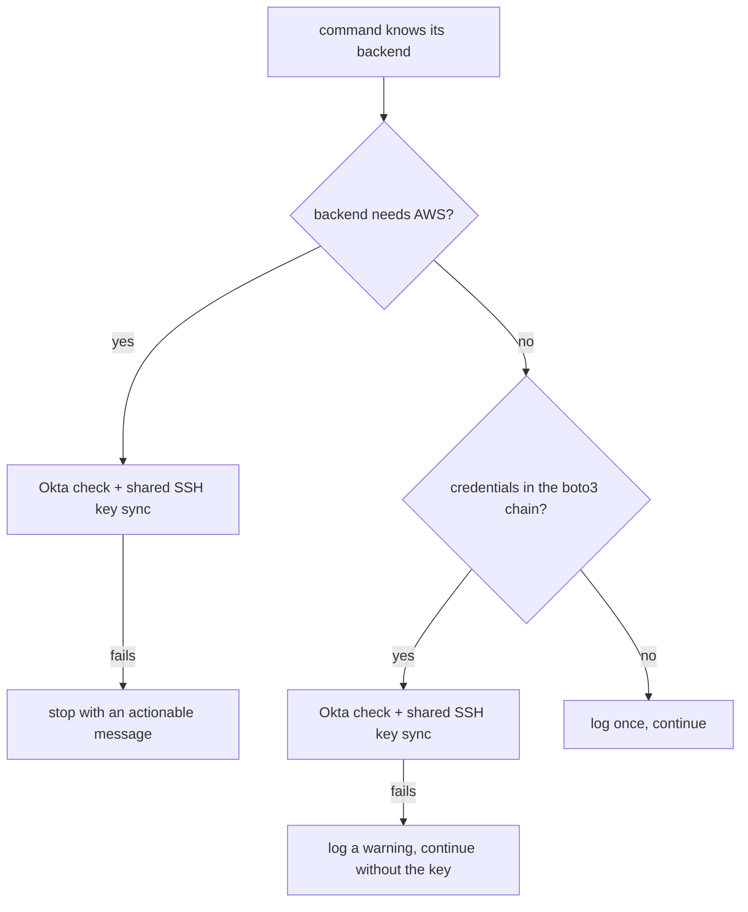

# Credential-free local testing

**Status:** draft

## Overview

One credential helper answers two questions for the whole of SCT: does this
run need AWS, and are AWS credentials there. The `sct.py` commands that
resolve a configuration ask it once their backend is known, and run the Okta
check and the shared SSH key sync only when the backend needs AWS, or when
credentials are there. Integration tests that need AWS carry a `requires_aws`
marker that skips them locally and fails them in CI. Reads of public buckets
go unsigned, the kind Docker Hub secret becomes optional, and a `local`
KeyStore backend lets a person supply their own secrets. A GitHub Actions
job with no secrets keeps all of this true.

## Constraints

- A run on a real cloud backend still checks the credentials at start-up,
  before it provisions anything.
- A run with credentials does the same work as today, on every backend.
- The decision uses no AWS API call. The boto3 credential chain can still
  probe the instance metadata on a host with no credentials.
- The click group callback runs before the subcommand parses `--backend`, so
  it cannot take the decision.
- A fork pull request must not get access to a secret.

## Design

### Credential helper

The helper classifies a backend and checks the boto3 credential chain. Only
`docker` and `k8s-local-kind` run without AWS. kind on a cloud VM
(`k8s-local-kind-aws`, `k8s-local-kind-gce`) is not a local backend. An
unknown backend needs AWS. A backend that does not need AWS does not need the
shared SSH key: Docker nodes are reached with `docker exec`, and kind pods
with `kubectl`.

### CLI start-up

The click group callback keeps a fixed list of commands that never need
credentials. The commands that resolve a configuration (`run-test`,
`run-pytest`, `conf`, `provision-resources`, `integration-tests`) prepare
the credentials themselves, once they know the backend.



The configuration check requires `user_credentials_path` only on a backend
that SSHes. On `docker` and `k8s-local-kind` SCT writes nothing to `~/.ssh`.
The Okta error message has no internal link, and tells staff and outsiders
what to do.

### Integration-test marker

`requires_aws` marks each integration test that needs the SCT AWS account. A
test is marked when it fails in a run with every credential hidden. A test
that reads a cached S3 object and passes because an unreadable cache reads as
empty is marked too. A moto-server test must not need real credentials: it is
fixed, not marked. Tests that call a cloud SDK directly (OCI utils, the
catalog generator) keep their own skips.

| Condition | Behavior |
|---|---|
| Marked test, no credentials, `JOB_NAME` unset | Skip: `needs AWS credentials for the SCT AWS account` |
| Marked test, no credentials, `JOB_NAME` set | Fail, with the job name |
| Marked test, credentials expired or of another account | Run. The AWS error names the problem |
| Unmarked test | Run as today |

`need_network` stays a separate marker: public internet access is not a
credential.

### Public bucket reads

The repository and version lookups against `downloads.scylladb.com` use an
unsigned S3 client, as their sibling helpers already do. The resolved URLs do
not change.

### Docker Hub secret on kind

On `k8s-local-kind`, namespace creation tries to read the Docker Hub secret.
When the read fails, it logs once and continues. The Helm charts keep the
`imagePullSecrets` reference. kubelet ignores the missing secret and pulls
anonymously, under the anonymous rate limit. EKS and GKE create the secret
as today.

### minicloud offline mode

A minicloud run has `cluster_backend: aws` or `gce`, so the backend alone
says that it needs AWS. A run is minicloud-offline when the minicloud endpoint
is set and the local image cache holds every image that the run asks for. A
cold cache still needs the credentials once, to download the image.

On the SCT side, offline mode is:

- the `local` KeyStore backend for the secrets that the run reads;
- an offline overlay: an empty S3 passthrough list, literal image ids, and no
  version lookups;
- no minicloud preflight credential check when the cache covers the run.

With a warm cache and no other change, minicloud still forwards
`DescribeImages`, SSM, STS, and Secrets Manager calls to AWS, and GCE auth
fetches a real OAuth token. The emulator side of offline mode is in the
minicloud repository (see Deferred work).

### CI guard

A GitHub Actions workflow on the `pull_request` trigger, with no secrets and
a read-only token, runs on each pull request, fork pull requests included:

```
sct.py unit-tests
sct.py integration-tests -m "integration and not requires_aws"
```

The Jenkins stages do not change.

## Contracts

### Configuration

```
SCT_KEYSTORE_BACKEND=local        # new value; secretsmanager stays the default
SCT_KEYSTORE_LOCAL_DIR=<dir>      # default ~/.sct/keystore
```

In the `local` backend each secret is a file in the directory, with the name
of the Secrets Manager key. A missing file raises the same not-found error as
the AWS backends, so callers that fall back on a miss behave the same. The
message names the file path to create. The KeyStore cache key includes the
directory, so one backend never serves the bytes of another.

### Module API

```python
# sdcm/utils/credentials.py
def backend_needs_aws(backend: str | None) -> bool: ...
def backend_needs_ssh_key(backend: str | None) -> bool: ...
def aws_credentials_available() -> bool: ...
def prepare_cli_credentials(backend: str | None) -> None: ...
```

### Outputs

```ini
# unit_tests/pytest.ini
markers =
    requires_aws: needs credentials for the SCT AWS account
```

## Risks

| Risk | Response |
|---|---|
| A cloud run starts and fails late on an expired token | Every real cloud backend needs AWS, so the start-up check still runs for it |
| Broken CI credentials hide a whole class of tests | With `JOB_NAME` set, a marked test fails instead of skipping |
| A new local-backend feature SSHes with the shared key | It fails with a missing-file error that names the path. The Docker provision test runs with no key |
| Unsigned reads get throttled | The same public bucket that other helpers read unsigned; the retry policy does not change |
| GitHub-hosted runners are too small for the Docker Scylla fixtures | Start with the unit suite and a small Docker subset, then grow |
| A fork pull request abuses the workflow | No secrets, a read-only token, no `pull_request_target` |
| minicloud offline mode needs emulator changes | Every other part of this change works without it |

Rollback: each part acts only when the credentials are absent and the
backend is local. A revert restores the eager checks. Credentialed users
never take the new paths.

## Deferred work

- minicloud repository: an `--offline` switch that stops the passthrough,
  image metadata (`DescribeImages`, GCE `images.get`) served from a sidecar
  next to each cached image, local SSM and GCE OAuth stubs, and cache export
  and import. Until then, minicloud offline mode needs a cache that was warmed
  once with credentials.
- A collection-time check that fails an unmarked test that calls real boto3.
- `docs/running-without-credentials.md`, with what works with no credentials,
  with your own credentials, and with the Scylla QA credentials, linked from
  `README.md` and `docs/contrib.md`.

## Decisions

- One marker, `requires_aws`. SCT reads its GCE, Azure, and OCI credentials
  from the KeyStore, which needs AWS, and every measured credential failure
  was AWS. (build)
- The marker is chosen by a run with credentials hidden, not by reading the
  code. (build)
- The availability check is local only. It does not tell valid credentials
  from expired ones, or the QA account from a personal one. On a local
  backend a rejected credential logs a warning and the run continues. A
  marked test with such a credential runs and fails on the AWS error.
  (review)
- SCT writes nothing to `~/.ssh` on `docker` and `k8s-local-kind`. The
  location of the keys for cloud backends stays as it is, in SCT-1292.
  (review)
- minicloud offline mode is detected from the minicloud endpoint and the
  image cache, not from `cluster_backend`. (review)
- How SCT knows that the cache covers every image before the configuration
  resolves the images. (open)
- The implementation spans pull requests #16447 (helper and CLI start-up),
  #16453 (marker), #16454 (unsigned reads), #16468 (kind Docker Hub secret),
  and #16541 (`local` KeyStore backend). The CI guard and the documentation
  follow. (spec)
