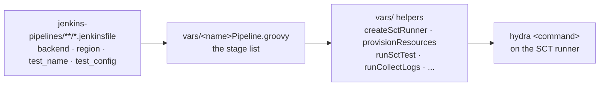
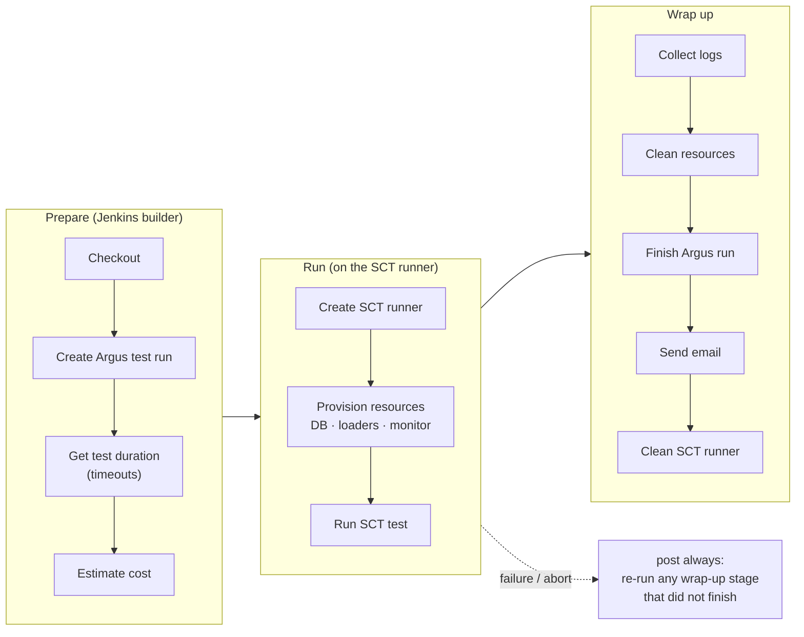
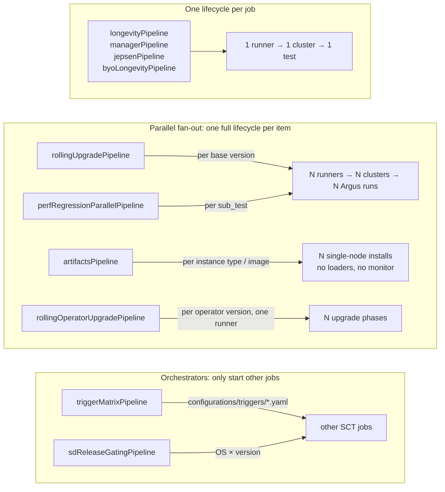

# SCT Jenkins pipelines

Every SCT job in Jenkins is a short `*.jenkinsfile` that calls one of the shared pipelines in
`vars/`. The pipeline runs a fixed list of stages, and each stage is a `hydra` command. All of it
lives in this repo, so a pipeline change is reviewed like any other code change.



A jenkinsfile only picks the pipeline and its parameters:

```groovy
longevityPipeline(
    backend: 'aws',
    region: 'eu-west-1',
    test_name: 'longevity_test.LongevityTest.test_custom_time',
    test_config: 'test-cases/longevity/longevity-10gb-3h.yaml'
)
```

For how the test method and `test_config` YAML are written, see [writing a test](writing-a-test.md).

## The standard flow: `longevityPipeline`

`longevityPipeline` is used by about 900 jobs: longevity, features, gemini, nemesis, tier1/2 and
all Scylla Operator (k8s) longevity jobs. Most other pipelines are variations of it.



| Stage | `hydra` command |
|---|---|
| Create Argus test run | `create-argus-test-run` |
| Get test duration | `output-conf` (derives the job, runner, log-collection and cleanup timeouts) |
| Estimate cost | `estimate-cost` (advisory; a failure does not fail the job) |
| BYO ScyllaDB *(optional)* | builds a custom ScyllaDB first, see [BYO ScyllaDB](byo-scylladb.md) |
| Create SCT runner | `find-runner-instance` / `create-runner-instance`, see [SCT runners](sct-runners.md) |
| Provision resources | `provision-resources` |
| Run SCT test | `run-test <test_name> --backend <backend>` (or `run-pytest`), then `fetch-junit-from-runner` |
| Collect logs | `collect-logs` |
| Clean resources | `clean-resources` (honours `post_behavior_*`) |
| Finish Argus run | `finish-argus-test-run` |
| Send email | `send-email` |
| Clean SCT runner | `set-runner-tags` + `clean-runner-instances` |

Every command runs on the SCT runner through `hydra --execute-on-runner` when one exists, and on the
builder otherwise. The `post { always }` block remembers which stages completed, so an aborted or
failed build still collects logs, cleans resources and closes the Argus run.

## Pipeline variants and why they differ



| Pipeline | Used for | How it differs | Why |
|---|---|---|---|
| `longevityPipeline` | longevity, features, gemini, nemesis, tier1/2, k8s operator longevity | the standard flow above | |
| `managerPipeline` | Scylla Manager | provisions only on aws/gce/azure/oci; adds *Running downstream jobs* on success | chains manager upgrade jobs after a green run |
| `jepsenPipeline` | Jepsen | no provision stage; always `run-test jepsen_test --backend gce` | Jepsen brings its own repo and command and runs on GCE only |
| `rollingUpgradePipeline` | rolling upgrade | parallel branch per base version from `get-scylla-base-versions`, each with its own test id | one job proves upgrades from every supported source version |
| `perfRegressionParallelPipeline` | performance regression | parallel branch per entry in `sub_tests` | several workloads (read, write, mixed) measured against the same build |
| `artifactsPipeline` | package and image checks | parallel branch per `instance_type`; no provision stage; runs on the builder | single-node install checks need no loaders or monitoring |
| `rollingOperatorUpgradePipeline` | Scylla Operator upgrade | one runner, a phase per operator base version | operator upgrades are sequential phases on one k8s cluster |
| `perfSearchBestConfigParallelPipeline` | perf best-config search | like perf regression | |
| `byoLongevityPipeline` | longevity on a custom build | older minimal flow, no Argus or timeouts stage | |
| `triggerMatrixPipeline` | scheduled runs | reads a trigger matrix and starts jobs | one place to define what runs on which branch and when; see [trigger matrix](testing/trigger-matrix.md) |
| `sdReleaseGatingPipeline` | scylla-doctor release gating | starts artifact jobs per OS × version, then reports | |
| `createTestJobPipeline` | job creation | creates the Jenkins job tree for a branch from `jenkins-pipelines/` | jobs are generated, never hand-made |

Kubernetes jobs do not have their own pipeline: they use `longevityPipeline` with the `k8s_*`
parameters, and the k8s cluster is created as part of provisioning.

## Directory layout

The Jenkins folder tree is generated from `jenkins-pipelines/`, so a jenkinsfile's path is its job
path. Folder names and job metadata come from `_folder_definitions.yaml` (older folders still use
`_display_name`).

```
jenkins-pipelines/
├── oss/                 # core ScyllaDB tests
│   ├── longevity/  features/  gemini/  nemesis/  tier1/  tier2/
│   ├── rolling-upgrade/  artifacts/  artifacts-offline-install/
│   ├── alternator/  jepsen/  raft/  scale/  kafka_connectors/ ...
│   └── minicloud/  reproducers/  customer-cases/
├── performance/         # perf regression (+ performance_staging/)
├── manager/             # Scylla Manager
├── operator/            # Scylla Operator on k8s
├── scylla-doctor/  vector-search/
├── master-triggers/     # trigger-matrix jobs
├── qa/                  # job creation and maintenance jobs
└── quarantined/         # stale pipelines kept out of the schedule
```

Job definitions and their generation: [job_defines_format](job_defines_format.md).

## Running on a local Jenkins agent

By default a pipeline schedules on the region-appropriate cloud builder
(`getJenkinsLabels` maps backend+region to an ASG/template label), and longevity-style
pipelines then provision a cloud sct-runner that the test actually runs on. Two knobs change
that, both usable independently:

- **`jenkins_label` (job parameter, any backend, any pipeline that declares it)** - pin the
  build to a named agent label, bypassing the region→builder mapping entirely. Only approved
  labels are accepted: the builder labels `getJenkinsLabels` itself maps to, the
  `minicloud-kvm-builders-*` family, and the `pinnableExtras` list in that file. A new lab
  machine becomes pinnable with a one-line addition there. Empty (the default) keeps the
  normal mapping, so build #1 - where parameters are not yet populated - behaves exactly as
  before. Use it to debug on a specific machine or to prove out a new agent.

- **`local_agent: true` (jenkinsfile literal, longevity / rolling-upgrade)** - skip the
  *Create SCT Runner* / *Clean SCT Runners* stages and run the test right on the Jenkins
  agent, the way `artifactsPipeline` always has (every stage helper already takes the
  builder-local path when `./sct_runner_ip` is absent). It must be combined with something
  that picks an appropriate agent - `minicloud: true` (which resolves the KVM-capable label)
  or a `jenkins_label`.

Both are job parameters as well as jenkinsfile knobs, with one caveat worth knowing: the agent
label is decided at pipeline-definition time, and `params` is empty on build #1 - the
parameters-loading build these pipelines abort anyway - so a parameter only takes effect from
build #2 onward, falling back to the jenkinsfile value before that.

For minicloud specifically - which needs a KVM-capable agent for the local topology - see
[minicloud](./minicloud.md). For the cloud sct-runner mechanics, see
[sct-runners](./sct-runners.md).
