# SCT system map

What a test run is made of on each backend, drawn for the Longevity shape. Expand a backend to see its diagram and the test types it supports.

<b>AWS</b> · AWS account

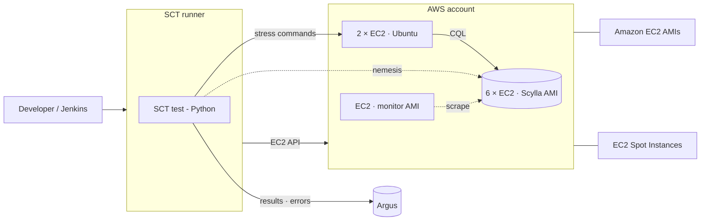

| Test type | What it does |
|---|---|
| [Longevity](../docs/longevity.md) | Long-running mixed load with chaos. The default shape most tests share. |
| [Performance regression](../docs/performance/README.md) | Steady stress against a fixed cluster. HDR latency and throughput go to Argus, which compares with past runs and fails on regression. |
| [Rolling upgrade](../docs/rolling-upgrade.md) | Starts on a base version and upgrades one node at a time under load, optionally rolling some back. |
| [Artifacts](../docs/artifacts_test.md) | Checks a package, image or AMI on one node. No loaders, no monitor. |
| [Scylla Manager](../docs/configuration_options/scylla-manager.md) | Backup, restore, repair and health checks driven by sctool. Backups go to the backend's object storage. |
| [Multi-DC longevity](../docs/longevity.md) | One cluster across regions. List values give per-DC counts; rack_aware_loader keeps load local. |
| [Gemini](https://github.com/scylladb/gemini#readme) | Gemini sends the same random operations to the test cluster and an oracle cluster and fails on any difference. Nemesis hits the test cluster only. |
| [Alternator](../docs/configuration_options/alternator-dynamodb-api.md) | Same topology as longevity; the load uses the DynamoDB-compatible API instead of CQL. |
| [Cassandra → Scylla (Spark/EMR)](../docs/cs-to-scylla-migration.md) | An EMR Spark job runs scylla-migrator from a Cassandra source cluster into Scylla, then a validator job. |
| [Vector search](../docs/configuration_options/vector-store.md) | Vector-store nodes attached to the Scylla cluster, serving ANN queries over HTTP. |
| [Kafka connectors](../docs/kafka.md) | Kafka runs as a docker-compose stack on the SCT runner. CDC source and sink connectors move data between Scylla and Kafka. |
| [Security: EaR + LDAP](../test-cases/longevity) | Encryption at rest with the cloud KMS (key rotation threads), and LDAP auth against an OpenLDAP container on the runner. |

<b>GCE</b> · GCP project

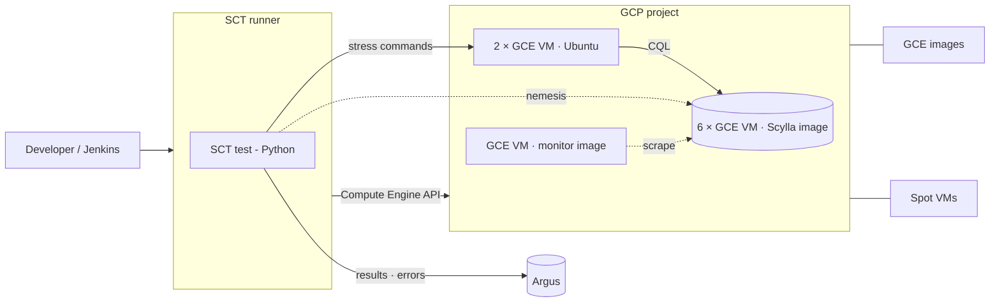

| Test type | What it does |
|---|---|
| [Longevity](../docs/longevity.md) | Long-running mixed load with chaos. The default shape most tests share. |
| [Performance regression](../docs/performance/README.md) | Steady stress against a fixed cluster. HDR latency and throughput go to Argus, which compares with past runs and fails on regression. |
| [Rolling upgrade](../docs/rolling-upgrade.md) | Starts on a base version and upgrades one node at a time under load, optionally rolling some back. |
| [Artifacts](../docs/artifacts_test.md) | Checks a package, image or AMI on one node. No loaders, no monitor. |
| [Scylla Manager](../docs/configuration_options/scylla-manager.md) | Backup, restore, repair and health checks driven by sctool. Backups go to the backend's object storage. |
| [Multi-DC longevity](../docs/longevity.md) | One cluster across regions. List values give per-DC counts; rack_aware_loader keeps load local. |
| [Gemini](https://github.com/scylladb/gemini#readme) | Gemini sends the same random operations to the test cluster and an oracle cluster and fails on any difference. Nemesis hits the test cluster only. |
| [Alternator](../docs/configuration_options/alternator-dynamodb-api.md) | Same topology as longevity; the load uses the DynamoDB-compatible API instead of CQL. |
| [Jepsen](../docs/configuration_options/jepsen-tests.md) | Jepsen consistency tests. The control node drives the DB nodes over SSH and injects its own faults. |
| [Kafka connectors](../docs/kafka.md) | Kafka runs as a docker-compose stack on the SCT runner. CDC source and sink connectors move data between Scylla and Kafka. |
| [Security: EaR + LDAP](../test-cases/longevity) | Encryption at rest with the cloud KMS (key rotation threads), and LDAP auth against an OpenLDAP container on the runner. |

<b>Azure</b> · Azure subscription

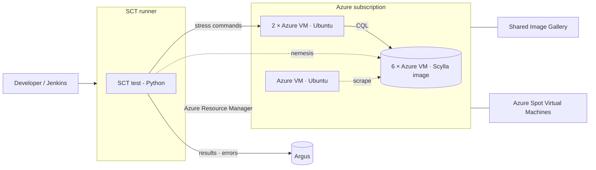

| Test type | What it does |
|---|---|
| [Longevity](../docs/longevity.md) | Long-running mixed load with chaos. The default shape most tests share. |
| [Performance regression](../docs/performance/README.md) | Steady stress against a fixed cluster. HDR latency and throughput go to Argus, which compares with past runs and fails on regression. |
| [Rolling upgrade](../docs/rolling-upgrade.md) | Starts on a base version and upgrades one node at a time under load, optionally rolling some back. |
| [Artifacts](../docs/artifacts_test.md) | Checks a package, image or AMI on one node. No loaders, no monitor. |
| [Scylla Manager](../docs/configuration_options/scylla-manager.md) | Backup, restore, repair and health checks driven by sctool. Backups go to the backend's object storage. |
| [Multi-DC longevity](../docs/longevity.md) | One cluster across regions. List values give per-DC counts; rack_aware_loader keeps load local. |
| [Gemini](https://github.com/scylladb/gemini#readme) | Gemini sends the same random operations to the test cluster and an oracle cluster and fails on any difference. Nemesis hits the test cluster only. |
| [Alternator](../docs/configuration_options/alternator-dynamodb-api.md) | Same topology as longevity; the load uses the DynamoDB-compatible API instead of CQL. |
| [Kafka connectors](../docs/kafka.md) | Kafka runs as a docker-compose stack on the SCT runner. CDC source and sink connectors move data between Scylla and Kafka. |
| [Security: EaR + LDAP](../test-cases/longevity) | Encryption at rest with the cloud KMS (key rotation threads), and LDAP auth against an OpenLDAP container on the runner. |

<b>OCI</b> · OCI tenancy

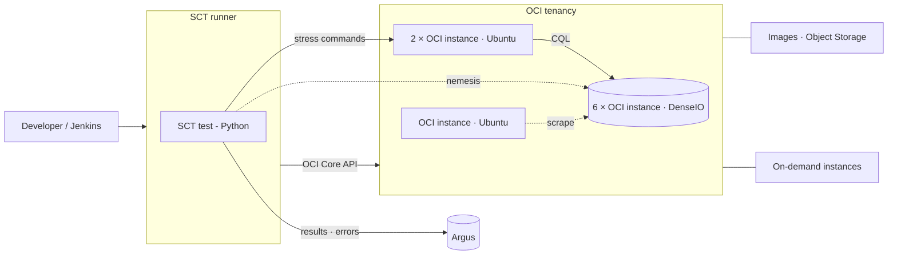

| Test type | What it does |
|---|---|
| [Longevity](../docs/longevity.md) | Long-running mixed load with chaos. The default shape most tests share. |
| [Performance regression](../docs/performance/README.md) | Steady stress against a fixed cluster. HDR latency and throughput go to Argus, which compares with past runs and fails on regression. |
| [Rolling upgrade](../docs/rolling-upgrade.md) | Starts on a base version and upgrades one node at a time under load, optionally rolling some back. |
| [Artifacts](../docs/artifacts_test.md) | Checks a package, image or AMI on one node. No loaders, no monitor. |
| [Scylla Manager](../docs/configuration_options/scylla-manager.md) | Backup, restore, repair and health checks driven by sctool. Backups go to the backend's object storage. |
| [Multi-DC longevity](../docs/longevity.md) | One cluster across regions. List values give per-DC counts; rack_aware_loader keeps load local. |
| [Gemini](https://github.com/scylladb/gemini#readme) | Gemini sends the same random operations to the test cluster and an oracle cluster and fails on any difference. Nemesis hits the test cluster only. |
| [Alternator](../docs/configuration_options/alternator-dynamodb-api.md) | Same topology as longevity; the load uses the DynamoDB-compatible API instead of CQL. |
| [Kafka connectors](../docs/kafka.md) | Kafka runs as a docker-compose stack on the SCT runner. CDC source and sink connectors move data between Scylla and Kafka. |
| [Security: EaR + LDAP](../test-cases/longevity) | Encryption at rest with the cloud KMS (key rotation threads), and LDAP auth against an OpenLDAP container on the runner. |

<b>Docker</b> · Docker host

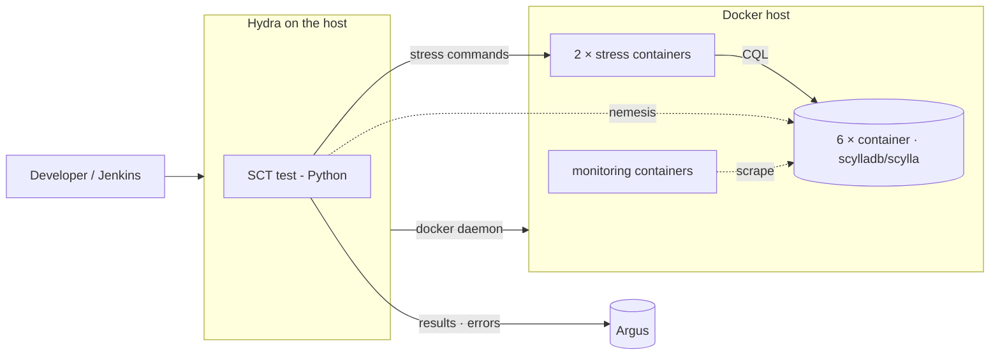

| Test type | What it does |
|---|---|
| [Longevity](../docs/longevity.md) | Long-running mixed load with chaos. The default shape most tests share. |
| [Rolling upgrade](../docs/rolling-upgrade.md) | Starts on a base version and upgrades one node at a time under load, optionally rolling some back. |
| [Artifacts](../docs/artifacts_test.md) | Checks a package, image or AMI on one node. No loaders, no monitor. |
| [Alternator](../docs/configuration_options/alternator-dynamodb-api.md) | Same topology as longevity; the load uses the DynamoDB-compatible API instead of CQL. |
| [Vector search](../docs/configuration_options/vector-store.md) | Vector-store nodes attached to the Scylla cluster, serving ANN queries over HTTP. |
| [Kafka connectors](../docs/kafka.md) | Kafka runs as a docker-compose stack on the SCT runner. CDC source and sink connectors move data between Scylla and Kafka. |

<b>EKS</b> · AWS account

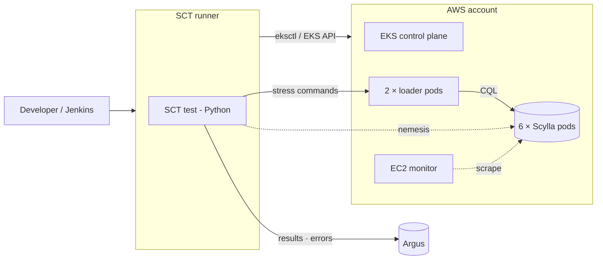

| Test type | What it does |
|---|---|
| [Longevity](../docs/longevity.md) | Long-running mixed load with chaos. The default shape most tests share. |
| [Scylla Manager](../docs/configuration_options/scylla-manager.md) | Backup, restore, repair and health checks driven by sctool. Backups go to the backend's object storage. |
| [Scylla Operator (k8s)](../docs/k8s-functional-test.md) | Functional tests of Scylla Operator. Scylla, loaders and supporting services all run as pods. |

<b>GKE</b> · GCP project

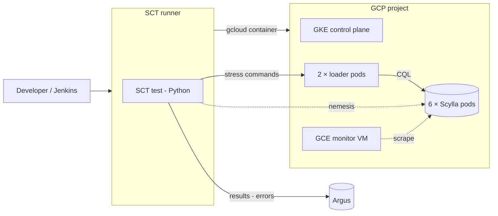

| Test type | What it does |
|---|---|
| [Longevity](../docs/longevity.md) | Long-running mixed load with chaos. The default shape most tests share. |
| [Scylla Manager](../docs/configuration_options/scylla-manager.md) | Backup, restore, repair and health checks driven by sctool. Backups go to the backend's object storage. |
| [Scylla Operator (k8s)](../docs/k8s-functional-test.md) | Functional tests of Scylla Operator. Scylla, loaders and supporting services all run as pods. |

<b>kind</b> · kind cluster (docker)

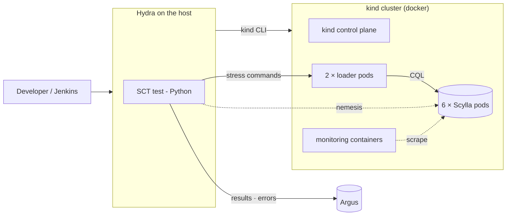

| Test type | What it does |
|---|---|
| [Longevity](../docs/longevity.md) | Long-running mixed load with chaos. The default shape most tests share. |
| [Scylla Manager](../docs/configuration_options/scylla-manager.md) | Backup, restore, repair and health checks driven by sctool. Backups go to the backend's object storage. |
| [Scylla Operator (k8s)](../docs/k8s-functional-test.md) | Functional tests of Scylla Operator. Scylla, loaders and supporting services all run as pods. |

<b>ScyllaDB Cloud</b> · Your AWS account (xcloud_provider: aws)

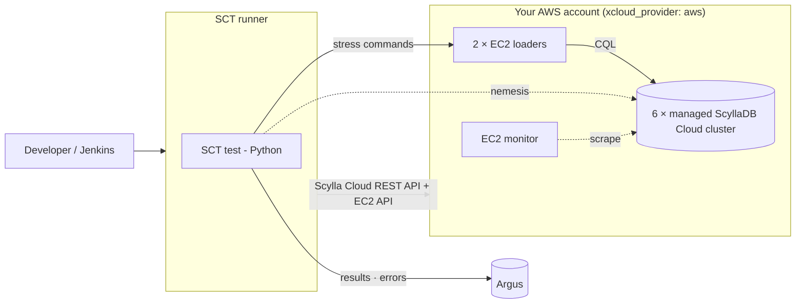

| Test type | What it does |
|---|---|
| [Longevity](../docs/longevity.md) | Long-running mixed load with chaos. The default shape most tests share. |
| [Performance regression](../docs/performance/README.md) | Steady stress against a fixed cluster. HDR latency and throughput go to Argus, which compares with past runs and fails on regression. |
| [Vector search](../docs/configuration_options/vector-store.md) | Vector-store nodes attached to the Scylla cluster, serving ANN queries over HTTP. |

<b>Bare metal</b> · Pre-provisioned hosts

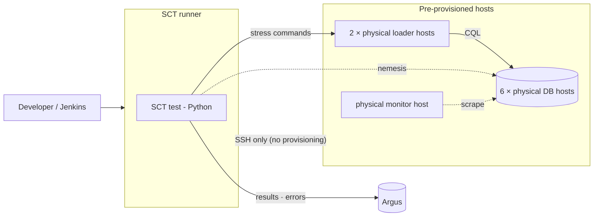

| Test type | What it does |
|---|---|
| [Longevity](../docs/longevity.md) | Long-running mixed load with chaos. The default shape most tests share. |

<b>minicloud</b> · minicloud container (QEMU/KVM)

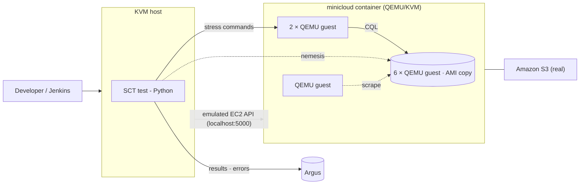

| Test type | What it does |
|---|---|
| [Longevity](../docs/longevity.md) | Long-running mixed load with chaos. The default shape most tests share. |
| [Performance regression](../docs/performance/README.md) | Steady stress against a fixed cluster. HDR latency and throughput go to Argus, which compares with past runs and fails on regression. |
| [Rolling upgrade](../docs/rolling-upgrade.md) | Starts on a base version and upgrades one node at a time under load, optionally rolling some back. |
| [Artifacts](../docs/artifacts_test.md) | Checks a package, image or AMI on one node. No loaders, no monitor. |
| [Multi-DC longevity](../docs/longevity.md) | One cluster across regions. List values give per-DC counts; rack_aware_loader keeps load local. |
| [Alternator](../docs/configuration_options/alternator-dynamodb-api.md) | Same topology as longevity; the load uses the DynamoDB-compatible API instead of CQL. |
| [Kafka connectors](../docs/kafka.md) | Kafka runs as a docker-compose stack on the SCT runner. CDC source and sink connectors move data between Scylla and Kafka. |

