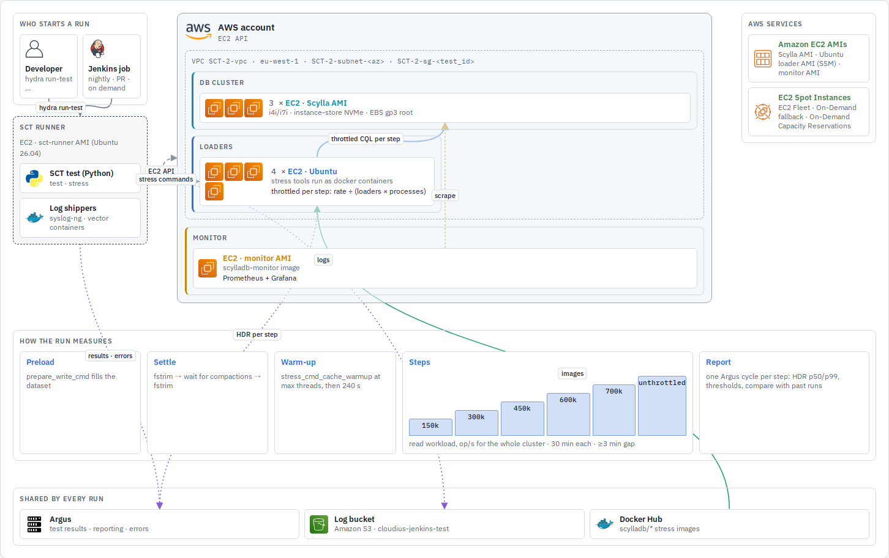
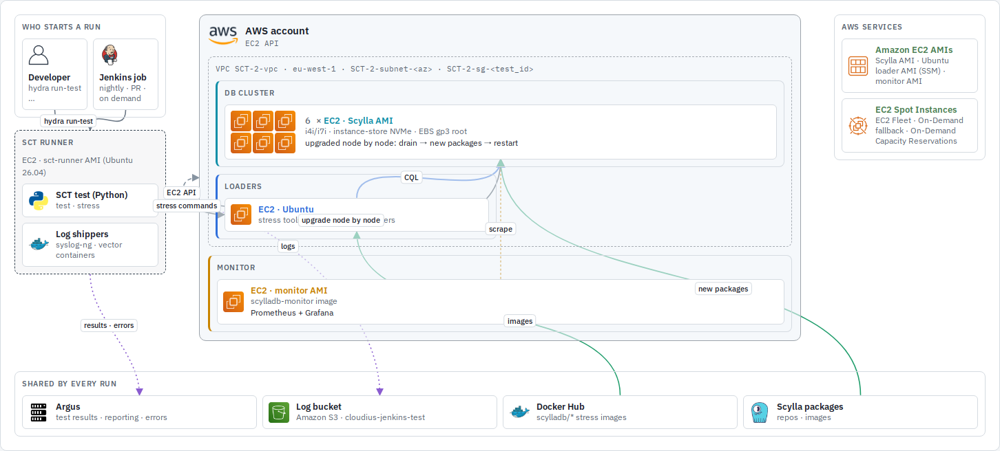
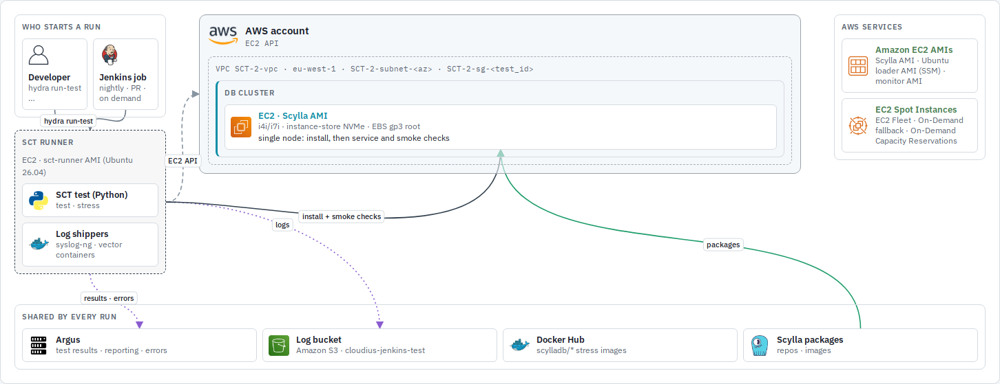
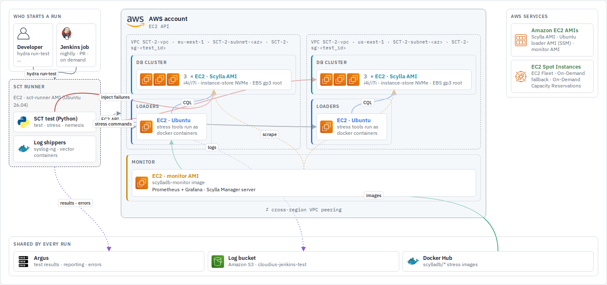
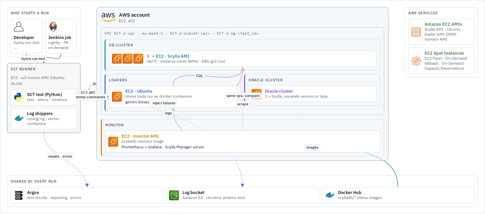
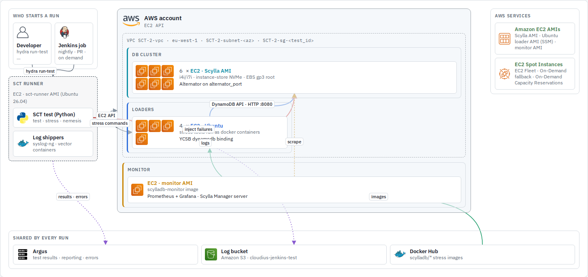
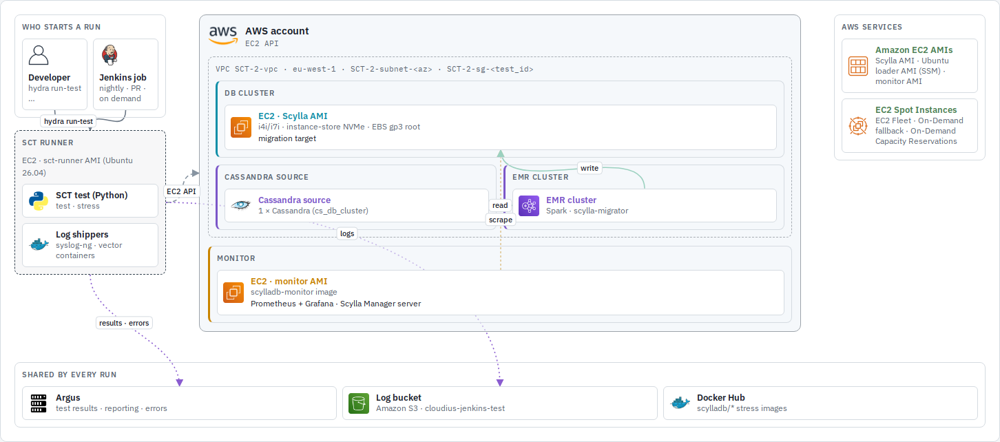
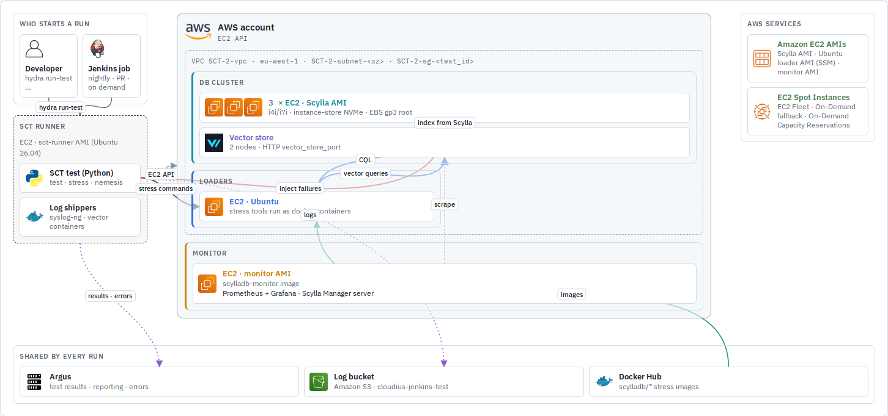
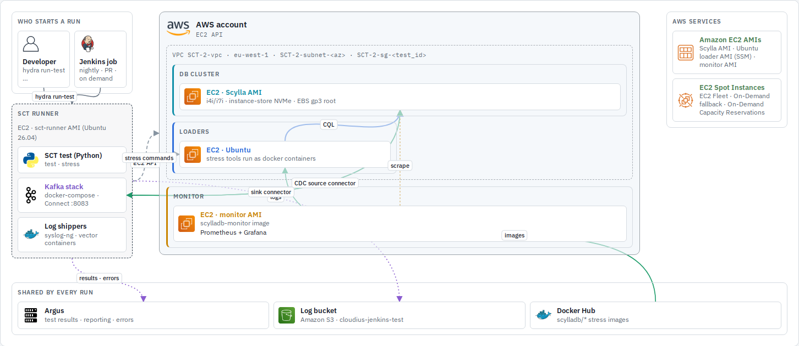
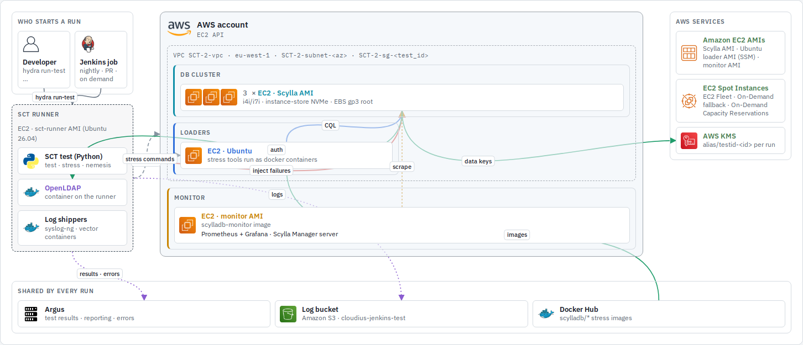

# SCT system map: test types

Every SCT run has the same skeleton: the SCT runner provisions a DB cluster, loaders and a
monitor on the chosen backend, runs stress and nemesis against the cluster, and reports to
Argus. The backend only changes *where* those machines come from. Each section below shows
what one **test type** adds or drops on top of that skeleton, drawn on AWS (or the type's own
backend), with every connection shown.

## Test types

**[Longevity](#longevity)** · [Performance](#performance-throughput-steps) · [Rolling upgrade](#rolling-upgrade) · [Artifacts](#artifacts) · [Multi-DC](#multi-dc) · [Gemini](#gemini) · [Alternator](#alternator) · [Cassandra → Scylla](#cassandra--scylla-sparkemr) · [Vector search](#vector-search) · [Kafka](#kafka-connectors) · [Security](#security-ear--ldap)

The images are generated from the interactive map in [system-map/index.html](system-map/index.html)
(open it locally to switch backends and hover components). After changing the map, re-render
with the command at the top of [system-map/render.js](system-map/render.js).

| Test type | One line | Runs on |
|---|---|---|
| [Longevity](#longevity) | Mixed load + nemesis + Scylla Manager backups for hours | every backend |
| [Performance (throughput steps)](#performance-throughput-steps) | Preload, warm up, then a fixed staircase of throttled steps, one Argus cycle per step | aws, gce, azure, oci, xcloud |
| [Rolling upgrade](#rolling-upgrade) | Upgrade node by node under load | VM backends, docker |
| [Artifacts](#artifacts) | One node, install and smoke-check a package or image | VM backends, docker |
| [Multi-DC](#multi-dc) | One cluster across regions, per-DC counts | aws, gce, azure, oci |
| [Gemini](#gemini) | Same random ops to the test cluster and an oracle, compare | aws, gce, azure, oci |
| [Alternator](#alternator) | Longevity over the DynamoDB API | VM backends, docker |
| [Cassandra → Scylla (Spark/EMR)](#cassandra--scylla-sparkemr) | EMR Spark migrates a Cassandra cluster into Scylla | aws |
| [Vector search](#vector-search) | Vector-store nodes attached to the cluster | aws, docker, xcloud |
| [Kafka connectors](#kafka-connectors) | Kafka on the runner, CDC source and sink connectors | VM backends, docker |
| [Security: EaR + LDAP](#security-ear--ldap) | Cloud KMS encryption at rest, LDAP auth | aws, gce, azure, oci |

## Longevity

The baseline. Typically 6 DB nodes, 2 loaders, 1 monitor.

- Scylla Manager is on by default (`use_mgmt: true`): server on the monitor, agent on every DB
  node. The manager nemeses (`MgmtBackup`, `MgmtRestore`, `MgmtRepair`, ...) back up to and
  restore from the backend's object storage.
- Keys: `n_db_nodes`, `n_loaders`, `stress_cmd`, `prepare_write_cmd`, `nemesis_class_name`,
  `nemesis_selector`, `use_mgmt`, `backup_bucket_location`.
- Code: `longevity_test.py` `LongevityTest.test_custom_time`. Manager CLI tests that drive
  sctool directly: `mgmt_cli_test.py`.
- Example: `test-cases/longevity/longevity-100gb-4h.yaml`. Docs: [longevity](longevity.md),
  [nemesis](nemesis.md).

[↑ test types](#test-types)

## Performance (throughput steps)

No nemesis. Typically 3 DB nodes and 4 loaders. What is unique is how the run measures:

- Each workload (read, write, mixed) climbs its own staircase from
  `perf_gradual_throttle_steps`. The rate in the YAML is for the whole cluster and is divided
  across loaders and stress processes; steps last `perf_gradual_step_duration` with at least
  3 minutes between them.
- Every step is one measured cycle reported to Argus, which applies
  `latency_decorator_error_thresholds` and compares with previous runs.
- Code: `performance_regression_gradual_grow_throughput.py`
  `PerformanceRegressionPredefinedStepsTest`.
- Example: `test-cases/performance/perf-regression-predefined-throughput-steps.yaml` with
  `configurations/performance/cassandra_stress_gradual_load_steps.yaml`.
- Docs: [performance testing](performance/README.md), especially
  [anatomy of a perf run](performance/anatomy.md).

[↑ test types](#test-types)

## Rolling upgrade

No nemesis and no Scylla Manager. The test is the disruption:

- The base version comes from `get-scylla-base-versions`; Jenkins runs one branch per base
  version (see [SCT pipelines](sct-pipelines.md)).
- Keys: `new_scylla_repo`, `upgrade_node_packages`, `upgrade_node_system`.
- Code: `upgrade_test.py` `UpgradeTest.test_rolling_upgrade`.
- Example: `test-cases/upgrades/rolling-upgrade.yaml`. Docs: [rolling upgrade](rolling-upgrade.md).

[↑ test types](#test-types)

## Artifacts

One DB node; no loaders (`n_loaders: 0`), no monitor (`n_monitor_nodes: 0`), no nemesis.

- Code: `artifacts_test.py` `ArtifactsTest.test_scylla_service`.
- Example: `test-cases/artifacts/debian12.yaml`. Docs: [artifact tests](artifacts_test.md).

[↑ test types](#test-types)

## Multi-DC

Same as longevity, with one DC per region. List values give per-DC counts.

- Keys: `n_db_nodes: [3, 3]`, `n_loaders: [1, 1]`, one `region_name` entry per DC,
  `simulated_racks`, `rack_aware_loader`.
- Example: `test-cases/longevity/longevity-multi-dc-rack-aware.yaml`. Layout details:
  [writing a test](writing-a-test.md#3-from-configuration-to-cluster-layout).

[↑ test types](#test-types)

## Gemini

Adds an **oracle cluster** (`db_type: mixed_scylla`). The gemini binary on the loader sends
the same random operations to both clusters and fails on any difference.

- Keys: `db_type: mixed_scylla`, `n_test_oracle_db_nodes`, `instance_type_db_oracle`, `gemini_cmd`.
- Code: `gemini_test.py` `GeminiTest`.
- Example: `test-cases/gemini/gemini-3h-with-nondisruptive-nemesis.yaml`.
  Docs: [gemini](https://github.com/scylladb/gemini#readme).

[↑ test types](#test-types)

## Alternator

Longevity shape; the load goes through the DynamoDB-compatible API instead of CQL.

- Keys: `alternator_port`, `dynamodb_primarykey_type`, YCSB `stress_cmd`.
- Code: `longevity_test.py`, `longevity_alternator_ttl_test.py`, `performance_regression_alternator_test.py`.
- Example: `test-cases/longevity/longevity-alternator-3h.yaml`.
  Docs: [Alternator options](configuration_options/alternator-dynamodb-api.md).

[↑ test types](#test-types)

## Cassandra → Scylla (Spark/EMR)

Adds a **Cassandra source cluster** (`db_type: mixed_cassandra`) and an **EMR cluster**; no
nemesis. AWS only.

- Keys: `db_type: mixed_cassandra`, `n_test_oracle_db_nodes`, `emr_release_label`, `post_behavior_emr_cluster`.
- Code: `spark_migrator_test.py` `SparkMigratorTest`.
- Example: `test-cases/spark-migrator/cs-to-scylla-small.yaml`.
  Docs: [Cassandra to Scylla migration](cs-to-scylla-migration.md), [EMR permissions](aws-emr-permissions.md).

[↑ test types](#test-types)

## Vector search

Adds **vector-store nodes**, attached to the DB cluster (`db_cluster.vector_store_cluster`).

- Keys: `n_vector_store_nodes`, `instance_type_vector_store`, `vector_store_docker_image`, `vector_store_port`.
- Code: `longevity_test.py`, `scylla_cloud_e2e_test.py` `XCloudVectorSearchTest`.
- Example: `test-cases/vector-search/vector-search-sanity.yaml`.
  Docs: [vector store options](configuration_options/vector-store.md).

[↑ test types](#test-types)

## Kafka connectors

Kafka is not a provisioned machine: it runs as a docker-compose stack **on the SCT runner**.
No nemesis, no Scylla Manager.

- Keys: `kafka_backend: localstack`, `kafka_connectors`.
- Code: `sdcm/kafka/kafka_cluster.py` `LocalKafkaCluster`.
- Example: `test-cases/kafka/longevity-kafka-cdc.yaml`. Docs: [Kafka](kafka.md).

[↑ test types](#test-types)

## Security: EaR + LDAP

Longevity shape plus the backend's **KMS** for encryption at rest and an **OpenLDAP**
container on the runner.

- Keys: `scylla_encryption_options`, `use_ldap`, `ldap_server_type`, `append_scylla_yaml.kms_hosts`.
- Example: `test-cases/longevity/longevity-encryption-at-rest-200GB-6h.yaml`.

[↑ test types](#test-types)
