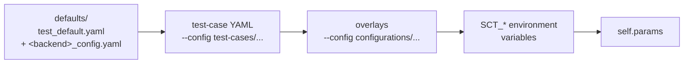
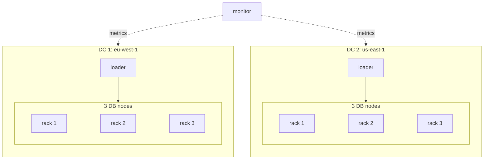

# Writing a test

How a test is put together in SCT, from the Python test method to the machines it runs on.
For the overall picture of SCT's moving parts, see the diagram at the top of the [README](../README.md).

An SCT test has four pieces:

| Piece | Where | What it decides |
|---|---|---|
| Test class and method | `*_test.py` in the repo root | **What** the test does: which stress to run, when to start nemesis, what to verify |
| Test-case YAML | `test-cases/<area>/*.yaml` | **With what**: cluster size, instance sizing, stress commands, duration, nemesis selection |
| Config overlays | `configurations/**/*.yaml` | Reusable tweaks layered on top: networking, backend specifics, nemesis presets |
| Jenkins pipeline file | `jenkins-pipelines/**/*.jenkinsfile` | **Where and when**: backend, region, which test method + YAMLs, which [pipeline](sct-pipelines.md) runs it |

Most new tests do not need new Python. Reusing `longevity_test.LongevityTest.test_custom_time` with a
new test-case YAML covers the bulk of longevity, feature and nemesis coverage.

## 1. The test class

Every test is a method on a `ClusterTester` subclass (`sdcm/tester.py`). By the time the method
runs, `setUp()` has already provisioned everything the configuration asked for:

| Attribute | What it is |
|---|---|
| `self.params` | the merged configuration (see below) |
| `self.db_cluster` | the ScyllaDB cluster, `self.db_cluster.nodes` for the nodes |
| `self.loaders` | the loader set that runs stress tools |
| `self.monitors` | the monitoring stack (Prometheus + Grafana) |

A minimal test:

```python
from sdcm.tester import ClusterTester


class MyFeatureTest(ClusterTester):
    def test_my_feature(self):
        # start load in the background; returns a handle to wait on
        stress = self.run_stress_thread(stress_cmd=self.params.get("stress_cmd"))

        # optionally start chaos against the DB cluster
        self.db_cluster.add_nemesis(nemesis=self.get_nemesis_class(), tester_obj=self)
        self.db_cluster.start_nemesis()

        # ... exercise the feature under test ...

        # wait for the load and fail the test on stress errors
        self.verify_stress_thread(stress)
```

`tearDown()` stops nemesis, collects logs and cleans up per the `post_behavior_*` settings. Do not
clean up in the test body.

Read configuration through `self.params`, never with an inline default:
`self.params.get("my_option", 300)` does not behave like `dict.get`. New options go in
`sdcm/sct_config/` with their default in `defaults/test_default.yaml`, as described in the
[configuration guide](sct-configuration.md#adding-new-configuration-options).

For new chaos actions see [writing a nemesis](nemesis.md); for the stress tools see
[loaders and stress commands](loader_usage.md).

## 2. The test-case YAML

Start by copying the closest existing file in `test-cases/`. `test-cases/PR-provision-test.yaml`
is the smallest complete example. The keys fall into a few groups:

```yaml
# how long and what load
test_duration: 180                     # minutes; also drives instance keep-alive and job timeouts
prepare_write_cmd: "cassandra-stress write ..."   # runs once, before the main load
stress_cmd: ["cassandra-stress mixed ...", "latte run ..."]  # one thread per entry

# cluster layout (see section 3)
n_db_nodes: 3
n_loaders: 1
n_monitor_nodes: 1
sizing_db: {vcpu: '>=8', memory: '>=64.0'}

# chaos
nemesis_class_name: SisyphusMonkey
nemesis_selector: "not disruptive"
nemesis_interval: 5

user_prefix: my-feature
```

Every test-case also carries a `test_metadata:` block (type, tier, backends, stress tools) used by
the pipeline catalog; `hydra lint-test-docs` checks it.

All options, with their `SCT_*` environment-variable names, are in the
[configuration options reference](configuration_options.md).

### How configuration is layered

Later sources override earlier ones:



So the same test-case runs on AWS or Docker by changing `--backend` and adding the matching
overlay, and a Jenkins job can override any value through `SCT_*` variables without a new file.

## 3. From configuration to cluster layout

`setUp()` reads the layout keys and asks the selected backend to create the machines
(`get_cluster_aws()`, `get_cluster_gce()`, `get_cluster_docker()`, ... in `sdcm/tester.py`).

| Key | Becomes |
|---|---|
| `n_db_nodes`, `n_loaders`, `n_monitor_nodes` | node counts. A list means one entry per datacenter: `n_db_nodes: [3, 3]` is two DCs of 3 nodes |
| `region_name` (AWS), `gce_datacenter`, `azure_region_name` | where each datacenter lives; one entry per DC, matching the list lengths above |
| `availability_zone` | comma-separated zones spread nodes across AZs (AWS) |
| `simulated_racks` | number of racks the DB nodes are spread over, using GossipingPropertyFileSnitch |
| `sizing_db`, `sizing_loader`, `sizing_monitor` | instance choice by constraints, resolved per cloud ([cross-cloud sizing](cross-cloud-sizing.md)); or `instance_type_db` etc. for an exact type |
| `n_db_zero_token_nodes` | extra zero-token nodes per DC |
| `use_mgmt` | installs Scylla Manager agent on the DB nodes and the server on the monitor |

Example: this test-case gives two datacenters in two AWS regions, 3 DB nodes each spread over
3 racks, one loader per region, and a single monitor:

```yaml
region_name: 'eu-west-1 us-east-1'
n_db_nodes: [3, 3]
n_loaders: [1, 1]
n_monitor_nodes: 1
simulated_racks: 3
```



By default every stress command runs on every loader. With `round_robin: true` each command runs
on a single loader, rotating through them.

## 4. Running it

Locally, see the README for [the first run](../README.md#2-run-your-first-test-docker-backend):

```bash
hydra run-test my_feature_test.MyFeatureTest.test_my_feature --backend docker \
    --config test-cases/my-area/my-feature.yaml
```

In CI, add a jenkinsfile that points at the test method and YAML. Most use `longevityPipeline`:

```groovy
longevityPipeline(
    backend: 'aws',
    region: 'eu-west-1',
    test_name: 'my_feature_test.MyFeatureTest.test_my_feature',
    test_config: 'test-cases/my-area/my-feature.yaml'
)
```

See [SCT pipelines](sct-pipelines.md) for the other pipeline types and when to use them.
Before spending cloud time, a test can be shrunk to run on one machine with
[minicloud](minicloud.md).
