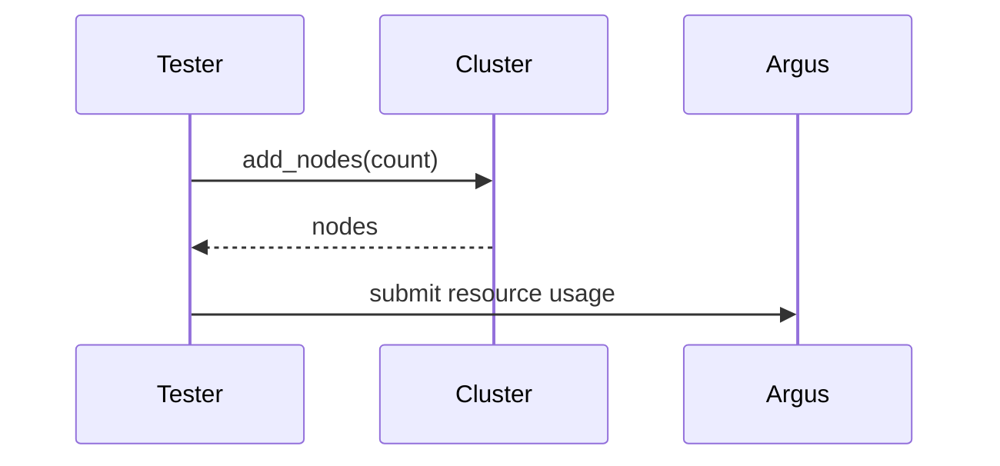

# Spec Template

## Section Rule

After the overview, show code and diagrams first. A data shape is a
dataclass or a pydantic model. A configuration parameter is its `SctField` in
`sdcm/sct_config/` and its default. A module API is its signature. An
external contract is the request and the response, with the real field names.
A flow or a decision is a Mermaid diagram, except a single linear flow. Prose
carries what no code states: a constraint, a decision, a risk.

Replace every example with content. Leave out a section or a subsection where
the change adds nothing. `Constraints` and `Risks` stay, with `None` when
empty. Files, internal functions, and tests go to `plan.md`. Name no line
numbers.

## Template

````markdown
# <Short title>

**Jira:** <KEY>

## Overview

What the change builds and how it works, end to end, in three to five lines.
A reviewer learns the solution here. The Design section holds the detail.

## Constraints

What the design must meet that `intent.md` does not name. One line each. The
Design section meets each one. `None` when the intent names every constraint.

- The change works on every backend: AWS, GCE, Azure, OCI, Docker, and K8S.
- The default behavior of existing test cases does not change.

## Design

The components that take part, and what each one does.

One Mermaid diagram for each flow that the change adds or alters. Use a
sequence diagram for a call chain and a flowchart for a decision. Name
components, not functions.



The failure behavior that the design adopts, as a table:

| Condition | Behavior |
|---|---|
| The cloud API returns a capacity error | Try the next availability zone, then fail the setup |
| Argus is not reachable | Log a warning event and continue the test |

## Contracts

### Configuration

Each new or changed configuration parameter, with its type and its default.

```python
cleanup_timeout_minutes: int = SctField(
    description="How long the cleanup waits for the resources to go away.",
)
```

```yaml
# defaults/test_default.yaml
cleanup_timeout_minutes: 30
```

### Inputs

Each external source that the change reads: the API, the CLI command, or the
file, and the fields that it uses.

```
argus run get <run_id>    # fields: status, scylla_version, started_at
```

### Outputs

Each surface that another party uses: an event, an Argus result, a file, or
a log line, in the form it takes.

```python
class CleanupTimeoutEvent(InformationalEvent):
    resource_id: str
    waited_minutes: int
```

### Module API

Each signature that another module calls, or that a subclass overrides. The
whole public API of a new module.

```python
def wait_for_cleanup(resources: list[CloudResource], timeout: int) -> None: ...
```

## Risks

`None` when the change carries no risk.

| Risk | Response |
|---|---|
| | |

## Deferred work

The work planned for later that shapes the design now. The design leaves
room for it and does not build it.

## Decisions

Each decision that shapes this spec, when the Design section does not state
its reason. An answer of the user to a design question always gets a line.
One line each: the decision, the reason, and the stage that took it:
`(spec)`, `(build)`, or `(review)`. Name no rejected option. When a later
decision reverses a line, edit the line and the design. A question for the
reviewer is an `(open)` line. The answer replaces it, tagged `(review)`.

- The cleanup runs in the tester process. The runner can stop at any time. (spec)
- The timeout applies to each resource or to the whole cleanup. (open)
````
